# A2A (Agent2Agent): guía para arquitectos

Guía para arquitectos empresariales y de soluciones · Especificación A2A 1.0 · Octubre 2026

---

## 1. Resumen

**Conclusión:** A2A es un protocolo abierto para que agentes de equipos, proveedores o frameworks distintos se descubran, se deleguen tareas y colaboren **sin exponer su funcionamiento interno** (prompts, tools, memoria, modelo). Es el complemento de MCP: **MCP conecta un agente con sus tools y datos; A2A conecta agentes entre sí**. Merece la pena cuando los agentes tienen dueños o ciclos de vida distintos. Entre agentes del mismo proceso y del mismo equipo, una llamada de función es más sencilla.

Estado a octubre de 2026:

| Aspecto | Situación |
| --- | --- |
| Versión | **1.0.0** (12 de marzo de 2026). La 1.0.1 (mayo de 2026) cambia guías y ejemplos, no las operaciones |
| Gobierno | Creado por Google, donado a la Linux Foundation en 2025. Desde agosto de 2026 es proyecto Growth Stage de la **Agentic AI Foundation**, junto a MCP |
| Adopción | Más de 150 organizaciones según el informe de la Linux Foundation de abril de 2026. Soporte en Azure AI Foundry, Copilot Studio y Amazon Bedrock AgentCore |
| SDKs oficiales | Python, JavaScript, Java, Go, C#/.NET y Rust |
| Herramientas | CLI oficial `a2a` (octubre de 2026) para descubrir agentes, enviar mensajes y seguir tareas desde la terminal |

---

## 2. Qué problema resuelve

Sin un protocolo común, cada pareja de agentes necesita una integración propia: formato de mensajes, cómo se sigue una tarea larga, cómo se autentica, cómo se anuncia lo que sabe hacer. Con N agentes de M proveedores, las integraciones crecen de forma cuadrática y cada una se rompe cuando cambia un lado.

A2A fija un contrato común para cuatro cosas:

1. **Descubrimiento:** qué sabe hacer un agente y cómo se le llama (Agent Card).
2. **Delegación:** enviar un mensaje que puede convertirse en una tarea con ciclo de vida.
3. **Seguimiento:** saber cómo va la tarea (respuesta directa, consulta, streaming o push notifications).
4. **Intercambio de resultados:** mensajes y artefactos con partes de texto, ficheros o datos estructurados.

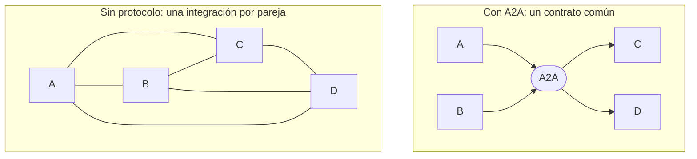

**El principio de diseño clave es la opacidad.** Un agente A2A es una caja negra: publica sus capacidades (skills) y acepta tareas, pero no comparte su prompt, sus tools, su memoria ni el modelo que usa. Esto permite que colaboren agentes de organizaciones distintas sin exponer propiedad intelectual ni datos internos, y que cada equipo cambie su implementación sin romper a los demás.

---

## 3. A2A y MCP

| Criterio | MCP | A2A |
| --- | --- | --- |
| Conecta | Un agente con tools, datos y prompts | Agentes entre sí, como pares |
| Dirección | Vertical: el agente usa recursos | Horizontal: un agente delega en otro |
| La otra parte es | Una función o recurso, sin autonomía | Un agente autónomo y opaco, que razona |
| Duración típica | Llamada corta | Desde una respuesta inmediata hasta tareas de horas, con estados intermedios |
| Interacción | Petición y respuesta | Multi-turn: el agente remoto puede pedir más información o autenticación |
| Descubrimiento | El cliente lista las tools del servidor | Agent Card publicada en una URL conocida |

Son complementarios. La propia especificación lo describe así: un agente servidor A2A puede usar MCP internamente para acceder a las tools que necesita para resolver la tarea que le han delegado.

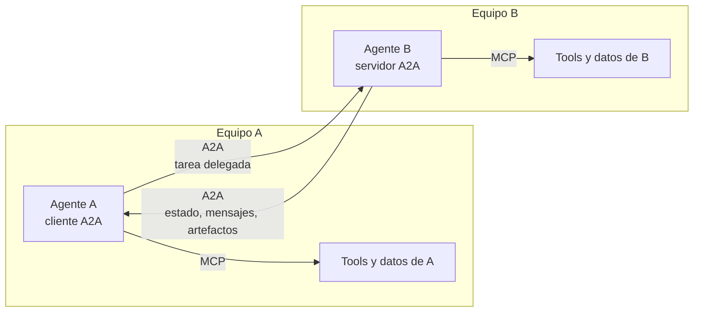

**Regla práctica:** si la otra parte es determinista y la controlas (una API, una base de datos, un fichero), es una tool y va por MCP. Si la otra parte decide por sí misma cómo resolver el encargo y la mantiene otro equipo u organización, es un agente y va por A2A.

---

## 4. Conceptos

| Concepto | Qué es |
| --- | --- |
| **Cliente A2A** | El agente o aplicación que delega el trabajo |
| **Servidor A2A** (agente remoto) | El agente que expone un endpoint A2A y resuelve las tareas |
| **Agent Card** | Documento JSON con la identidad, las skills, los endpoints, las capacidades y los requisitos de autenticación del agente |
| **Skill** | Una capacidad concreta anunciada en la Agent Card (`id`, `name`, `description`, `tags`, `examples`) |
| **Message** | Un turno de comunicación con rol `ROLE_USER` (cliente) o `ROLE_AGENT` (servidor), formado por partes |
| **Part** | La unidad de contenido. Lleva exactamente uno de: `text`, `raw` (bytes), `url` (fichero por referencia) o `data` (JSON), y opcionalmente `mediaType` y `filename` |
| **Task** | La unidad de trabajo con estado y ciclo de vida. La crea el servidor cuando el trabajo no es inmediato |
| **Artifact** | Un resultado de la tarea (documento, imagen, datos), formado por partes, con `artifactId` único dentro de la tarea |
| **contextId** | Agrupa tareas y mensajes relacionados de una misma conversación |
| **referenceTaskIds** | Tareas anteriores que un mensaje cita como contexto |

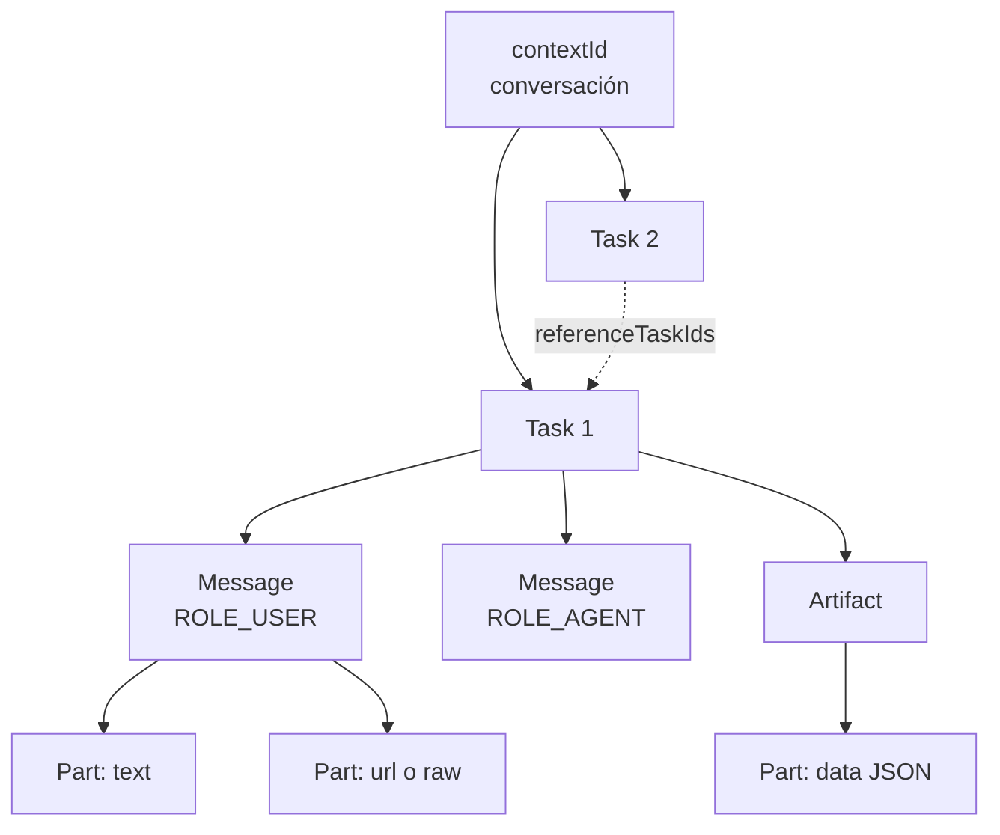

**Message o Task.** Ante un mensaje, el servidor puede responder con un **Message** (respuesta inmediata, sin estado que seguir) o con una **Task** (trabajo con ciclo de vida). Lo decide el servidor según la naturaleza del encargo.

---

## 5. Arquitectura en capas

La especificación 1.0 separa tres capas, para que el modelo de datos y las operaciones no dependan del transporte:

| Capa | Contenido |
| --- | --- |
| 1. Modelo de datos canónico | Estructuras independientes del protocolo, definidas en `spec/a2a.proto` (fuente normativa) |
| 2. Operaciones abstractas | Lo que se puede hacer: enviar mensajes, consultar, cancelar o suscribirse a tareas, configurar push notifications, obtener la Agent Card extendida |
| 3. Protocol bindings | Cómo viajan: **JSON-RPC 2.0**, **gRPC**, **HTTP+JSON/REST** o bindings propios |

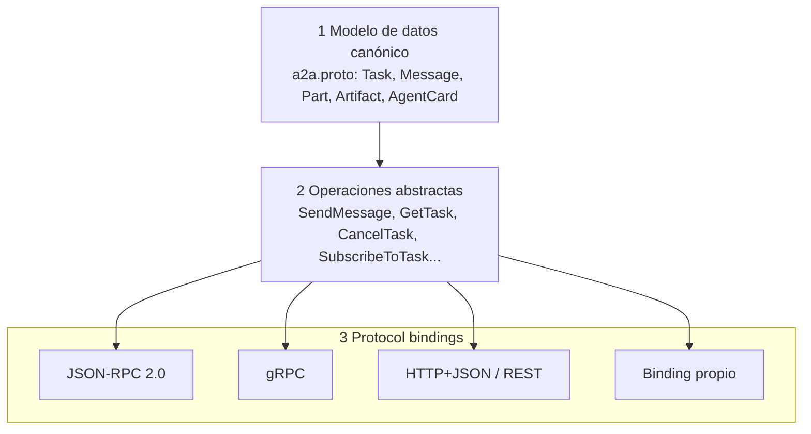

Un mismo agente puede publicar varios bindings a la vez. La Agent Card los lista en `supportedInterfaces`, por orden de preferencia, y el cliente elige uno que entienda.

---

## 6. Descubrimiento: la Agent Card

### 6.1 Dónde se publica

La ubicación estándar es **`https://<dominio>/.well-known/agent-card.json`**. Además del well-known, una organización puede ofrecer las cards desde un registro o catálogo curado (el directorio interno de agentes de la empresa) o configurarlas directamente en el cliente.

### 6.2 Contenido

| Campo | Para qué |
| --- | --- |
| `name`, `description`, `version` | Identidad del agente y versión de su implementación |
| `provider` | Organización que lo ofrece |
| `supportedInterfaces` | Endpoints con su `protocolBinding`, `protocolVersion` y `url`, en orden de preferencia (opcionalmente `tenant`) |
| `capabilities` | Si admite `streaming`, `pushNotifications`, `extensions` y Agent Card extendida |
| `securitySchemes`, `securityRequirements` | Cómo hay que autenticarse |
| `defaultInputModes`, `defaultOutputModes` | Tipos MIME que acepta y produce, que cada skill puede sobrescribir |
| `skills` | Lo que sabe hacer, con descripción, tags y ejemplos |
| `signatures` | Firmas JWS de la card, opcionales |

Ejemplo (basado en el de la especificación):

```json
{
  "name": "GeoSpatial Route Planner Agent",
  "description": "Plans routes and generates custom maps.",
  "version": "1.2.0",
  "supportedInterfaces": [
    {
      "url": "https://georoute-agent.example.com/a2a/v1",
      "protocolBinding": "JSONRPC",
      "protocolVersion": "1.0"
    }
  ],
  "capabilities": { "streaming": true, "pushNotifications": true },
  "defaultInputModes": ["application/json", "text/plain"],
  "defaultOutputModes": ["application/json", "image/png"],
  "skills": [
    {
      "id": "route-optimizer-traffic",
      "name": "Traffic-Aware Route Optimizer",
      "description": "Calculates routes using live traffic data.",
      "tags": ["maps", "routing"]
    }
  ]
}
```

### 6.3 Card pública, card extendida y firma

- **Card pública:** la que cualquiera puede leer. Debe contener lo mínimo para decidir si interesa el agente y cómo autenticarse.
- **Card extendida** (`GetExtendedAgentCard`): se obtiene ya autenticado, con uno de los esquemas de la card pública. Sirve para mostrar skills o detalles solo a clientes autorizados.
- **Card firmada:** las firmas usan JWS (RFC 7515) sobre una forma canónica JCS (RFC 8785). El cliente verifica al menos una firma con claves obtenidas por HTTPS, y no acepta claves caducadas ni revocadas. Así se comprueba quién publica la card y que no se ha alterado.

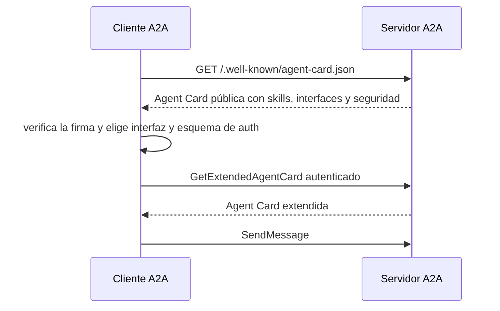

---

## 7. Ciclo de vida de una tarea

| Estado | Significado | ¿Terminal? |
| --- | --- | --- |
| `TASK_STATE_SUBMITTED` | Recibida y aceptada | No |
| `TASK_STATE_WORKING` | En proceso | No |
| `TASK_STATE_INPUT_REQUIRED` | Interrumpida: el agente necesita más información del cliente | No |
| `TASK_STATE_AUTH_REQUIRED` | Interrumpida: hace falta autenticación adicional | No |
| `TASK_STATE_COMPLETED` | Terminada con éxito | Sí |
| `TASK_STATE_FAILED` | Terminada con error | Sí |
| `TASK_STATE_CANCELED` | Cancelada | Sí |
| `TASK_STATE_REJECTED` | El agente no acepta la tarea | Sí |

En el diagrama, los estados redondeados son intermedios y los rectangulares, terminales (se omite el prefijo `TASK_STATE_`).

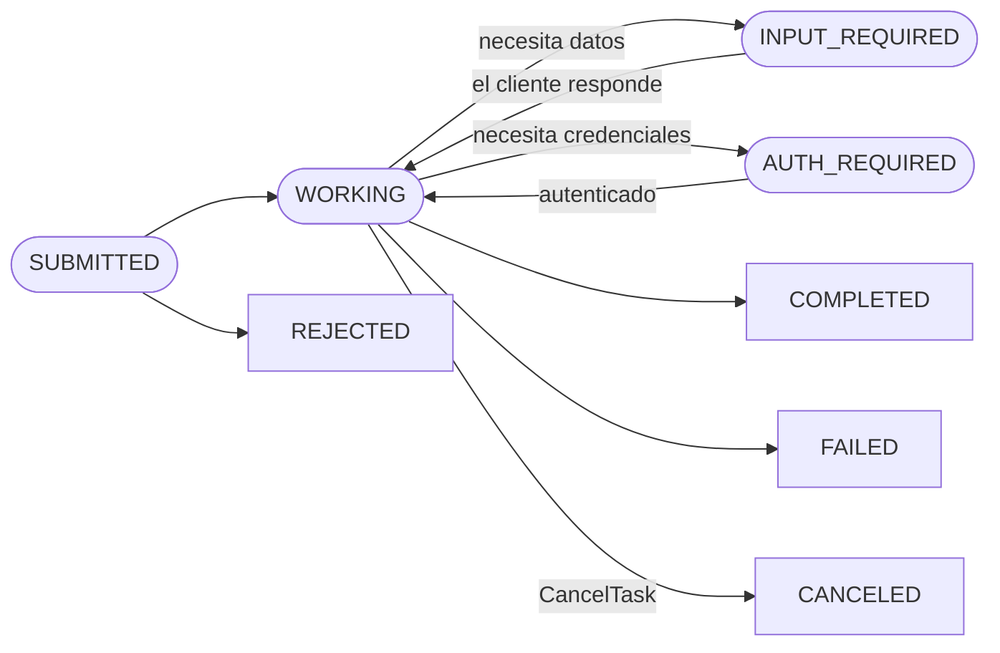

Una tarea en estado terminal no se reabre. Para continuar el trabajo se envía un mensaje nuevo en el mismo `contextId`, citando la tarea anterior en `referenceTaskIds`.

### 7.1 Interacción multi-turn

`TASK_STATE_INPUT_REQUIRED` es lo que distingue a A2A de una llamada a una API: el agente remoto puede pararse y preguntar. El cliente responde con un nuevo mensaje en la misma tarea.

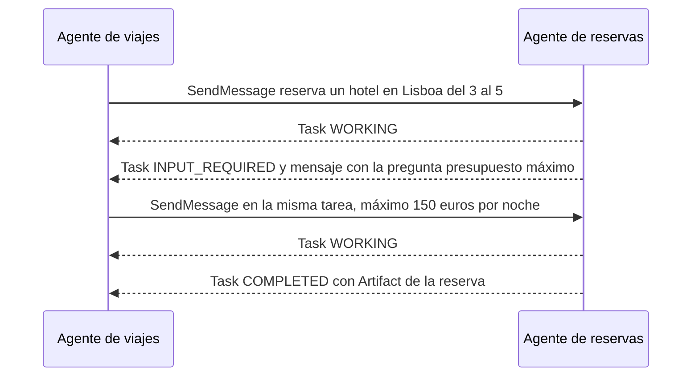

---

## 8. Modos de interacción

| Modo | Cómo funciona | Cuándo usarlo |
| --- | --- | --- |
| **Bloqueante** | `SendMessage` espera hasta que la tarea termina o se interrumpe (comportamiento por defecto) | Tareas de segundos |
| **No bloqueante con consulta** | `SendMessage` con `returnImmediately` devuelve la tarea al momento; el cliente consulta con `GetTask` | Tareas largas y clientes simples |
| **Streaming** | `SendStreamingMessage` abre un stream (SSE en HTTP) con eventos de estado y de artefactos. `SubscribeToTask` permite reengancharse a una tarea en curso | Progreso en tiempo real, resultados parciales |
| **Push notifications** | El cliente registra un webhook y el servidor le envía un HTTP POST en cada cambio | Tareas de minutos u horas, clientes que no pueden mantener una conexión abierta |

En streaming, los eventos llegan en orden. El stream empieza con la tarea y se cierra cuando llega a un estado terminal, y puede haber varios streams simultáneos sobre la misma tarea.

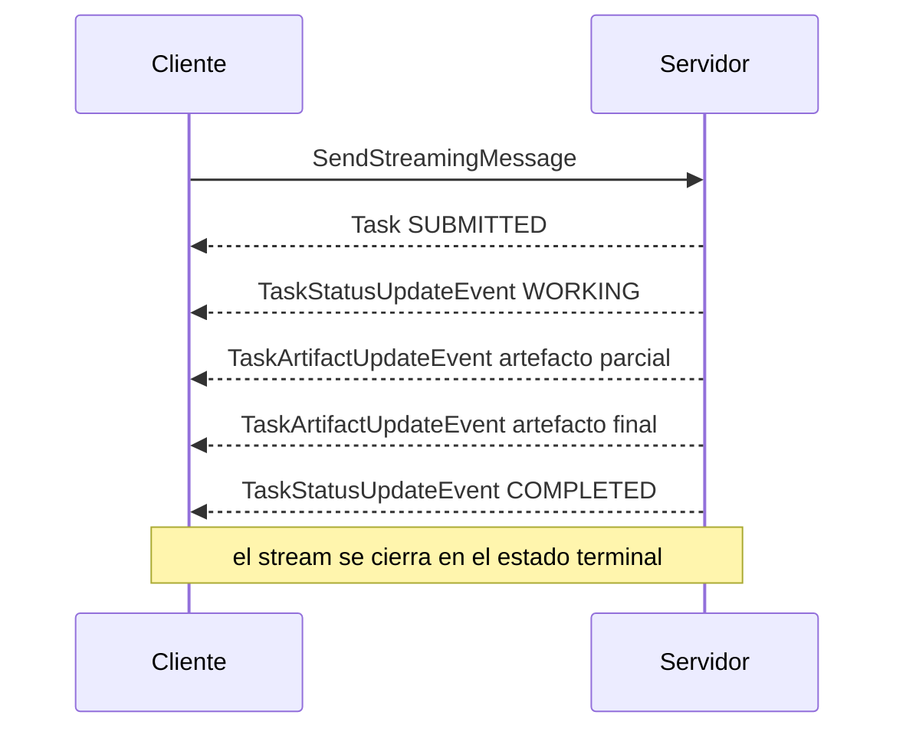

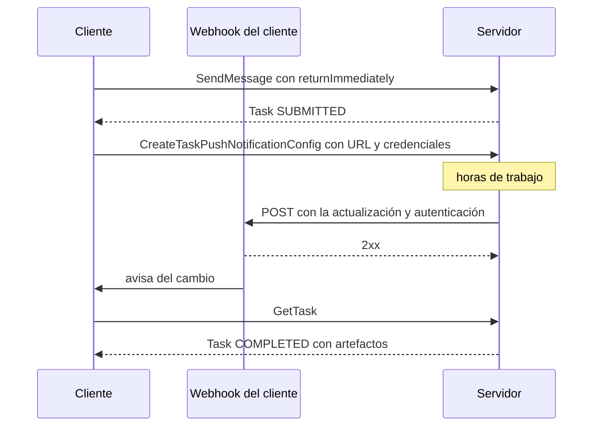

Las push notifications exigen `capabilities.pushNotifications: true` en la Agent Card. La configuración se mantiene hasta que la tarea termina o se borra.

---

## 9. Operaciones

| Operación | JSON-RPC | HTTP+JSON/REST | Para qué |
| --- | --- | --- | --- |
| Enviar mensaje | `SendMessage` | `POST /message:send` | Delegar una tarea o continuar una existente |
| Enviar con streaming | `SendStreamingMessage` | `POST /message:stream` | Igual, recibiendo eventos |
| Consultar tarea | `GetTask` | `GET /tasks/{id}` | Estado, historial y artefactos |
| Listar tareas | `ListTasks` | `GET /tasks` | Con filtros y paginación por cursor (máximo 100 por página); solo devuelve las tareas que el llamante puede ver |
| Cancelar tarea | `CancelTask` | `POST /tasks/{id}:cancel` | Pedir la cancelación |
| Suscribirse a una tarea | `SubscribeToTask` | `POST /tasks/{id}:subscribe` | Reengancharse al stream de una tarea en curso |
| Push notifications | `CreateTaskPushNotificationConfig`, `GetTaskPushNotificationConfig`, `ListTaskPushNotificationConfigs`, `DeleteTaskPushNotificationConfig` | Ver la especificación | Gestionar los webhooks de una tarea |
| Card extendida | `GetExtendedAgentCard` | `GET /extendedAgentCard` | Card completa para clientes autenticados |

**Cambios respecto a 0.3** a tener en cuenta si encuentras ejemplos antiguos: los métodos `message/send` y `tasks/get` pasan a llamarse `SendMessage` y `GetTask`; los estados y roles usan constantes con prefijo (`TASK_STATE_COMPLETED`, `ROLE_USER`); las partes ya no llevan `kind`, se distinguen por el campo que traen; desaparece el prefijo `/v1` de las rutas REST; y se eliminan los flujos OAuth implicit y password.

### 9.1 Ejemplo completo (HTTP+JSON)

Petición:

```http
POST /message:send HTTP/1.1
Host: agent.example.com
Content-Type: application/a2a+json
A2A-Version: 1.0
Authorization: Bearer <token>

{
  "message": {
    "role": "ROLE_USER",
    "messageId": "msg-uuid",
    "parts": [{ "text": "What is the weather today?" }]
  }
}
```

Respuesta:

```http
HTTP/1.1 200 OK
Content-Type: application/a2a+json

{
  "task": {
    "id": "task-uuid",
    "contextId": "context-uuid",
    "status": { "state": "TASK_STATE_COMPLETED" },
    "artifacts": [{
      "artifactId": "artifact-uuid",
      "name": "Weather Report",
      "parts": [{ "text": "Today will be sunny with a high of 75°F" }]
    }]
  }
}
```

### 9.2 Errores específicos

| Error | Cuándo |
| --- | --- |
| `TaskNotFoundError` | La tarea no existe o el llamante no puede verla |
| `TaskNotCancelableError` | La tarea ya no se puede cancelar |
| `PushNotificationNotSupportedError` | El agente no admite push notifications |
| `UnsupportedOperationError` | Operación no soportada |
| `ContentTypeNotSupportedError` | Tipo de contenido no aceptado |
| `InvalidAgentResponseError` | Respuesta del agente no válida |
| `ExtendedAgentCardNotConfiguredError` | No hay card extendida |
| `ExtensionSupportRequiredError` | El cliente no declara una extensión obligatoria |
| `VersionNotSupportedError` | Versión del protocolo no soportada |

---

## 10. Seguridad

**Conclusión:** A2A reutiliza la seguridad web estándar (TLS, OAuth 2.0, OpenID Connect, mTLS) y no inventa la suya. Lo nuevo, y lo más delicado, es que **lo que devuelve otro agente es contenido no confiable**: puede contener prompt injection igual que una página web.

### 10.1 Transporte e identidad

- En producción, todo el tráfico va cifrado (HTTPS o TLS) y el cliente valida el certificado del servidor.
- La Agent Card puede ir firmada (6.3) para verificar quién la publica.

### 10.2 Autenticación y autorización

| Esquema | Uso típico |
| --- | --- |
| API key | Integraciones internas sencillas |
| HTTP auth (Bearer) | Tokens emitidos por el IdP corporativo |
| OAuth 2.0: authorization code con PKCE | El agente actúa en nombre de una persona |
| OAuth 2.0: client credentials | Agente a agente, sin usuario |
| OAuth 2.0: device code | CLIs y clientes sin navegador |
| OpenID Connect | Identidad federada |
| mTLS | Agentes entre sistemas de confianza con certificados de cliente |

- El servidor **autentica cada petición** y comprueba la autorización en cada operación. Los resultados se limitan a lo que el llamante puede ver, aunque no aplique filtros.
- `TASK_STATE_AUTH_REQUIRED` indica que hace falta una credencial adicional durante la tarea (por ejemplo, el consentimiento del usuario para acceder a su calendario). Estar en ese estado no concede ningún permiso por sí solo. Las credenciales deben entregarse por un canal seguro aparte cuando sea posible.

### 10.3 Push notifications

- El servidor incluye credenciales en cada llamada al webhook, y el cliente valida su autenticidad antes de procesarla.
- El servidor protege contra SSRF: rechaza direcciones privadas y link-local en las URLs de webhook, y puede usar allowlists.
- El cliente procesa las notificaciones de forma idempotente, porque puede recibir duplicados.
- Los tokens de webhook son secretos: únicos por configuración y rotados periódicamente.

### 10.4 Prompt injection entre agentes

Un agente remoto puede estar comprometido o simplemente devolver texto que procede de fuentes no confiables. Para el agente cliente, sus mensajes y artefactos son **entrada no confiable**:

- Aplica el análisis de la **lethal trifecta**: si el agente cliente tiene datos privados y un canal de salida, lo que devuelve un agente remoto no puede decidir acciones nuevas por sí solo.
- Valida los artefactos `data` contra un esquema antes de usarlos.
- Usa patrones como Plan-then-execute o Dual LLM cuando el resultado remoto alimenta decisiones con efectos.
- No reenvíes a un agente remoto datos que no necesita: minimiza lo que viaja en cada mensaje.

(Detalle de estos patrones en la guía "Patrones aplicados al desarrollo de agentes", sección 7.)

### 10.5 Operación segura

La especificación pide validar todas las entradas y limitar el tamaño de mensajes y ficheros, aplicar rate limiting en todas las operaciones, no registrar credenciales ni datos personales en los logs, y cumplir la normativa de protección de datos, con mecanismos de borrado a petición del usuario.

---

## 11. Versionado, extensiones y multi-tenancy

- **Versión:** el cliente envía la cabecera `A2A-Version`. El servidor rechaza las versiones que no soporta con `VersionNotSupportedError`. Las versiones se identifican por major.minor; el patch no afecta a la compatibilidad.
- **Migración:** una Agent Card puede anunciar a la vez interfaces 0.3 y 1.0 en `supportedInterfaces`, para migrar clientes de forma gradual.
- **Extensiones:** se declaran en la Agent Card y el cliente las solicita con la cabecera `A2A-Extensions`. Si una extensión está marcada `required: true` y el cliente no la declara, el servidor devuelve `ExtensionSupportRequiredError`. Son el mecanismo previsto para añadir funcionalidad (por ejemplo, de dominio o de pagos) sin cambiar el núcleo.
- **Multi-tenancy:** el campo `tenant` permite que un mismo endpoint aloje varios agentes o clientes. Si la interfaz de la card fija un `tenant`, la petición debe usar el mismo.

---

## 12. A2A como sistema distribuido

Una llamada A2A es una llamada remota a un componente no determinista que puede tardar horas. Los patrones de sistemas distribuidos se aplican igual que con cualquier servicio:

| Problema | Patrón | En A2A |
| --- | --- | --- |
| Red o agente remoto caído | Retry con backoff y timeout | Reintentos solo ante errores transitorios (503, `UNAVAILABLE`), con timeout por operación |
| Reintento que duplica una tarea | Idempotency key | La especificación declara idempotentes las consultas (`GetTask`) y el borrado de configuraciones de push. Para `SendMessage`, diseña la idempotencia: por ejemplo, que el servidor deduplique por `messageId` |
| Agente remoto degradado | Circuit breaker con fallback | Desviar a otro agente con la misma skill o a una respuesta degradada |
| Tareas de horas | Durable execution | El servidor guarda las tareas en un almacén persistente, no en memoria. El cliente guarda los `taskId` para reengancharse con `SubscribeToTask` o `GetTask` |
| Muchas delegaciones a la vez | Backpressure y Bulkhead | Límite de tareas abiertas por agente remoto, respetando su rate limiting |
| Notificaciones duplicadas | Consumidor idempotente | Deduplicar por tarea y estado en el webhook |
| Seguir una petición entre agentes | Tracing distribuido | Propagar el contexto de traza (W3C `traceparent`) y registrar `taskId` y `contextId` en cada span |
| Cambios incompatibles | Versionado | `A2A-Version`, varias interfaces durante la migración y la `version` del agente en la card |

---

## 13. Topologías con A2A

### 13.1 Orquestador que delega en agentes de otros equipos

El patrón más habitual: un agente orquestador descubre agentes especializados por sus skills y les delega subtareas.

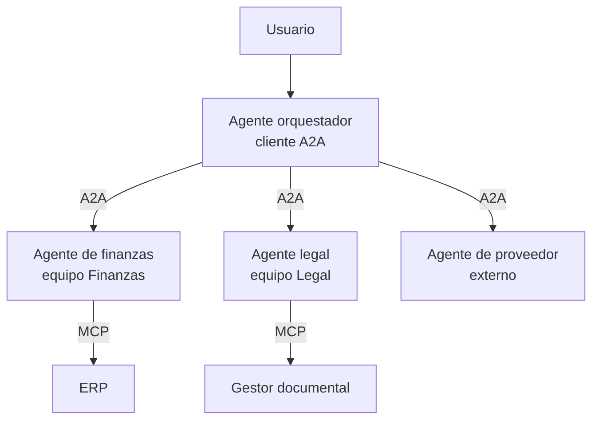

### 13.2 Arquitectura empresarial de referencia

En una organización con muchos agentes conviene centralizar el descubrimiento, la seguridad y la observabilidad, igual que con las APIs:

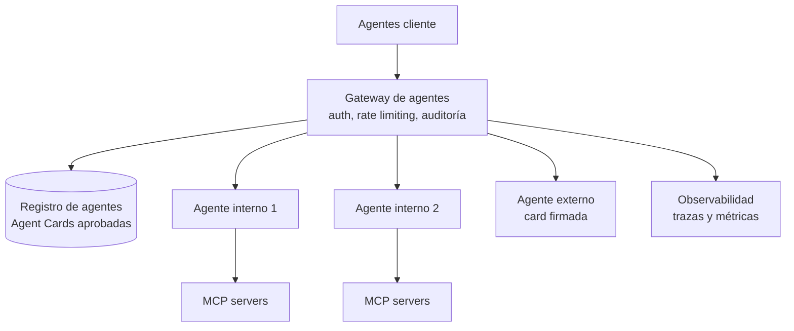

| Componente | Responsabilidad |
| --- | --- |
| **Registro de agentes** | Catálogo de Agent Cards aprobadas, con propietario, versión, nivel de riesgo y datos que maneja. Es el equivalente a un catálogo de APIs |
| **Gateway** | Terminación TLS, autenticación, autorización por skill, rate limiting, auditoría y bloqueo de agentes no registrados |
| **Observabilidad** | Trazas de punta a punta, coste por agente y tasa de tareas fallidas o rechazadas |
| **Política de agentes externos** | Solo cards firmadas, contrato y revisión de seguridad antes del alta en el registro |

### 13.3 Cuándo no usar A2A

- **Agentes del mismo proceso y del mismo equipo:** una llamada de función o un subagente es más simple, más rápido y más fácil de depurar.
- **La otra parte no es un agente:** si es una API o un recurso, usa MCP o la API directamente.
- **Interacción de un solo paso, sin estado:** un endpoint REST normal basta.
- **Requisitos de latencia de milisegundos:** el valor de A2A está en tareas con autonomía, no en llamadas de alta frecuencia.

---

## 14. Implementación

### 14.1 SDKs y herramientas

| Lenguaje | Repositorio |
| --- | --- |
| Python | `a2aproject/a2a-python` |
| JavaScript/TypeScript | `a2aproject/a2a-js` |
| Java | `a2aproject/a2a-java` |
| Go | `a2aproject/a2a-go` |
| C#/.NET | `a2aproject/a2a-dotnet` |
| Rust | `a2aproject/a2a-rs` |

Los ejemplos oficiales en varios lenguajes están en `a2aproject/a2a-samples`. Frameworks como Microsoft Agent Framework, Google ADK y Amazon Bedrock AgentCore permiten exponer o consumir agentes por A2A.

### 14.2 CLI oficial

```bash
brew tap a2aproject/a2a-cli https://github.com/a2aproject/a2a-cli
brew install a2a

a2a card get https://agent.example.com                              # ver la Agent Card
a2a send -a https://agent.example.com "Hello, what can you do?"      # enviar y esperar
a2a send -a https://agent.example.com --stream "Summarize this"     # con streaming
```

Es útil para probar un agente sin escribir un cliente, y para usarlo desde scripts y pipelines de CI.

### 14.3 Esqueleto en Python

Esquema orientativo de un servidor y un cliente con el SDK de Python (`a2a-sdk` 1.2.x, especificación 1.0). La API del SDK cambia entre versiones: contrasta los nombres con el README y los ejemplos oficiales de la versión que instales.

```bash
pip install "a2a-sdk[http-server]" uvicorn
```

Servidor (expone un agente con una skill):

```python
from a2a.helpers import new_text_message
from a2a.server.agent_execution import AgentExecutor, RequestContext
from a2a.server.events import EventQueue
from a2a.server.request_handlers import DefaultRequestHandler
from a2a.server.tasks import InMemoryTaskStore     # solo para desarrollo
from a2a.types import AgentCard, AgentCapabilities, AgentInterface, AgentSkill

class ResumenExecutor(AgentExecutor):
    async def execute(self, context: RequestContext, event_queue: EventQueue):
        texto = context.get_user_input()
        resumen = await mi_agente.run(texto)          # LangChain, Ollama, etc.: es opaco
        await event_queue.enqueue_event(new_text_message(resumen))

    async def cancel(self, context, event_queue):
        raise NotImplementedError

card = AgentCard(
    name="Agente de resúmenes", version="1.0.0",
    description="Resume documentos técnicos en español.",
    supported_interfaces=[AgentInterface(protocol_binding="JSONRPC",
                                         protocol_version="1.0", url="http://localhost:9999/")],
    capabilities=AgentCapabilities(streaming=True, push_notifications=False),
    default_input_modes=["text/plain"], default_output_modes=["text/plain"],
    skills=[AgentSkill(id="resumir", name="Resumir",
                       description="Resume un texto técnico", tags=["resumen"])],
)
handler = DefaultRequestHandler(agent_executor=ResumenExecutor(),
                                task_store=InMemoryTaskStore(), agent_card=card)
# montar las rutas de la card (/.well-known/agent-card.json) y JSON-RPC en Starlette y arrancar con uvicorn
```

Cliente (descubre la card y envía un mensaje):

```python
import uuid, httpx
from a2a.client import A2ACardResolver, ClientConfig, create_client
from a2a.types import Message, Part, Role, SendMessageRequest

async with httpx.AsyncClient() as http:
    card = await A2ACardResolver(http, "http://localhost:9999").get_agent_card()
(http, "http://localhost:9999").get_agent_card()
client = await create_client(card, client_config=ClientConfig(streaming=False))
msg = Message(role=Role.ROLE_USER, message_id=str(uuid.uuid4()),
              parts=[Part(text="Resume este documento: ...")])
async for event in client.send_message(SendMessageRequest(message=msg)):
    ...   # Message directo o Task con artefactos
```

**El modelo que usa el agente es un detalle interno.** Un agente servidor puede ejecutarse con Ollama y `qwen3.5:9b` en local, o con un modelo en la nube: el cliente solo ve la Agent Card y las respuestas.

---

## 15. A2A en el ciclo ODD

Exponer o consumir un agente por A2A es una decisión de diseño y queda escrita en la spec antes del primer write:

1. **La Agent Card es parte del contrato.** La spec incluye las skills, los modos de entrada y salida, el esquema de autenticación y la versión. Cambiar una skill o un esquema de salida es un cambio sustancial: genera documento de feature y nueva versión del agente.
2. **AC por skill.** Cada skill anunciada tiene al menos un AC y sus evals, lanzadas a través del propio protocolo (por ejemplo, con la CLI `a2a` o un cliente de test), no solo llamando al código por dentro.
3. **Contract tests en CI.** La card se valida contra el esquema, y se prueban los estados de tarea, los errores y la versión con un LLM fake, igual que el resto de capas de CI.
4. **Patrones transversales con AC.** Idempotencia de `SendMessage`, timeouts, comportamiento en `INPUT_REQUIRED`, cancelación y límite de tareas abiertas.
5. **Riesgo.** Un agente expuesto a otros equipos o a terceros sube como mínimo a riesgo medio en RDD. Si recibe tareas de agentes externos o maneja datos personales, a riesgo alto: revisión de seguridad, card firmada y análisis de la lethal trifecta.

---

## 16. Antipatrones

| Antipatrón | Problema | Alternativa |
| --- | --- | --- |
| A2A entre agentes del mismo proceso | Latencia, serialización y operación sin beneficio | Llamada de función o subagente |
| Usar A2A para exponer una tool | La otra parte no razona: es una API | MCP |
| Confiar en lo que devuelve el agente remoto | Prompt injection entre agentes | Tratarlo como no confiable (10.4) |
| Agent Card con todo el detalle interno | Expone propiedad intelectual y superficie de ataque | Card pública mínima y card extendida autenticada |
| `InMemoryTaskStore` en producción | Las tareas se pierden al reiniciar | Almacén persistente |
| Reintentar `SendMessage` sin deduplicar | Tareas duplicadas con efectos | Deduplicación por `messageId` |
| Webhook sin autenticar ni validar | Notificaciones falsas, SSRF | 10.3 |
| Agentes externos sin registro ni gateway | Sin control de quién llama a quién ni del coste | Registro y gateway (13.2) |
| Ignorar `INPUT_REQUIRED` | La tarea se queda colgada para siempre | Manejar el estado, con timeout y escalado |
| Ejemplos de la versión 0.3 | `message/send`, `kind`, rutas `/v1` ya no son válidos en 1.0 | Usar la especificación 1.0 |

---

## 17. Checklist de adopción

- [ ] Está justificado A2A (agentes de equipos u organizaciones distintas, o reutilización entre varios clientes) frente a una llamada interna o MCP
- [ ] Agent Card con skills, modos, versión y esquema de autenticación, publicada en `/.well-known/agent-card.json` o en el registro
- [ ] Card pública mínima; card extendida para el detalle; card firmada si se expone fuera de la organización
- [ ] TLS en todo el tráfico; autenticación en cada petición; autorización por operación y por skill
- [ ] Almacén de tareas persistente
- [ ] Manejo de `INPUT_REQUIRED`, `AUTH_REQUIRED`, cancelación y estados terminales
- [ ] Modo de interacción elegido (bloqueante, consulta, streaming o push) según la duración de las tareas
- [ ] Webhooks autenticados, protegidos contra SSRF e idempotentes
- [ ] Retry con timeout, deduplicación de `SendMessage`, circuit breaker y límite de tareas abiertas
- [ ] Tracing de punta a punta con `taskId` y `contextId`
- [ ] Respuestas de agentes remotos tratadas como no confiables (lethal trifecta analizada)
- [ ] `A2A-Version` y plan de migración entre versiones
- [ ] Agent Card, skills y AC en la spec; evals a través del protocolo; contract tests en CI
- [ ] Nivel de riesgo RDD acorde a la exposición

---

## 18. Lecturas recomendadas y fuentes

- **[Especificación A2A (latest)](https://a2a-protocol.org/latest/specification/)**. Fuente normativa: modelo de datos, operaciones, bindings, seguridad y relación con MCP (apéndice B).
- **[SDKs oficiales](https://a2a-protocol.org/latest/sdk)** y **[repositorios de a2aproject](https://github.com/a2aproject)**, incluidos los ejemplos (`a2a-samples`).
- **[Meet the A2A CLI](https://a2a-protocol.org/latest/blog/2026/10/01/introducing-a2a-cli/)** (blog oficial, octubre de 2026).
- **[Blog de A2A, 2026](https://a2a-protocol.org/latest/blog/archive/2026/)**: incorporación a la Agentic AI Foundation (agosto de 2026).
- **[A2A Protocol v1.0: What's New, What Changed](https://www.testmuai.com/blog/a2a-protocol-v1/)**. Resumen de los cambios entre 0.3 y 1.0.
- **[A2A Python SDK tutorial](https://lucaberton.com/blog/a2a-python-sdk-tutorial/)** (octubre de 2026, `a2a-sdk` 1.2.1).
- **[Model Context Protocol](https://modelcontextprotocol.io/)**. Para la parte agente-tool.
- **[Design Patterns for Securing LLM Agents against Prompt Injections](https://arxiv.org/abs/2506.08837)** y **[The lethal trifecta](https://simonwillison.net/2025/Jun/16/the-lethal-trifecta/)**. Base de la sección 10.4.
- Guías relacionadas: "Patrones aplicados al desarrollo de agentes" (secciones 4, 6.9 y 7), "ODD aplicado a la generación de agentes" y "RDD en el ciclo ODD".
