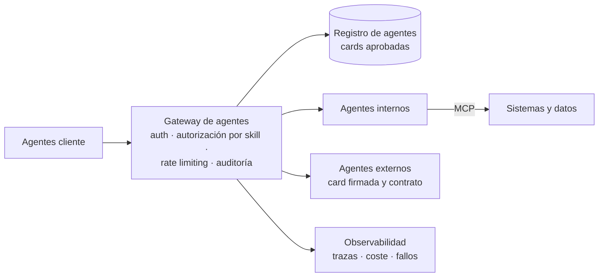

# A2A (Agent2Agent): resumen ejecutivo

Resumen de "A2A (Agent2Agent) - guía para arquitectos" · Especificación A2A 1.0 · Noviembre 2026

---

## 1. En una frase

**A2A es el estándar abierto para que agentes de IA de equipos, proveedores o plataformas distintos se descubran, se deleguen trabajo y colaboren sin exponer cómo funcionan por dentro.** Es el complemento de MCP: MCP conecta un agente con sus herramientas y datos; A2A conecta agentes entre sí.

| Aspecto | Situación a octubre de 2026 |
| --- | --- |
| Madurez | Versión **1.0** (marzo de 2026), estable en sus operaciones |
| Gobierno | Neutral: Linux Foundation y, desde agosto de 2026, Agentic AI Foundation, junto a MCP |
| Adopción | Más de 150 organizaciones; soporte en Azure AI Foundry, Copilot Studio y Amazon Bedrock AgentCore |
| Ecosistema | SDKs oficiales en Python, JavaScript, Java, Go, C#/.NET y Rust, y una CLI oficial |

---

## 2. Por qué importa

Sin un protocolo común, cada pareja de agentes necesita su propia integración, y el número de integraciones crece de forma cuadrática con el número de agentes y proveedores. A2A sustituye esas integraciones por un contrato común para cuatro cosas: **descubrir** qué sabe hacer un agente, **delegarle** una tarea, **seguir** su progreso y **recibir** los resultados.

El valor para la organización está en tres efectos:

- **Interoperabilidad sin dependencia de un proveedor.** Un agente construido con un framework o un modelo puede trabajar con otro construido con tecnología distinta.
- **Protección de la propiedad intelectual.** Cada agente es una caja negra: publica lo que sabe hacer, pero no su prompt, sus herramientas, sus datos ni su modelo.
- **Autonomía de los equipos.** Cada equipo cambia su agente sin romper a los que lo usan, igual que con una API bien versionada.

---

## 3. Cómo funciona, sin entrar en detalle

| Pieza | Qué es | Por qué le importa a un arquitecto |
| --- | --- | --- |
| **Agent Card** | Documento JSON publicado en una URL conocida con la identidad, las capacidades (skills), los endpoints y la autenticación del agente | Es el contrato. Puede ir firmada para verificar quién la publica |
| **Task** | Unidad de trabajo con ciclo de vida: en curso, a la espera de datos o autorización, terminada, fallida, cancelada o rechazada | Permite tareas de segundos u horas, no solo llamadas cortas |
| **Interacción multi-turn** | El agente remoto puede pararse y pedir más información o autenticación | Es lo que distingue a A2A de una API: la otra parte razona y pregunta |
| **Modos de interacción** | Respuesta bloqueante, consulta posterior, streaming de progreso o notificaciones push a un webhook | Se elige según la duración de la tarea y el tipo de cliente |
| **Transportes** | JSON-RPC, gRPC o HTTP+JSON, sobre la seguridad web estándar | Encaja con la infraestructura existente: TLS, OAuth 2.0, OpenID Connect, mTLS |

**A2A o MCP.** Si la otra parte es determinista y la controla el propio equipo (una API, una base de datos), es una herramienta y va por MCP. Si la otra parte decide por sí misma cómo resolver el encargo y la mantiene otro equipo u organización, es un agente y va por A2A. Los dos conviven: un agente que recibe una tarea por A2A usa MCP para resolverla.

---

## 4. Arquitectura empresarial de referencia

Con muchos agentes, el descubrimiento, la seguridad y la observabilidad se centralizan, igual que con las APIs:

El registro es el catálogo de Agent Cards aprobadas, con propietario, versión, nivel de riesgo y datos que maneja. El gateway aplica la autenticación, la autorización por skill, el rate limiting y la auditoría, y bloquea los agentes no registrados. Los agentes externos solo se dan de alta con card firmada, contrato y revisión de seguridad.

---

## 5. Riesgos y cómo se gestionan

| Riesgo | Qué significa | Respuesta |
| --- | --- | --- |
| **Prompt injection entre agentes** | Lo que devuelve otro agente es contenido no confiable y puede llevar instrucciones maliciosas, igual que una página web | Tratarlo siempre como dato. Aplicar patrones de arquitectura (lethal trifecta, Plan-then-execute, Dual LLM) cuando el resultado alimenta decisiones con efectos |
| Suplantación de agentes | Un agente falso se presenta como uno legítimo | Cards firmadas, TLS, registro de agentes aprobados y gateway |
| Accesos indebidos | Un agente obtiene datos o acciones que no le corresponden | Autenticación en cada petición y autorización por operación y por skill |
| Fallos en cascada y tareas duplicadas | Un agente lento bloquea a los que dependen de él; un reintento repite una tarea con efectos | Timeouts, circuit breaker, límite de tareas abiertas, deduplicación de mensajes y almacén de tareas persistente |
| Fuga de datos personales | Datos que viajan a agentes que no los necesitan o que acaban en los logs | Minimizar lo que viaja en cada mensaje; no registrar credenciales ni datos personales |
| Ataques a los webhooks (SSRF) | Notificaciones push dirigidas a servicios internos | Rechazar direcciones privadas, autenticar cada notificación y procesarlas de forma idempotente |

**El riesgo principal no es técnico sino de confianza.** A2A reutiliza la seguridad web estándar; lo nuevo es que al otro lado hay un sistema autónomo cuyas respuestas no se pueden dar por buenas.

---

## 6. Cuándo usarlo y cuándo no

| Usar A2A | No usar A2A |
| --- | --- |
| Agentes de equipos, áreas u organizaciones distintas | Agentes del mismo proceso y del mismo equipo: una llamada interna es más simple |
| Un agente que van a reutilizar varios clientes | La otra parte es una API o un recurso: MCP o la API directamente |
| Tareas largas, con estados intermedios o que necesitan preguntar | Una interacción de un solo paso sin estado: basta un endpoint REST |
| Agentes de proveedores externos o de plataformas cloud distintas | Requisitos de latencia de milisegundos o llamadas de alta frecuencia |

---

## 7. Recomendaciones

1. **Adoptar A2A como estándar para la colaboración entre agentes de dueños distintos**, y MCP para el acceso de los agentes a herramientas y datos. Evitar integraciones propietarias nuevas entre agentes.
2. **Crear el registro y el gateway de agentes antes de que proliferen.** Son la base del control de quién llama a quién, del coste y de la auditoría, y son mucho más baratos de implantar pronto.
3. **Tratar la Agent Card como un contrato.** Sus skills, esquemas y versión se especifican y se prueban antes de publicarla; un cambio en ella es un cambio de versión del agente.
4. **Clasificar por riesgo.** Un agente expuesto a otros equipos parte de riesgo medio. Si recibe tareas de agentes externos o maneja datos personales, es riesgo alto: revisión de seguridad, card firmada y análisis de la lethal trifecta.
5. **Exigir a los proveedores soporte A2A 1.0** y cards firmadas para integrarse con los agentes de la organización.
6. **Empezar con una PoC acotada:** un orquestador que delega en dos agentes internos, con trazas de punta a punta y pruebas de seguridad en un sandbox antes de abrirlo a otros equipos.

### Hoja de ruta orientativa

| Fase | Objetivo | Resultado |
| --- | --- | --- |
| 1. PoC | Validar el protocolo con agentes internos | Dos o tres agentes colaborando, con trazas y pruebas de seguridad |
| 2. Plataforma | Registro, gateway y observabilidad comunes | Alta controlada de agentes internos y métricas de coste y fiabilidad |
| 3. Apertura | Agentes de otras áreas y de proveedores | Política de agentes externos, cards firmadas y contratos |

---

*Detalle técnico y checklist en "A2A (Agent2Agent) - guía para arquitectos"; seguridad entre agentes en la guía de patrones (sección 7) y en las dos guías de sandbox.*
