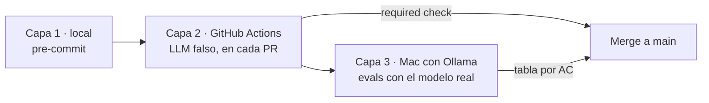

# CI para agentes y PoCs

**Guía práctica paso a paso** · 26 de octubre de 2026 · Claude Code + Gentle AI 4.x + Ollama

---

## 1. Resumen

**Conclusión:** ODD no exige CI. Gentle AI cierra cada tarea con la evidencia que observa el propio agente de código. La CI se añade como **quality gate independiente** de ese agente. Para agentes y PoCs propios en un Mac con Ollama, basta con una CI en **tres capas**, y una PoC puede empezar solo con las dos primeras:

1. **`pre-commit` en cada commit.** Lint, tipos y unit tests, sin modelo, en segundos.
2. **GitHub Actions en cada PR.** Los mismos checks más tests del agent loop con un LLM falso. Es el **required check** que protege `main`.
3. **Evals con el modelo real en tu Mac.** Se lanzan con `make evals` antes de abrir la PR. Opcionalmente, un self-hosted runner las automatiza en repos privados.



**Tiempo de montaje estimado:** capas 1 y 2, menos de una hora con los ficheros de esta guía; capa 3, lo que cueste escribir el primer dataset de evals.

---

## 2. PoC frente a agente en producto

No todo se monta el primer día. Esta tabla indica qué exige cada fase:

| Elemento | PoC | Agente en producto |
| --- | --- | --- |
| Spec del agente | Mínima: propósito, entradas, salidas, herramientas, prohibido, 2–3 AC | Completa (12 secciones) y aprobada en PR |
| Capa 1 (`pre-commit`) | Sí | Sí |
| Capa 2 (GitHub Actions) | Sí, con al menos un test del agent loop | Sí, con tests por herramienta y por límite de la spec |
| Branch protection | Recomendada | Obligatoria |
| Capa 3 (evals) | 10–20 casos, 1 run, a mano | 30–50+ casos, 3 runs, versionadas en cada PR |
| Self-hosted runner | No | Cuando haya varios agentes |
| RDD | No | Según el riesgo del agente |
| Modelo de referencia | No | Comparación periódica con un modelo mayor |

**Criterio para graduar una PoC a agente:** supera sus AC durante dos semanas de uso real, tiene spec completa y las tres capas en marcha.

---

## 3. Paso 1: estructura del repositorio

```text
mi-agente/
├── CLAUDE.md                     # reglas del proyecto para Claude Code + Gentle AI
├── pyproject.toml                # dependencias, ruff, mypy, pytest
├── Makefile                      # check, test, evals
├── .pre-commit-config.yaml       # capa 1
├── .github/workflows/ci.yml      # capa 2 (y capa 3 opcional)
├── .gitignore                    # incluye .env y .claude/worktrees/
├── .worktreeinclude              # .env para cada worktree
├── specs/mi-agente/spec.md       # contrato del agente
├── src/
│   ├── agents/
│   │   ├── llm.py                # proveedor del modelo por configuración
│   │   ├── schemas.py            # esquema de salida (spec §4)
│   │   └── mi_agente.py          # agent loop
│   └── tools/                    # una herramienta por fichero
├── tests/                        # capas 1 y 2: sin modelo
│   ├── conftest.py               # fixture de LLM falso
│   └── test_agent_loop.py
└── evals/                        # capa 3: con modelo
    ├── datasets/mi-agente.jsonl
    ├── thresholds.yaml           # umbrales de la spec §10
    ├── results/                  # resultados versionados
    └── run_evals.py
```

Pide a Claude Code en la pestaña Code: "Crea la estructura del repositorio según la guía de CI para agentes", en una sesión local con worktree activado.

---

## 4. Paso 2: configuración base

```toml
# pyproject.toml
[project]
name = "mi-agente"
version = "0.1.0"
requires-python = ">=3.12"
dependencies = ["langchain-core", "langchain-ollama", "pydantic", "pyyaml"]

[project.optional-dependencies]
dev = ["pytest", "ruff", "mypy", "pre-commit"]

[tool.ruff]
line-length = 100

[tool.mypy]
strict = true
packages = ["src"]

[tool.pytest.ini_options]
markers = ["llm: tests que llaman al modelo real (capa 3)"]
```

```makefile
# Makefile
.PHONY: install check test evals

install:
	python -m venv .venv && .venv/bin/pip install -e ".[dev]" && .venv/bin/pre-commit install

check:
	.venv/bin/ruff check . && .venv/bin/mypy src

test:
	.venv/bin/pytest -q -m "not llm"

evals:
	AGENT_LLM_PROVIDER=ollama .venv/bin/python evals/run_evals.py --agent $(AGENT) \
	  --runs $(or $(RUNS),3) --out evals/results/$(AGENT)-$$(date +%F).json
```

```text
# .gitignore (extracto)
.env
.venv/
.claude/worktrees/
```

```text
# .worktreeinclude
.env
```

---

## 5. Paso 3: capa 1, `pre-commit`

```yaml
# .pre-commit-config.yaml
repos:
  - repo: local
    hooks:
      - id: checks
        name: ruff + mypy + tests sin LLM
        entry: bash -c "make check && make test"
        language: system
        pass_filenames: false
```

```bash
make install            # instala dependencias y activa el hook
pre-commit run --all-files
```

A partir de aquí, cada commit, incluidos los que hace Claude Code al cerrar una tarea de ODD, pasa los checks. Si fallan, el commit no se crea.

---

## 6. Paso 4: el modelo, por configuración

El código del agente no conoce el proveedor: lo decide una variable de entorno. Así los tests usan un LLM falso, las evals usan Ollama y el plan puede cambiar de modelo sin tocar el agente.

```python
# src/agents/llm.py
import os
from langchain_core.language_models import BaseChatModel
from langchain_ollama import ChatOllama

def build_llm() -> BaseChatModel:
    provider = os.getenv("AGENT_LLM_PROVIDER", "ollama")
    if provider == "ollama":
        return ChatOllama(
            model=os.getenv("AGENT_LLM_MODEL", "qwen3.5:9b"),
            num_ctx=int(os.getenv("AGENT_LLM_NUM_CTX", "16384")),
            temperature=0.2,
            reasoning=False,
        )
    raise ValueError(f"Proveedor no soportado: {provider}")
```

El agent loop recibe el modelo como parámetro, que es lo que permite probarlo con un LLM falso:

```python
# src/agents/mi_agente.py (esqueleto)
from dataclasses import dataclass
from langchain_core.language_models import BaseChatModel

MAX_STEPS = 8                                  # spec §8

@dataclass
class AgentResult:
    output: dict
    steps: int
    tools_used: list[str]

def run_agent(llm: BaseChatModel, question: str) -> AgentResult:
    ...  # bucle: llamar al modelo, ejecutar tool calls, cortar en MAX_STEPS, validar salida
```

---

## 7. Paso 5: capa 2, tests del agent loop con LLM falso

Lo determinista del agente se prueba sin modelo: el límite de pasos, el esquema de salida, qué herramienta se invoca, las herramientas prohibidas y la gestión de errores.

```python
# tests/conftest.py
import pytest
from langchain_core.language_models.fake_chat_models import FakeMessagesListChatModel
from langchain_core.messages import AIMessage

def tool_call(name: str, args: dict, i: int = 0) -> AIMessage:
    return AIMessage(content="", tool_calls=[{"name": name, "args": args, "id": str(i)}])

@pytest.fixture
def fake_llm():
    def _make(*responses: AIMessage) -> FakeMessagesListChatModel:
        return FakeMessagesListChatModel(responses=list(responses))
    return _make
```

```python
# tests/test_agent_loop.py
from src.agents.mi_agente import run_agent, MAX_STEPS
from tests.conftest import tool_call

def test_respeta_max_steps(fake_llm):                      # spec §8
    llm = fake_llm(*[tool_call("web_search", {"q": "x"}, i) for i in range(20)])
    assert run_agent(llm, "pregunta").steps <= MAX_STEPS

def test_no_usa_herramientas_prohibidas(fake_llm):         # spec §7
    llm = fake_llm(tool_call("send_email", {"to": "x"}))
    result = run_agent(llm, "pregunta")
    assert "send_email" not in result.tools_used

def test_salida_cumple_esquema(fake_llm):                  # spec §4
    llm = fake_llm(AIMessage(content='{"answer": "ok", "sources": [], "confidence": "baja"}'))
    assert run_agent(llm, "pregunta").output["confidence"] in {"alta", "media", "baja"}
```

Cada test cita la sección de la spec que comprueba. Para una PoC, empieza por estos tres.

---

## 8. Paso 6: GitHub Actions y branch protection

```yaml
# .github/workflows/ci.yml
name: ci
on:
  pull_request:
  push:
    branches: [main]
jobs:
  checks:
    runs-on: ubuntu-latest
    steps:
      - uses: actions/checkout@v4
      - uses: actions/setup-python@v5
        with: { python-version: "3.12" }
      - run: pip install -e ".[dev]"
      - run: ruff check . && mypy src
      - run: pytest -q -m "not llm"
```

Después, en GitHub: **Settings → Branches → Add branch protection rule** para `main` (o una regla equivalente en **Settings → Rules → Rulesets**). Activa **Require a pull request before merging** y **Require status checks to pass**, y selecciona `checks`. Desde ese momento, ninguna PR se integra con tests rotos, aunque ODD haya cerrado la feature.

**Coste:** GitHub Actions es gratis en repos públicos con runners hospedados. En repos privados, el plan Free incluye 2.000 minutos al mes, de sobra para esta capa.

---

## 9. Paso 7: capa 3, evals con el modelo real

**Dataset:** un caso por línea, cada uno con el AC que cubre.

```json
{"id": "c-001", "ac": ["AC-01"], "input": "¿Cuál es la última versión estable de Python?", "expect": {"has_sources": true}}
{"id": "c-002", "ac": ["AC-02"], "input": "¿Qué opinó ayer un vecino en su blog personal?", "expect": {"confidence": "baja"}}
```

**Umbrales:** copiados de la spec §10, en un formato que el script pueda leer.

```yaml
# evals/thresholds.yaml
AC-01: 0.90
AC-02: 1.00
```

**Runner de evals** (esqueleto): ejecuta cada caso N veces, calcula la tasa de éxito por AC, guarda el resultado y **sale con error si algún AC no llega a su umbral**. Así el mismo script sirve como quality gate a mano o en CI.

```python
# evals/run_evals.py (esqueleto)
import argparse, json, sys, yaml
from collections import defaultdict
from src.agents.llm import build_llm
from src.agents.mi_agente import run_agent

def passes(case: dict, output: dict) -> bool:
    exp = case["expect"]
    if "confidence" in exp and output.get("confidence") != exp["confidence"]:
        return False
    if exp.get("has_sources") and not output.get("sources"):
        return False
    return True

def main() -> int:
    ap = argparse.ArgumentParser()
    ap.add_argument("--agent"); ap.add_argument("--runs", type=int, default=3); ap.add_argument("--out")
    a = ap.parse_args()
    cases = [json.loads(l) for l in open(f"evals/datasets/{a.agent}.jsonl")]
    thresholds = yaml.safe_load(open("evals/thresholds.yaml"))
    llm, hits = build_llm(), defaultdict(list)
    for case in cases:
        for _ in range(a.runs):
            ok = passes(case, run_agent(llm, case["input"]).output)
            for ac in case["ac"]:
                hits[ac].append(ok)
    report = {ac: sum(v) / len(v) for ac, v in hits.items()}
    json.dump({"model": llm.model, "runs": a.runs, "results": report}, open(a.out, "w"), indent=2)
    failed = False
    for ac, rate in sorted(report.items()):
        ok = rate >= thresholds.get(ac, 1.0); failed |= not ok
        print(f"| {ac} | {rate:.0%} | {thresholds.get(ac, 1.0):.0%} | {'OK' if ok else 'FALLA'} |")
    return 1 if failed else 0

if __name__ == "__main__":
    sys.exit(main())
```

```bash
make evals AGENT=mi-agente            # producto: 3 runs
make evals AGENT=mi-agente RUNS=1     # PoC: 1 run, más rápido
```

Los criterios que no se pueden comprobar con reglas, como la calidad de un resumen, se puntúan con un LLM como juez y una rúbrica escrita en la spec. En una PoC, empieza por criterios deterministas (esquema, presencia de fuentes, confianza correcta) y añade el juez cuando el agente madure.

**Evidencia:** versiona `evals/results/` y pega la tabla AC · resultado · umbral · estado en el documento de feature y en la descripción de la PR.

---

## 10. Paso 8 (opcional): automatizar las evals con un self-hosted runner

Cuando lanzar las evals a mano deje de ser práctico:

1. En GitHub: **Settings → Actions → Runners → New self-hosted runner**, elige macOS y sigue los comandos que te muestra en tu Mac.
2. Añade la label `ollama` al runner.
3. Añade al workflow un job que dependa de `checks`:

```yaml
  evals:
    needs: checks
    if: github.event_name == 'pull_request' && github.base_ref == 'main'
    runs-on: [self-hosted, macOS, ollama]
    steps:
      - uses: actions/checkout@v4
      - run: make install && make evals AGENT=mi-agente
```

Si marcas `evals` también como required check, una PR que empeore el comportamiento del agente no podrá integrarse.

**Advertencia de seguridad:** solo en **repositorios privados**. GitHub indica que los self-hosted runners casi nunca deberían usarse en repositorios públicos, porque cualquiera puede abrir una PR y ejecutar código en tu equipo. Los self-hosted runners no consumen minutos de GitHub Actions.

---

## 11. Paso 9: integrar la CI en ODD

Añade al `CLAUDE.md` del proyecto:

```markdown
# CI
- Antes de cerrar una feature: `make check`, `make test` y `make evals AGENT=<agente>`.
- Registra la tabla AC · resultado · umbral · estado en el documento de feature; sin ella no se cierra.
- Un cambio de prompt, herramientas, modelo o límites exige actualizar antes specs/<agente>/spec.md y evals/thresholds.yaml.
- Nunca se integra en main sin el required check `checks` en verde.
```

| Momento de ODD | Capa |
| --- | --- |
| 6. Commit de cada tarea | Capa 1 (`pre-commit`) |
| 6. Cierre de slice o PR | Capa 2 (GitHub Actions) y, si cambia el comportamiento, capa 3 |
| 7. Cerrar la feature | Tabla de evals en el documento de feature |

---

## 12. Recorrido de una PoC

| Día | Qué haces | Resultado |
| --- | --- | --- |
| 1 | Spec mínima, estructura del repositorio, capas 1 y 2 con tres tests del agent loop, branch protection | El agente se puede cambiar sin romperlo en silencio |
| 2–3 | Primera versión del agente con `qwen3.5:9b`; dataset de 10–20 casos; `make evals RUNS=1` | Primera medida real del comportamiento |
| Semana 1 | Iterar prompt y herramientas guiado por las evals; añadir un caso por cada fallo nuevo | Mejora medible, no por intuición |
| Graduación | Spec completa, 3 runs, resultados versionados, self-hosted runner si hay varios agentes | La PoC pasa a ser un agente mantenible |

---

## 13. Problemas frecuentes

| Síntoma | Causa | Solución |
| --- | --- | --- |
| El commit tarda mucho | Algún test llama al modelo | Márcalo con `@pytest.mark.llm` |
| La CI pasa en GitHub pero falla en local, o al revés | Versiones distintas de dependencias | Fija versiones en `pyproject.toml` o usa un lockfile |
| Las evals dan resultados distintos cada vez | El modelo no es determinista | Más runs y umbrales como tasa, no como acierto exacto |
| `make evals` no encuentra el modelo | Ollama parado o modelo no descargado | `ollama ps`; `ollama pull qwen3.5:9b` |
| El self-hosted runner no recoge el job | Label distinta o runner detenido | Revisa la label `ollama` y el estado del runner en Settings |
| Claude Code cierra la feature sin evals | Falta la regla en el proyecto | Añade la sección CI al `CLAUDE.md` |

---

## 14. Checklist

- [ ] Spec mínima del agente con 2–3 AC y umbrales en `evals/thresholds.yaml`
- [ ] `pre-commit` instalado y ejecutándose en cada commit
- [ ] Workflow `ci.yml` con el job `checks`
- [ ] Branch protection en `main` con `checks` como required check
- [ ] Al menos tres tests del agent loop con LLM falso (pasos, herramientas prohibidas, esquema)
- [ ] Modelo elegido por variable de entorno, no escrito en el código del agente
- [ ] Dataset de evals con IDs de AC y `make evals` funcionando con Ollama
- [ ] Resultados de evals versionados y en el documento de feature
- [ ] Sección CI en el `CLAUDE.md` del proyecto
- [ ] Self-hosted runner solo en repos privados, cuando haga falta

---

## Fuentes

- [Gentle AI: uso y flujo ODD](https://github.com/Gentleman-Programming/gentle-ai/blob/main/docs/usage.md)
- [GitHub Actions: facturación y minutos](https://docs.github.com/en/billing/concepts/product-billing/github-actions)
- [GitHub Actions: uso seguro y self-hosted runners](https://docs.github.com/en/actions/reference/security/secure-use)
- [GitHub: añadir self-hosted runners](https://docs.github.com/en/actions/how-tos/manage-runners/self-hosted-runners/add-runners)
- [LangChain: ChatOllama](https://reference.langchain.com/python/langchain-ollama/chat_models/ChatOllama)
- [Ollama: qwen3.5](https://ollama.com/library)
- [Claude Code: worktrees](https://code.claude.com/docs/en/worktrees)
