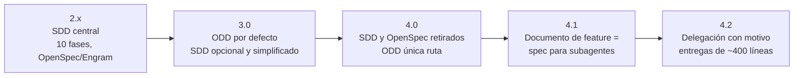
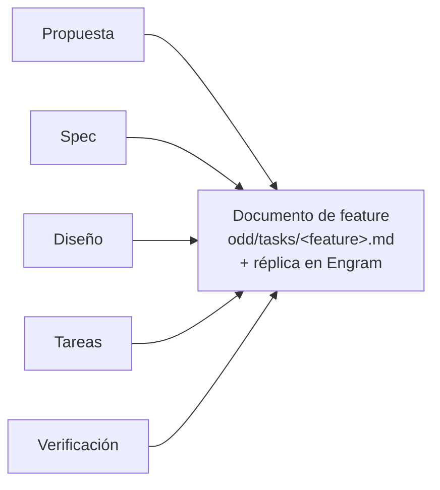
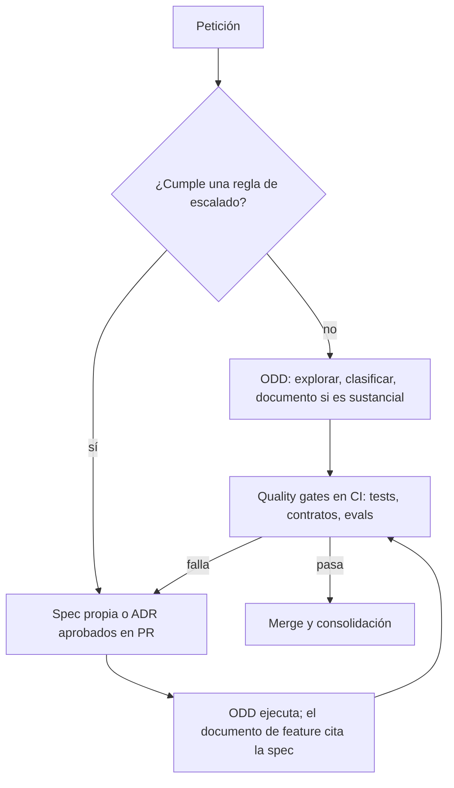

# De SDD a ODD: la evolución del desarrollo con agentes de IA

**Guía para arquitectos empresariales y de soluciones** · 25 de octubre de 2026

---

## 1. Resumen ejecutivo

**Conclusión:** Gentle AI ha pasado de un proceso por fases con cinco artefactos (SDD) a un flujo proporcional con un solo documento por feature (ODD). La ejecución ahora es más ligera y adaptable, pero desaparece la especificación estable como activo de la herramienta. **Las organizaciones deben mantener por su cuenta los activos duraderos que la herramienta ya no gestiona: specs de contratos y de agentes, ADR y suites de evaluación.** ODD gobierna cómo se ejecuta el cambio; el repositorio de la organización gobierna qué se ha acordado.

- **De dónde venimos:** en Gentle AI 2.x, SDD era el flujo central, con diez fases (de `sdd-init` a `sdd-archive`) y artefactos separados de propuesta, spec, diseño, tareas y verificación, guardados en Engram, en ficheros OpenSpec o en ambos.
- **Transición:** en la 3.0, ODD pasó a ser el flujo por defecto y SDD quedó como opción explícita, simplificada y con la verificación como diagnóstico, no como quality gate.
- **Dónde estamos:** en la 4.0, SDD y OpenSpec se retiraron y ODD quedó como única ruta. La 4.1 convirtió el documento de feature en la especificación literal que leen los subagentes, y la 4.2 ajustó la delegación y el tamaño de las entregas.
- **Qué hacer:** adoptar ODD como motor de ejecución, sacar del flujo de la herramienta los activos que deben perdurar y automatizar la regla que decide cuándo un cambio exige uno de esos activos.

---

## 2. La evolución en el tiempo

| Versión | Cambio | Qué significa para la organización |
| --- | --- | --- |
| 2.x | SDD como flujo estructurado de diez fases; artefactos en Engram, OpenSpec o híbrido; modelo distinto por fase | Proceso explícito y auditable, con más ceremonia y más artefactos que mantener |
| 3.0 | ODD por defecto en cada petición; SDD solo si se pide; investigación y verificación opcionales; la verificación no bloquea el archivo; el archivo refleja el estado real | La herramienta deja de imponer la spec; el quality gate ya no está en el flujo |
| 4.0 | Se retiran los comandos `/sdd-*`, las fases, los perfiles SDD y la integración con OpenSpec; se eliminan flags como `--sdd-mode` y `--strict-tdd`; se conservan los ficheros del usuario | SDD deja de ser una capacidad de la herramienta; pasa a ser responsabilidad del proceso de la organización |
| 4.1 | El documento de feature es la especificación literal para los subagentes; la delegación necesita un motivo; las tareas se dimensionan por comprensión, riesgo y capacidad de reanudación; piloto de orquestador modular para Claude Code | La "spec" existe, pero es operativa y ligada a una feature |
| 4.2 | Reescritura del routing de ODD; independent verifier solo para elementos de alto riesgo nombrados; commits en slices revisables de unas 400 líneas | Más control del tamaño del cambio y menos delegación innecesaria |

Fuentes por versión al final del documento. Nota: la documentación de uso de Gentle AI todavía describe SDD como flujo opcional, mientras que las notas de la 4.0 lo dan por retirado; para estandarizar, prevalecen las notas de versión.

---

## 3. Punto de partida: SDD

SDD hace de la especificación el artefacto principal: primero se acuerda *qué* debe hacer el sistema y con qué criterios, y el código se deriva de ella.

| Fase en Gentle AI 2.x | Artefacto |
| --- | --- |
| `sdd-init` | Contexto del proyecto: stack, tests, convenciones |
| `sdd-explore` (+ investigación opcional) | Notas de exploración |
| `sdd-propose` | Propuesta: intención, alcance, enfoque |
| `sdd-spec` | Especificación: requisitos y escenarios |
| `sdd-design` | Diseño técnico y decisiones de arquitectura |
| `sdd-tasks` | Desglose en tareas |
| `sdd-apply` | Implementación |
| `sdd-verify` | Validación frente a la spec |
| `sdd-archive` | Consolidación de los deltas en la spec principal |

**Fortalezas:** trazabilidad requisito → diseño → tarea → test; aprobación humana temprana; specs estables que sirven de contrato entre equipos.

**Costes:** ceremonia aplicada también a cambios pequeños; varios artefactos que coordinar y mantener sincronizados; especificaciones que se desactualizan si el proceso no las protege; más contexto que el agente debe cargar y reconciliar.

SDD sigue vivo como método fuera de Gentle AI, en herramientas como GitHub Spec Kit, Kiro u OpenSpec.

---

## 4. Punto de llegada: ODD

ODD se ejecuta en cada petición, sin que haya que pedirlo, y escala el proceso al tamaño real del trabajo:

1. **Autorizar:** decide si la petición permite cambiar código; las explicaciones, investigaciones y propuestas se quedan en solo lectura.
2. **Explorar** el código y los requisitos, en proporción a la petición.
3. **Resolver incertidumbre:** investigación opcional para una duda concreta; como mucho una pregunta sobre una decisión real de producto.
4. **Clasificar:** el trabajo es *sustancial* si hay dos o más pasos de implementación significativos o progreso que merezca recuperarse.
5. **Registrar antes de escribir:** si es sustancial, crea `odd/tasks/<feature>.md` y su réplica en Engram antes de tocar código.
6. **Implementar tarea a tarea:** feature branch, TDD si está configurado, casillas marcadas solo con evidencia, al menos un commit por tarea.
7. **Cerrar:** resultado verificado, checks fallidos o pendientes y siguiente paso.

Controles alrededor del flujo: previsión y recuento de líneas cambiadas con cuatro delivery strategies (`ask-on-risk` por defecto, `auto-chain`, `single-pr`, `exception-ok`); revisión RDD opcional según riesgo; reanudación que reconcilia documento, Engram y código antes de continuar.

---

## 5. Qué se conserva, qué se transforma y qué desaparece

| Activo SDD | En ODD | Valoración arquitectónica |
| --- | --- | --- |
| Propuesta | Objetivo, problema y porqué del documento de feature | Se conserva el contenido; se pierde la aprobación como paso separado |
| Spec | Alcance, restricciones y criterios de aceptación del documento | Se transforma: pasa de activo estable a activo operativo ligado a la feature |
| Diseño | Justificación breve de decisiones aceptadas | Se reduce: las decisiones transversales necesitan otro hogar (ADR) |
| Tareas | Checklist con IDs estables y criterios por tarea | Se conserva y mejora: evidencia observada por casilla |
| Verificación | Evidencia por tarea y en el cierre | Se conserva como evidencia, no como quality gate |
| Archivo y spec principal | Documento en el repo + historial de commits | Desaparece la consolidación en una spec principal viva |
| Constitución / `sdd-init` | Instrucciones globales del orquestador | Se conserva como mecanismo de estándares |
| OpenSpec | Retirado | Los ficheros existentes del usuario se conservan, pero la herramienta ya no los gestiona |

---

## 6. Por qué tiene sentido esta evolución

Lo que sigue es una lectura arquitectónica, no una declaración de los autores de Gentle AI.

- **Proporcionalidad.** La mayor parte del cambio en un sistema vivo es pequeño y se entiende bien. Un proceso de nueve fases para cada cambio genera coste sin reducir riesgo. ODD aplica estructura solo cuando el trabajo la justifica.
- **Un solo documento es más fácil de mantener coherente.** Cinco artefactos por cambio multiplican los puntos de desincronización. Un documento con objetivo, alcance, tareas y evidencia reduce la reconciliación, tanto para personas como para agentes.
- **Coste de contexto.** Cada artefacto que el agente debe cargar consume contexto y presupuesto. Un documento único y una delegación que exige un motivo reducen ese coste.
- **La verificación real está fuera de la herramienta.** Desde la 3.0, la verificación de Gentle AI ya era diagnóstica. La calidad efectiva la garantizan los tests y la CI de cada organización, no un paso del flujo del agente.
- **Ejecución recuperable.** El documento de feature y su réplica en Engram permiten retomar un trabajo interrumpido con evidencia, algo que el flujo por fases resolvía peor.

---

## 7. Qué se pierde y cómo compensarlo

| Se pierde | Riesgo | Compensación recomendada |
| --- | --- | --- |
| Spec estable que sobrevive a la feature | Contratos y comportamiento definidos en un documento que se cierra | Specs propias en `specs/` para contratos públicos y agentes de IA; el documento de feature las referencia |
| Aprobación explícita de la spec antes de implementar | Decisiones de producto tomadas durante la ejecución | Regla: si se cumple un criterio de escalado, la spec se aprueba en PR antes del primer commit de código |
| Diseño como artefacto | Deriva en decisiones transversales | ADR obligatorio para decisiones con impacto más allá de la feature |
| Consolidación en una spec principal | Conocimiento disperso en documentos de feature cerrados | Consolidación periódica en la spec del componente o en la documentación de arquitectura |
| Verificación como fase | Cierre sin evidencia suficiente | Contract tests y evals como quality gate en CI |
| Integración con OpenSpec | Dependencia de un formato que ya no se gestiona | Formato de spec propio y versionado en el repo |

---

## 8. Implicaciones para la arquitectura empresarial

**El método ya no lo garantiza la herramienta.** El cambio de Gentle AI entre versiones mayores muestra el riesgo de estandarizar un proceso en las fases de una herramienta. El estándar de la organización debe vivir en artefactos propios: templates de spec y ADR, reglas de escalado y suites de evaluación.

**Gobierno de las instrucciones globales.** En ODD, los estándares se inyectan a través de las instrucciones globales del orquestador, que se cargan en cada sesión. Trátalas como un activo de arquitectura con dueño, versión y revisión, y mide su coste de contexto: en una instalación revisada para esta guía rondaban los 29.000 tokens por sesión.

**Fuente de verdad.** El repositorio es la fuente de verdad auditada; Engram es una memoria operativa. Define retención, acceso y qué información puede almacenarse en ella.

**Cumplimiento.** Donde haya obligaciones de trazabilidad, ODD no basta por sí solo: la cadena requisito → criterio → test → evidencia debe sostenerse con specs y evals propias.

**Gestión del cambio de versión.** Las actualizaciones mayores de la herramienta cambian el proceso. Inclúyelas en la gestión de cambios: notas de versión revisadas, entorno piloto y `gentle-ai sync` controlado.

---

## 9. Implicaciones para la arquitectura de soluciones

- **Contratos fuera del documento de feature.** APIs, eventos, esquemas y herramientas expuestas por agentes se definen en formatos propios (OpenAPI, AsyncAPI, JSON Schema o la spec del agente).
- **Requisitos no funcionales explícitos.** Sin una fase de spec, los NFR dependen de que la exploración los descubra. Inclúyelos en el template del documento de feature y en las instrucciones del proyecto.
- **Agentes de IA, el caso que más necesita spec.** Su comportamiento depende de prompts, herramientas y modelo, y no es determinista. Mantén por agente una spec con objetivo, herramientas, límites de autonomía y criterios medibles, y ejecútalos como evals sobre varias ejecuciones. ODD gestiona el trabajo; la spec y las evals definen cuándo está terminado.
- **Tamaño del cambio.** Los slices de unas 400 líneas y los commits por tarea facilitan la revisión. Alinea la delivery strategy de ODD con tu política de PR.
- **Aislamiento.** Combina ODD con worktrees: una sesión, un worktree, un documento de feature, una PR.

---

## 10. Modelo operativo recomendado tras la evolución

**Reglas de escalado** (cualquiera basta para exigir spec o ADR antes del código):

1. Crea o modifica un contrato público: API, evento, esquema de datos, herramienta expuesta.
2. Altera el comportamiento de un agente de IA: prompt, herramientas, modelo o límites de autonomía.
3. Afecta a seguridad, privacidad, datos personales o cumplimiento.
4. Implica a más de un equipo o a un tercero.
5. No es fácilmente reversible.

**Implementación con Gentle AI 4.x:**

- `CLAUDE.md` del proyecto con las reglas de escalado y la obligación de citar la spec en el documento de feature.
- Templates propios en el repo: spec, ADR y template de documento de feature con el campo "Spec de referencia".
- Contract tests y evals como quality gate en CI; si fallan, se revisa la spec, no solo el código.
- RDD activado para cambios que cumplan las reglas 3 y 5.

---

## 11. Plan de migración para equipos que usaban SDD

| Paso | Acción | Resultado |
| --- | --- | --- |
| 1. Inventario | Localizar artefactos SDD existentes: `openspec/`, specs en Engram, cambios en curso | Mapa de lo que hay que conservar |
| 2. Cerrar lo abierto | Terminar o archivar los cambios SDD en curso antes de actualizar | Ningún cambio a medias entre dos flujos |
| 3. Consolidar specs | Mover las specs vivas a `specs/<componente>/` con formato propio | Specs independientes de la herramienta |
| 4. Actualizar | `brew upgrade gentle-ai` y `gentle-ai sync`; eliminar de scripts `--sdd-mode`, `--sdd-profile-strategy` y `--strict-tdd` | Herramienta en 4.x sin flags retirados |
| 5. Reglas y templates | Publicar reglas de escalado, templates y `CLAUDE.md` de proyecto | El híbrido queda codificado |
| 6. Quality gates | Contract tests y evals obligatorios en CI | Calidad independiente del flujo del agente |
| 7. Formación | Sesiones cortas: qué hace ODD, cuándo escalar, cómo revisar un documento de feature | Equipos alineados |
| 8. Medir | Métricas de la sección 13 durante dos trimestres | Base para ajustar reglas |

Gentle AI 4.0 conserva los ficheros instalados por el usuario y las claves SDD persistidas; la limpieza de la 4.1 solo retira elementos del flujo SDD de Claude Code cuando puede demostrar que los instaló la propia herramienta.

---

## 12. Riesgos de la transición

| Riesgo | Señal | Mitigación |
| --- | --- | --- |
| Pérdida de specs vivas | Specs que solo existían en Engram u OpenSpec | Paso 3 del plan antes de actualizar |
| Contratos definidos en documentos de feature | PR que cambian APIs sin spec | Regla de escalado 1 comprobada en revisión o CI |
| Decisiones transversales sin registro | Cambios de arquitectura sin ADR | ADR obligatorio para reglas 3–5 |
| Calidad dependiente del agente | Cierres sin evidencia de tests | Quality gates en CI |
| Coste de contexto creciente | Instrucciones globales muy pesadas | Medir y valorar el orquestador modular (piloto en 4.1) |
| Divergencia entre documentación y versión | Equipos siguiendo guías de SDD obsoletas | Revisar notas de versión antes de cada actualización mayor |

---

## 13. Métricas para validar la evolución

| Métrica | Qué indica |
| --- | --- |
| Tiempo de ciclo por cambio, antes y después | Si ODD reduce la ceremonia sin aumentar el riesgo |
| % de cambios que activan una regla de escalado | Calibración de las reglas |
| Tasa de fallo en cambios e incidentes | Si la calidad se mantiene sin la fase de verificación |
| PR reabiertas por requisito mal entendido | Si falta spec donde debería haberla |
| Cambios de contrato sin spec actualizada | Disciplina del modelo híbrido |
| Coste de contexto de las instrucciones globales | Eficiencia del orquestador |

---

## 14. Checklist para arquitectos

- [ ] Inventario y consolidación de specs SDD existentes en formato propio
- [ ] Reglas de escalado publicadas y comprobables en revisión o CI
- [ ] Templates de spec, ADR y documento de feature en el repositorio
- [ ] Instrucciones globales del orquestador con dueño, versión y medición de coste
- [ ] Contratos públicos y specs de agentes fuera de los documentos de feature
- [ ] Contract tests y evals como quality gate en CI
- [ ] Política de memoria del agente: retención, acceso y contenido permitido
- [ ] Actualizaciones mayores de la herramienta gestionadas como cambio de proceso
- [ ] Métricas antes y después durante al menos dos trimestres

---

## Fuentes

- [Gentle AI: uso y flujo ODD](https://github.com/Gentleman-Programming/gentle-ai/blob/main/docs/usage.md)
- [Gentle AI: componentes y fases SDD (2.x)](https://github.com/Gentleman-Programming/gentle-ai/blob/main/docs/components.md)
- [Wiki de Gentle AI (2.x)](https://gentle-ai-wiki.gentlemanprogramming.com/)
- [Gentle AI v3.0.0](https://newreleases.io/project/github/Gentleman-Programming/gentle-ai/release/v3.0.0)
- [Gentle AI v4.0.0: SDD retirado, ODD como ruta única](https://github.com/Gentleman-Programming/gentle-ai/releases/tag/v4.0.0)
- [Gentle AI v4.1.0](https://newreleases.io/project/github/Gentleman-Programming/gentle-ai/release/v4.1.0)
- [Gentle AI v4.2.0](https://newreleases.io/project/github/Gentleman-Programming/gentle-ai/release/v4.2.0)
- [Microsoft: Spec-driven development con Spec Kit](https://developer.microsoft.com/blog/spec-driven-development-spec-kit/)
