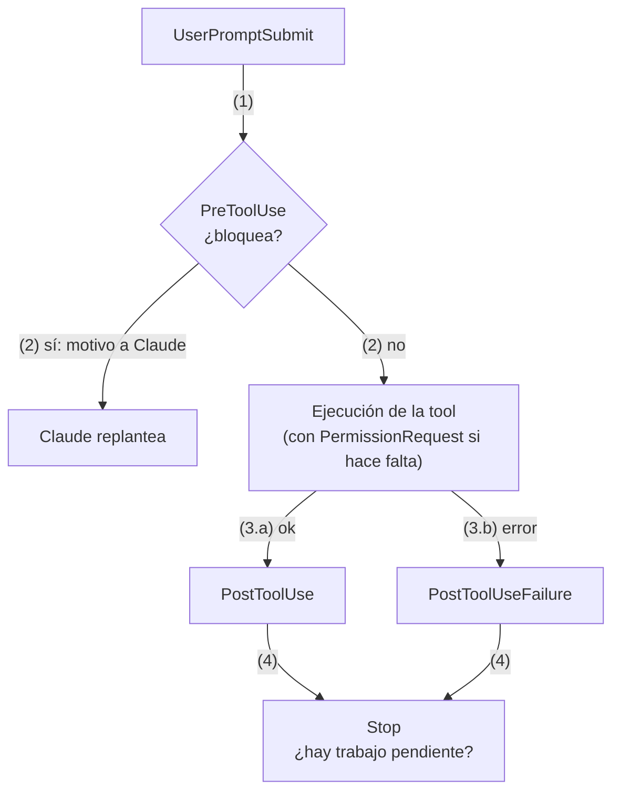

# Hooks aplicados a la IA: control determinista sobre los agentes

**Guía de trabajo para arquitectos empresariales y de soluciones** · 10 de noviembre de 2026

---

## 1. Resumen ejecutivo

**Conclusión:** una instrucción a un agente (CLAUDE.md, prompt, skill) es una petición: el modelo decide si la cumple. Un hook es código que Claude Code ejecuta en un punto fijo del ciclo de vida, decida lo que decida el modelo. Cuando una regla no admite excepciones (formatear, no tocar `.env`, registrar cada comando), debe pasar de instrucción a hook.

- **Qué es:** un comando, una llamada HTTP, una tool MCP, un prompt o un agente que se dispara en un evento (antes de una tool, al terminar una respuesta, al empezar la sesión…). Recibe el evento como JSON y responde con un código de salida y, opcionalmente, JSON.
- **Qué aporta:** garantía de ejecución, capacidad de bloquear acciones antes de que ocurran, inyección de contexto y trazabilidad.
- **Qué exige:** tratar los hooks como código de producción: versionados, revisados, probados y con el mismo cuidado que un script de CI, porque se ejecutan con los privilegios del usuario.
- **Decisión para la organización:** estandarizar un conjunto de hooks por repositorio en `.claude/settings.json` y reservar la configuración gestionada para los obligatorios.

---

## 2. Instrucción, permiso o hook

| Mecanismo | Quién decide | Garantía | Úsalo para |
| --- | --- | --- | --- |
| CLAUDE.md, skills, prompts | El modelo | Ninguna: puede ignorarlo | Convenciones, contexto, procedimientos |
| Reglas de permisos (allow, ask, deny) | Claude Code | Determinista, sobre tool y argumentos | Qué tools y comandos están permitidos |
| Hooks | Tu código | Determinista, con lógica arbitraria | Reglas con lógica propia, efectos colaterales, auditoría |

Los permisos cubren las reglas estáticas («nunca `rm -rf`»). Los hooks cubren lo que necesita lógica: leer el fichero, consultar un servicio, registrar, decidir según contexto. Por eso se combinan, y para un allow o deny duro la documentación recomienda el sistema de permisos antes que un hook con `if`, porque ese filtro es de mejor esfuerzo.

---

## 3. Ciclo de vida y tipos de hook

Claude Code dispara eventos a lo largo de la sesión y ejecuta en paralelo todos los hooks que coinciden con cada uno. Hay unos treinta eventos; el flujo básico es este:



`SessionStart` abre la sesión antes del primer prompt y `SessionEnd` la cierra.

Los eventos que cubren casi todos los casos:

| Evento | Cuándo se dispara | Qué puede hacer el hook |
| --- | --- | --- |
| `PreToolUse` | Antes de ejecutar una tool | Bloquear la llamada o decidir allow, ask o deny |
| `PermissionRequest` | Cuando Claude Code va a pedir un permiso | Responder la petición en nombre del usuario |
| `PostToolUse` | Tras una tool con éxito | Reaccionar (formatear, registrar); no puede deshacer la acción |
| `UserPromptSubmit` | Al enviar un prompt, antes de procesarlo | Bloquearlo o añadir contexto |
| `Stop` | Cuando Claude termina de responder | Impedir que termine y devolverle trabajo pendiente |
| `SessionStart` | Al iniciar o reanudar (`startup`, `resume`, `clear`, `compact`, `fork`) | Añadir contexto; no bloquea |
| `ConfigChange` | Cuando cambia un fichero de configuración | Auditar o bloquear el cambio |
| `Notification` | Cuando Claude espera una entrada o un permiso | Avisar al usuario |

Cada hook tiene un `type` que decide cómo se evalúa:

| Tipo | Qué hace | Cuándo elegirlo |
| --- | --- | --- |
| `command` | Ejecuta un comando o script del sistema | Por defecto: reglas deterministas |
| `http` | Hace POST del evento a una URL y lee la respuesta | Servicio central de auditoría o políticas |
| `mcp_tool` | Llama a una tool de un servidor MCP configurado | Reutilizar una tool ya expuesta |
| `prompt` | Una llamada a un modelo que devuelve `ok` o no | Decisiones que piden juicio con solo el evento |
| `agent` | Un subagente con tools que verifica una condición | Comprobar el estado real del repositorio (experimental) |

---

## 4. Contrato de entrada y salida

**Entrada.** Claude Code envía por stdin un JSON con campos comunes (`session_id`, `cwd`, `hook_event_name`) y los propios del evento. En un `PreToolUse` de Bash llegan `tool_name` y `tool_input.command`:

```json
{ "session_id": "abc123", "cwd": "/repo", "hook_event_name": "PreToolUse",
  "tool_name": "Bash", "tool_input": { "command": "npm test" } }
```

**Salida.** El hook responde con el código de salida y, si hace falta, con JSON por stdout:

| Resultado | Efecto |
| --- | --- |
| Exit 0 | Sin objeción. En `PreToolUse` no aprueba la llamada: sigue el flujo normal de permisos. En `UserPromptSubmit` y `SessionStart`, el stdout se añade al contexto |
| Exit 2 | Bloquea la acción y el stderr se entrega como motivo (a Claude en la mayoría de eventos). En algunos, como `SessionStart`, no bloquea |
| Otro código | Error no bloqueante: la acción continúa |

Para más control, el hook sale con 0 e imprime JSON. Cada hook usa un método o el otro, no ambos. Este `PreToolUse` deniega y explica el motivo a Claude:

```json
{ "hookSpecificOutput": { "hookEventName": "PreToolUse",
    "permissionDecision": "deny",
    "permissionDecisionReason": "Usa rg en lugar de grep" } }
```

Dos detalles que causan fallos silenciosos: `additionalContext` debe ir **dentro** de `hookSpecificOutput`, o se ignora sin avisar; y el stdout tiene que ser JSON puro desde el primer carácter.

**Varios hooks sobre el mismo evento** se ejecutan en paralelo y hasta el final. En `PreToolUse` gana la respuesta más estricta (`deny`, `defer`, `ask`, `allow`), pero un deny no impide que los demás hooks hagan sus efectos, como escribir un log.

**Filtros.** El `matcher` filtra por nombre de tool (`Edit|Write`, `mcp__github__.*`) o, según el evento, por otro campo (`compact` en `SessionStart`, el tipo de notificación…). El campo `if` añade filtro por argumentos (`Bash(git *)`) en eventos de tool.

---

## 5. Dónde se configuran

| Ubicación | Alcance | ¿Se comparte? |
| --- | --- | --- |
| `~/.claude/settings.json` | Todos tus proyectos | No |
| `.claude/settings.json` | Un proyecto | Sí, en el repositorio |
| `.claude/settings.local.json` | Un proyecto, en local | No (gitignored) |
| Política gestionada | Toda la organización | Sí, la controla el administrador |
| Plugin (`hooks/hooks.json`), skill o subagente | Mientras estén activos | Sí, van en el paquete |

`/hooks` lista todos los hooks por evento y es la primera comprobación cuando algo no se dispara. Con `"disableAllHooks": true` se desactivan, pero los de la política gestionada siguen ejecutándose salvo que se desactiven también ahí. Si la organización activa `allowManagedHooksOnly`, solo corren los hooks gestionados y los de usuario, proyecto y local ni se ejecutan.

---

## 6. Casos de uso

**Quality gate tras cada edición.** `PostToolUse` sobre `Edit|Write` formatea el fichero que acaba de tocar Claude:

```json
{ "hooks": { "PostToolUse": [ { "matcher": "Edit|Write",
    "hooks": [ { "type": "command",
      "command": "jq -r '.tool_input.file_path' | xargs npx prettier --write" } ] } ] } }
```

**Guardrail: proteger ficheros.** `PreToolUse` sobre `Edit|Write` apunta a un script que sale con 2 si la ruta coincide con un patrón protegido; Claude recibe el mensaje y ajusta su plan:

```bash
#!/bin/bash
FILE_PATH=$(cat | jq -r '.tool_input.file_path // empty')
for p in ".env" "package-lock.json" ".git/"; do
  if [[ "$FILE_PATH" == *"$p"* ]]; then
    echo "Bloqueado: $FILE_PATH coincide con '$p'" >&2
    exit 2
  fi
done
exit 0
```

El script se registra con `"command": "\"$CLAUDE_PROJECT_DIR\"/.claude/hooks/protect-files.sh"` y debe ser ejecutable (`chmod +x`).

**Contexto que sobrevive a la compactación.** Un `SessionStart` con matcher `compact` reinyecta las normas clave (el stdout se añade al contexto). Para contexto dinámico por prompt, `UserPromptSubmit` con `additionalContext`.

**Auditoría y trazabilidad.** Un `PostToolUse` sobre `Bash` que añade cada comando a un log; `ConfigChange` para registrar cambios de configuración; o un hook `http` que envía cada evento a un servicio central, con la cabecera `Authorization` tomada de una variable de entorno declarada en `allowedEnvVars`:

```json
{ "type": "http", "url": "https://audit.interno/hooks/tool-use",
  "headers": { "Authorization": "Bearer $AUDIT_TOKEN" },
  "allowedEnvVars": ["AUDIT_TOKEN"] }
```

**Verificación antes de parar.** Un `Stop` de tipo `agent` (o `prompt`) comprueba que los tests pasan; si no, devuelve el motivo y Claude sigue trabajando. Si el hook es un script, debe leer `stop_hook_active` y salir con 0 cuando sea `true`, para no encadenar bloqueos.

---

## 7. Los hooks como capa de control de los patrones de agentes

Los hooks son el punto donde varios patrones de la guía «Patrones aplicados al desarrollo de agentes» dejan de ser una recomendación y pasan a ser una regla ejecutable:

| Patrón de la guía | Cómo lo implementa un hook |
| --- | --- |
| Guardrails (3.9) | `PreToolUse` valida los argumentos de cada tool con efectos |
| Human-in-the-loop (3.7) | `PreToolUse` devuelve `ask` para acciones irreversibles (borrar, desplegar, enviar) |
| Bounded autonomy (3.10) | Un hook que cuenta llamadas o tiempo y deniega al superar el límite |
| Lethal trifecta (7.1) | Deniega las tools de salida al exterior (`WebFetch`, `curl`) en repositorios con datos sensibles |
| Tracing distribuido (6.10) | Hook `http` que envía cada evento con su `session_id` a un colector |
| Evals como quality gates (8.1) | `Stop` que ejecuta tests o evals antes de dejar terminar |

---

## 8. Seguridad de los propios hooks

- **Corren con tus privilegios.** Un hook ejecuta comandos con los mismos permisos que Claude Code: solo se configuran los de fuentes de confianza. Los hooks de proyecto viajan con el repositorio, así que se revisan en el PR como cualquier script de CI.
- **Su entrada no es de confianza.** Rutas, comandos y argumentos los genera el modelo, que puede estar influido por contenido externo (prompt injection). Se parsean con `jq`, se entrecomillan las variables, se evita `eval` y se validan rutas.
- **Cobertura incompleta.** Un matcher `Edit|Write` no ve lo que escribe un comando de shell. Para ver todos los cambios se combina con `Bash` y un `Stop` que revisa `git status --porcelain`, o con `FileChanged`.
- **Un deny de `PreToolUse` se aplica también en `bypassPermissions`.** Eso permite imponer políticas que el usuario no desactiva cambiando de modo. Al revés, un hook con `allow` no salta las reglas de deny de los permisos.
- **Falla en abierto salvo que se diga lo contrario.** Un exit distinto de 2, o una respuesta HTTP no 2xx, deja continuar la acción. Los hooks de seguridad bloquean con exit 2 explícito y, en HTTP, con `onFailure: "block"`.
- **No registres secretos.** Los logs de auditoría reciben comandos y rutas completos: se filtran tokens y se define su retención.

---

## 9. Problemas frecuentes

| Síntoma | Causa habitual | Cómo comprobarlo o arreglarlo |
| --- | --- | --- |
| El hook no se dispara | Evento o matcher incorrecto (distingue mayúsculas) | `/hooks`; verificar el nombre exacto de la tool |
| El JSON no surte efecto | El `echo` del perfil del shell llega antes del JSON, o el campo está fuera de `hookSpecificOutput` | `claude --debug`; proteger los `echo` del perfil con `[[ $- == *i* ]]` |
| `Stop` en bucle | El hook bloquea sin mirar `stop_hook_active` | Salir con 0 si es `true`; hay un tope de ocho bloqueos seguidos |
| `command not found` o `jq` | Ruta relativa, sin permiso de ejecución o `jq` ausente | `$CLAUDE_PROJECT_DIR`, `chmod +x`, instalar `jq` |
| Resultado impredecible | Varios hooks reescriben el mismo `updatedInput`: gana el último en terminar | Un solo hook por tool que modifique la entrada |
| Un `PostToolUse` no evitó el daño | La tool ya se había ejecutado | Mover la regla a `PreToolUse` |

Los timeouts por defecto son 10 minutos para `command`, `http` y `mcp_tool`, 30 segundos para `prompt` y 60 para `agent`; `SessionEnd` solo dispone de unos 1,5 segundos. Para probar un hook sin Claude: `echo '{"tool_name":"Bash","tool_input":{"command":"ls"}}' | ./hook.sh; echo $?`. Con `Ctrl+O` se ve el resultado en la transcripción.

---

## 10. Checklist del estándar

- Las reglas sin excepción están en hooks, no en CLAUDE.md.
- Los hooks del proyecto están en `.claude/settings.json`, con scripts en `.claude/hooks/`, ejecutables y revisados por PR.
- Cada hook se ha probado con un JSON de ejemplo antes de registrarlo.
- Los matchers son lo más estrechos posible; no hay `PermissionRequest` con auto-allow genérico.
- Los hooks que protegen bloquean con exit 2 (o `deny`) y un mensaje que Claude pueda usar para corregir.
- Los obligatorios están en la política gestionada y se decide si se activa `allowManagedHooksOnly`.
- Hay cobertura para lo que escribe el shell (`Bash` o `Stop` con `git status`).
- Los logs no contienen secretos y tienen retención definida.

---

## Fuentes

- Claude Code: [Automatizar flujos con hooks](https://code.claude.com/docs/en/hooks-guide) (ejemplos, tipos de hook, límites y problemas frecuentes).
- Claude Code: [Hooks reference](https://code.claude.com/docs/en/hooks) (eventos, esquemas de entrada y salida).
- Claude Code: [Permissions](https://code.claude.com/docs/en/permissions) y [Settings](https://code.claude.com/docs/en/settings-reference).
- Ejemplo de validador de comandos Bash: [bash_command_validator_example.py](https://github.com/anthropics/claude-code/blob/main/examples/hooks/bash_command_validator_example.py).
- «Patrones aplicados al desarrollo de agentes», secciones 3.7, 3.9, 3.10, 6.10, 7.1 y 8.1.
