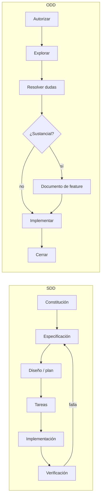
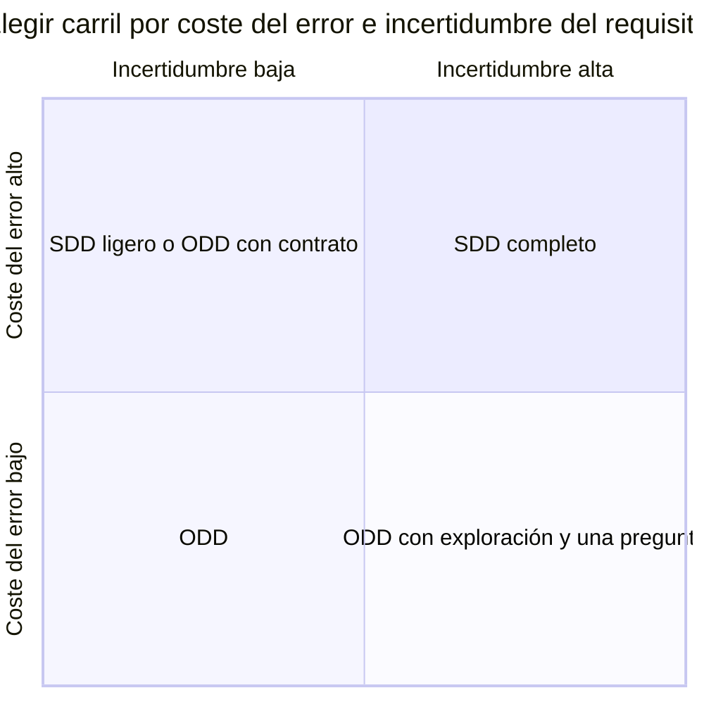
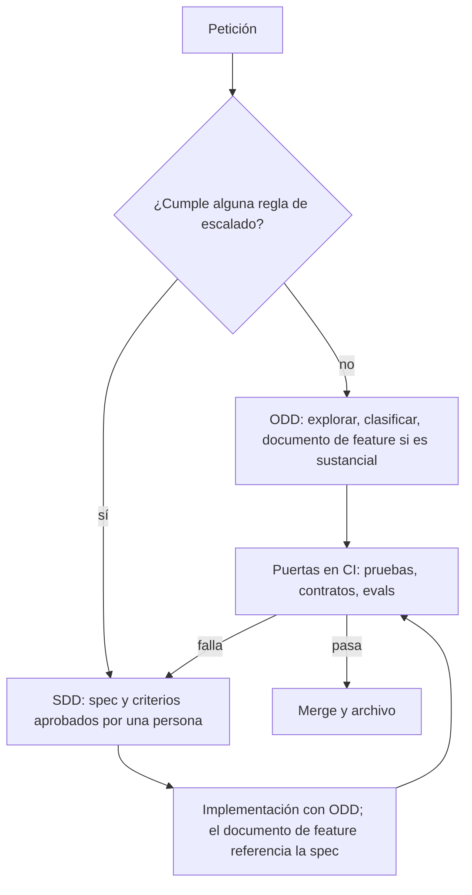

# ODD vs SDD: cómo gobernar el desarrollo con agentes de IA

**Guía para arquitectos empresariales y de soluciones** · 25 de octubre de 2026

---

## 1. Resumen ejecutivo

**Conclusión:** no son alternativas excluyentes. La recomendación para una organización es **ODD como carril por defecto y SDD como carril obligatorio para los cambios que tocan contratos, comportamiento de agentes, seguridad o varios equipos**. El valor arquitectónico está en definir, y automatizar, la regla que decide cuándo un cambio sube de un carril al otro.

- **SDD (Spec-Driven Development)** hace de la especificación el artefacto principal: primero se acuerda *qué* debe hacer el sistema y con qué criterios de aceptación, y el código se deriva de ella. Aporta trazabilidad, revisión temprana y contratos estables, a cambio de más ceremonia y más artefactos.
- **ODD (Organic Driven Development)** es el flujo por defecto de Gentle AI 4.x. El agente explora, clasifica el trabajo y, solo si es sustancial, abre **un único documento de feature** con objetivo, alcance, tareas y criterios de aceptación antes de escribir código. Aporta velocidad y proporcionalidad, a cambio de que el "contrato" vive en un documento operativo y no en una spec estable.
- **Contexto de mercado (octubre de 2026):** Gentle AI retiró SDD en su versión 4.0.0 y dejó ODD como única ruta. SDD sigue vivo como método y en herramientas como GitHub Spec Kit, Kiro y OpenSpec. Para una organización esto significa que **SDD es una decisión de proceso, no de herramienta**.

| Si tu prioridad es… | Usa |
| --- | --- |
| Velocidad en cambios acotados sobre código conocido | ODD |
| Contratos estables entre equipos o con terceros | SDD |
| Auditoría y trazabilidad requisito → código → prueba | SDD |
| Comportamiento de agentes de IA (no determinista) | SDD con evals como criterios de aceptación |
| Mantenimiento y evolución del día a día | ODD |
| Un estándar de organización sostenible | Híbrido con reglas de escalado explícitas |

---

## 2. Terminología y alcance

| Término | Qué es | Origen |
| --- | --- | --- |
| SDD | Método: la especificación es la fuente de verdad y el código se deriva de ella | Práctica de la industria; herramientas como Spec Kit, Kiro, OpenSpec |
| ODD | Flujo operativo de Gentle AI: explorar, clasificar, documentar solo lo sustancial e implementar tarea a tarea | Término propio de Gentle AI (no es un estándar de la industria) |
| Spec | Documento estable que describe el comportamiento observable y los criterios de aceptación | SDD |
| Documento de feature | Fichero único `odd/tasks/<feature>.md` con objetivo, alcance, tareas con IDs y criterios, evidencia y progreso | ODD |
| Constitución / instrucciones globales | Reglas no negociables que aplican a todo cambio | Ambos (`constitution.md` en Spec Kit; `CLAUDE.md` global en Gentle AI) |
| Engram | Memoria persistente vía MCP que replica el documento de feature | Gentle AI |
| RDD | Revisión independiente basada en riesgo, activada por el usuario | Gentle AI |

**Alcance de esta guía.** Compara los dos enfoques como modelos de gobierno del trabajo de agentes de código. Las referencias a herramientas reflejan la documentación pública a 25 de octubre de 2026; Gentle AI evoluciona rápido y su propia documentación no siempre está alineada con sus notas de versión, así que valida las versiones antes de estandarizar.

---

## 3. Cómo funciona cada enfoque

### 3.1 SDD: la spec como contrato

El trabajo avanza por fases con un artefacto por fase y un punto de aprobación humana al menos sobre la especificación:

1. **Constitución:** principios no negociables (stack, seguridad, testing, convenciones).
2. **Especificación:** el *qué* y el *porqué*, sin decisiones técnicas. Requisitos con criterios de aceptación verificables.
3. **Diseño o plan:** el *cómo*: arquitectura, librerías, datos, infraestructura, anclado a la constitución.
4. **Tareas:** desglose ejecutable por un agente, trazable a requisitos.
5. **Implementación:** el agente ejecuta tarea a tarea.
6. **Verificación y archivo:** se comprueba contra la spec y se consolida el cambio en la spec principal.

Las herramientas difieren en el detalle, no en el principio:

| Herramienta | Artefactos | Rasgo distintivo |
| --- | --- | --- |
| GitHub Spec Kit | `constitution.md`, spec, plan, tasks en `specs/`; plantillas y scripts en `.specify/` | Separa estrictamente *qué* (`/specify`) de *cómo* (`/plan`); la constitución codifica estándares de la organización |
| Kiro | `requirements.md` (notación EARS), `design.md`, `tasks.md` en `.kiro/specs/` | Requisitos en lenguaje controlado (EARS) que reduce ambigüedad |
| OpenSpec | Por cambio: `proposal.md`, `specs/`, `design.md`, `tasks.md`; los cambios terminados se archivan | Specs como *deltas* sobre lo existente; pensado para brownfield |

### 3.2 ODD: proporcionalidad y un único documento

ODD se ejecuta en cada petición, sin que haya que pedirlo. Las peticiones de explicación, investigación o propuesta se quedan en solo lectura. Sus siete pasos:

1. **Autorizar:** determina si la petición autoriza cambios.
2. **Explorar:** examina el código y los requisitos existentes, en proporción a la petición.
3. **Resolver incertidumbre:** investigación opcional para una duda concreta; como mucho una pregunta sobre una decisión real de producto y un único cuestionamiento de una premisa de alto impacto.
4. **Clasificar:** el trabajo es *sustancial* si la exploración arroja dos o más pasos de implementación significativos o progreso que merezca recuperarse. Lo pequeño se queda pequeño.
5. **Registrar antes de escribir:** para trabajo sustancial, crea `odd/tasks/<feature>.md` y su réplica en Engram **antes** de tocar código.
6. **Implementar tarea a tarea:** con la topología mínima útil, el modo TDD configurado y las comprobaciones aplicables. Una casilla solo se marca con evidencia observada; cada tarea cierra con al menos un commit (Conventional Commits) en una rama de feature, nunca en la rama principal.
7. **Cerrar:** informa del resultado verificado, de cada comprobación fallida o pendiente y del siguiente paso.

El documento de feature contiene objetivo, problema y porqué; alcance y restricciones; checklist con IDs estables y criterios de aceptación; evidencia de verificación, progreso y siguiente paso. Desde Gentle AI 4.1, es la especificación literal que leen los subagentes.

Mecanismos de control alrededor de ODD:

- **Tamaño de entrega:** previsión de líneas cambiadas y corte en porciones revisables de unas 400 líneas, con cuatro estrategias (`ask-on-risk` por defecto, `auto-chain`, `single-pr`, `exception-ok`).
- **TDD:** activado o no según la configuración del proyecto o la elección explícita del usuario; con TDD, ciclo observado RED → GREEN → REFACTOR.
- **RDD (opcional):** tras cada commit evalúa el riesgo; riesgo alto o evaluación fallida dispara revisión inmediata, riesgo medio la difiere al cierre de la porción.
- **Reanudación:** antes de continuar, el orquestador reconcilia documento, réplica en Engram y código; las versiones en conflicto se preservan, no se sobrescriben.

---

## 4. Comparativa detallada

| Dimensión | SDD | ODD |
| --- | --- | --- |
| Unidad de gobierno | La especificación (estable, versionada) | El documento de feature (operativo, por trabajo) |
| Cuándo se formaliza | Siempre, antes de diseñar | Solo si el trabajo se clasifica como sustancial |
| Separación qué / cómo | Explícita, en artefactos distintos | En el mismo documento |
| Punto de aprobación humana | Spec (y a menudo plan) antes de implementar | Autorización inicial y una pregunta como máximo; revisión en commits y PR |
| Trazabilidad | Requisito → diseño → tarea → prueba, por diseño | Tarea con ID → commit → evidencia; los requisitos viven en el documento de feature |
| Vida del artefacto | Larga: la spec evoluciona con el sistema | Corta: el documento acompaña a la feature hasta su cierre |
| Coste de entrada | Alto: varios artefactos y revisiones | Bajo: proporcional al tamaño real del cambio |
| Consumo de contexto del agente | Mayor por fase, pero cada fase carga solo lo suyo | Menor por cambio; las instrucciones globales del orquestador pesan en cada sesión |
| Cambios de requisitos a mitad | Se cambia la spec y se regeneran plan y tareas | Se edita el documento de feature y se replanifica |
| Brownfield | Requiere especificar lo existente (OpenSpec mitiga con deltas) | Natural: explora antes de actuar |
| Auditoría y cumplimiento | Fuerte: artefactos estables y revisables | Media: evidencia por tarea y commits, sin spec de producto estable |
| Coordinación entre equipos | Fuerte: la spec es el contrato | Débil si no hay un contrato externo al documento de feature |
| Riesgo dominante | Burocracia y spec desactualizada | Deriva de diseño y decisiones implícitas |
| Encaje con agentes de IA | Muy bueno: los criterios se convierten en evals | Bueno para el código; insuficiente para fijar el comportamiento de un agente |

---

## 5. Lente de arquitectura empresarial

**Gobierno y estándares.** Ambos enfoques tienen un punto donde se inyectan los estándares de la organización: la constitución en SDD y las instrucciones globales del orquestador en ODD. Trátalo como un activo de arquitectura gestionado: versionado, con dueño y con ciclo de revisión. Es el equivalente operativo de tus principios de arquitectura.

**Dónde viven las decisiones.** En SDD, las decisiones de producto están en la spec y las técnicas en el plan. En ODD, ambas conviven en el documento de feature, que se cierra con la feature. Si tu organización necesita un registro duradero de decisiones, exige que las decisiones con impacto más allá de la feature se eleven a un ADR, independientemente del carril.

**Gestión del conocimiento.** ODD replica el documento en Engram, una memoria fuera del repositorio. Desde la óptica empresarial, decide qué es fuente de verdad: el repositorio debe serlo siempre para lo que se audita; la memoria del agente es una caché operativa. Define retención, acceso y qué datos pueden acabar en ella.

**Cumplimiento y auditoría.** Donde haya obligaciones de trazabilidad (sector regulado, sistemas de IA con requisitos de documentación, contratos con terceros), el carril SDD debe ser obligatorio: la cadena requisito → criterio → prueba → evidencia es lo que se audita, y ODD no la garantiza por sí solo.

**Dependencia de proveedor y estabilidad del método.** Gentle AI cambió de SDD a ODD como ruta única entre versiones mayores. La lección arquitectónica: **ancla el método en artefactos del repositorio, no en la herramienta**. Plantillas de spec, criterios de aceptación y suites de evaluación propias sobreviven a cualquier cambio de herramienta.

**Portfolio y métricas.** Con dos carriles, puedes medir qué proporción del cambio pasa por cada uno y correlacionarla con incidentes y retrabajo. Es la base para ajustar las reglas de escalado con datos.

---

## 6. Lente de arquitectura de soluciones

**Requisitos no funcionales.** SDD los fuerza a la superficie: latencia, coste, seguridad y límites de autonomía aparecen en la spec con umbrales. En ODD dependen de que la exploración los descubra; por eso conviene listarlos en las instrucciones globales o en una plantilla de documento de feature.

**Contratos e integraciones.** Cualquier interfaz pública (API, eventos, esquemas de datos, herramientas que expone un agente) debe tener un contrato fuera del documento de feature: OpenAPI, AsyncAPI, JSON Schema o la spec del agente. En ODD, el documento de feature puede *referenciar* el contrato, nunca sustituirlo.

**Estrategia de pruebas.** En SDD, los criterios de aceptación son la base de las pruebas de aceptación; en sistemas con IA, de las evals. En ODD, las pruebas acompañan a cada tarea (TDD si está activo) y la evidencia se registra por casilla. La combinación recomendada: pruebas por tarea en ODD y pruebas de contrato o evals como puerta antes de cerrar cualquier cambio que toque un contrato.

**Diseño incremental y deriva.** ODD favorece el diseño emergente: bien para evolución local, arriesgado para decisiones transversales (modelo de datos, límites de servicios, seguridad). Define qué decisiones exigen ADR o paso a SDD.

**Agentes de IA como solución.** Si la solución *es* un agente, su comportamiento es no determinista y depende de prompts, herramientas y modelo. Aquí SDD es la opción correcta: la spec fija objetivo, herramientas, límites de autonomía y criterios medibles; los criterios se ejecutan como evals sobre varias ejecuciones. ODD puede gestionar el trabajo de implementación, pero la spec del agente debe existir fuera del documento de feature.

---

## 7. Riesgos y mitigaciones

| Riesgo | Enfoque | Mitigación |
| --- | --- | --- |
| Burocracia: specs para cambios triviales | SDD | Reglas de escalado claras; cambios menores por ODD |
| Spec desactualizada respecto al código | SDD | Ningún cambio de comportamiento sin tocar la spec; revisión en PR |
| Deriva de diseño por decisiones locales | ODD | ADR obligatorio para decisiones transversales |
| Contrato implícito en un documento efímero | ODD | Contratos externos (OpenAPI, spec de agente) referenciados desde el documento de feature |
| Verificación tratada como opcional | Ambos | Hacer de pruebas de contrato y evals una puerta en CI, no un diagnóstico |
| Memoria del agente como fuente de verdad | ODD | El repositorio es la fuente de verdad; la memoria es caché |
| Dependencia del flujo de una herramienta | Ambos | Plantillas y criterios propios en el repo; la herramienta solo orquesta |
| Coste de contexto de las instrucciones globales | ODD | Medirlo y usar orquestación modular cuando esté disponible |

---

## 8. Marco de decisión

Dos variables explican casi todas las decisiones: **cuánto cuesta equivocarse** (impacto, alcance, reversibilidad) y **cuánta incertidumbre hay sobre el requisito**.

**Reglas de escalado de ODD a SDD** (cualquiera basta):

1. El cambio crea o modifica un contrato público: API, evento, esquema de datos, herramienta expuesta.
2. El cambio altera el comportamiento de un agente de IA: prompt, herramientas, modelo, límites de autonomía.
3. Afecta a seguridad, privacidad, datos personales o cumplimiento.
4. Implica a más de un equipo o a un tercero.
5. No es fácilmente reversible: migraciones de datos, cambios de infraestructura compartida.
6. La clasificación de ODD lo considera sustancial **y** hay incertidumbre de producto que una sola pregunta no resuelve.

**Reglas de bajada de SDD a ODD:** corrección de errores sin cambio de contrato, refactorizaciones internas con cobertura de pruebas, cambios de configuración reversibles y mejoras locales dentro de un contrato ya especificado.

---

## 9. Modelo híbrido recomendado

Cómo implementarlo con Gentle AI 4.x, que ya no incluye fases SDD:

1. **Instrucciones globales del proyecto** (`CLAUDE.md` del repo): enumeran las reglas de escalado y exigen que, si se cumple alguna, exista `specs/<componente>/spec.md` aprobada antes del primer commit.
2. **Plantillas en el repositorio:** spec (qué, criterios con umbral, límites), ADR y plantilla de documento de feature con un campo obligatorio "Spec de referencia".
3. **El documento de feature referencia la spec.** ODD sigue gobernando la ejecución (tareas, commits, evidencia); la spec gobierna el *qué*.
4. **Puertas automáticas:** pruebas de contrato y evals en CI. Si fallan, el cambio vuelve a la spec, no al código.
5. **ADR para decisiones transversales**, en ambos carriles.
6. **RDD activado** para los cambios que cumplen reglas 3 y 5.

---

## 10. Hoja de ruta de adopción

| Fase | Objetivo | Entregables | Criterio de salida |
| --- | --- | --- | --- |
| 1. Piloto (4–6 semanas) | Validar ambos carriles en 1–2 equipos | Reglas de escalado v0, plantillas, puertas en CI | Los equipos clasifican sin ambigüedad la mayoría de cambios |
| 2. Estandarizar | Convertir el piloto en estándar | Instrucciones globales gestionadas, catálogo de plantillas, guía de ADR | Estándar aprobado por el comité de arquitectura |
| 3. Escalar | Extender a todos los equipos | Formación, métricas en cuadro de mando | Métricas estables durante dos trimestres |
| 4. Optimizar | Ajustar reglas con datos | Revisión trimestral de reglas y plantillas | Mejora sostenida en retrabajo e incidentes |

---

## 11. Métricas

| Métrica | Qué indica | Cómo se obtiene |
| --- | --- | --- |
| % de cambios por carril | Si las reglas de escalado están bien calibradas | Etiqueta en PR o presencia de spec |
| Tiempo de ciclo por carril | Coste real de la ceremonia SDD | Del primer commit al merge |
| Tasa de fallo en cambios | Calidad de lo que llega a producción | Incidentes y reversiones por cambio |
| Retrabajo por requisito mal entendido | Si ODD necesita más SDD | PR reabiertas o follow-ups con causa "requisito" |
| Specs desactualizadas | Salud del carril SDD | Cambios de comportamiento sin cambio de spec |
| Cobertura de criterios | Trazabilidad efectiva | Criterios de aceptación con prueba o eval asociada |
| Coste de contexto por sesión | Eficiencia de las instrucciones globales | Tokens de instrucciones cargadas por sesión |

---

## 12. Antipatrones

- **SDD para todo:** specs de una línea para cambios triviales. Destruye la credibilidad del carril.
- **ODD para contratos:** una API pública definida dentro de un documento de feature que se cierra con la feature.
- **Verificación decorativa:** informes de verificación que no bloquean nada.
- **Memoria como fuente de verdad:** decisiones que solo existen en la memoria del agente.
- **Estandarizar la herramienta, no el método:** quedar atado a fases que el proveedor puede retirar en la siguiente versión mayor.
- **Reglas de escalado implícitas:** cada equipo decide a su manera cuándo especificar.

---

## 13. Checklist para arquitectos

- [ ] Reglas de escalado ODD → SDD escritas, publicadas y automatizables
- [ ] Plantillas de spec, ADR y documento de feature en un repositorio compartido
- [ ] Instrucciones globales del orquestador versionadas, con dueño y revisión periódica
- [ ] Contratos públicos definidos fuera de los documentos de feature
- [ ] Pruebas de contrato y evals como puerta en CI
- [ ] Política sobre memoria de agentes: qué se guarda, retención y acceso
- [ ] Repositorio definido como fuente de verdad auditada
- [ ] Métricas por carril en un cuadro de mando
- [ ] Revisión trimestral de reglas y plantillas

---

## Fuentes

- [Gentle AI: uso y flujo ODD](https://github.com/Gentleman-Programming/gentle-ai/blob/main/docs/usage.md)
- [Gentle AI v4.0.0: SDD retirado, ODD como ruta única](https://github.com/Gentleman-Programming/gentle-ai/releases/tag/v4.0.0)
- [Gentle AI v4.1.0](https://newreleases.io/project/github/Gentleman-Programming/gentle-ai/release/v4.1.0) · [v4.2.0](https://newreleases.io/project/github/Gentleman-Programming/gentle-ai/release/v4.2.0)
- [Microsoft: Spec-driven development con Spec Kit](https://developer.microsoft.com/blog/spec-driven-development-spec-kit/)
- [Kiro: spec-driven development](https://www.verdent.ai/guides/agents/kiro-spec-driven-development)
- [OpenSpec](https://agentic-ai.readthedocs.io/en/latest/Standards/openspec/)
