# Patrones aplicados al desarrollo de agentes

Guía para arquitectos empresariales y de soluciones · Comportamiento, coordinación, concurrencia, sistemas distribuidos, seguridad y operación · Octubre 2026

---

## 1. Resumen

**Conclusión:** un agente es un sistema distribuido con un componente no determinista en el centro. Los patrones clásicos (retry, idempotency, saga, circuit breaker, lease, outbox…) siguen valiendo, y además hacen falta patrones propios del LLM para organizar el razonamiento, coordinar agentes y contener la prompt injection. La regla que más se repite en la literatura es **empezar por lo más simple que funcione**: una llamada, después un workflow, después un agente y solo al final varios agentes.

La guía organiza el catálogo en seis familias:

| Familia | Pregunta que responde | Patrones |
| --- | --- | --- |
| Comportamiento | ¿Cómo razona y actúa un agente? | Augmented LLM, ReAct, Plan-and-Execute, Evaluator-Optimizer, Prompt chaining, Routing, Human-in-the-loop, Memoria por capas, Guardrails, Bounded autonomy |
| Coordinación | ¿Cómo se reparten el trabajo varios agentes? | Orchestrator-workers, Jerárquico, Handoff, Group chat, Blackboard, Pipeline |
| Concurrencia | ¿Qué pasa cuando trabajan a la vez? | Fan-out/fan-in, Map-reduce, Voting, Aislamiento del workspace, Lease con fencing token, Control optimista, Backpressure, Ejecución especulativa |
| Sistemas distribuidos | ¿Cómo sobrevive a fallos parciales? | Durable execution, Idempotency key, Saga, Outbox, Coreografía por eventos, Retry con backoff, Circuit breaker, Bulkhead, MCP y A2A, Tracing distribuido |
| Seguridad | ¿Cómo se contiene la prompt injection? | Lethal trifecta, Dual LLM, Plan-then-execute, Action-selector, Context minimization |
| Operación | ¿Cómo se pone en producción con confianza? | Evals como quality gates, Shadow mode, Canary con kill switch |

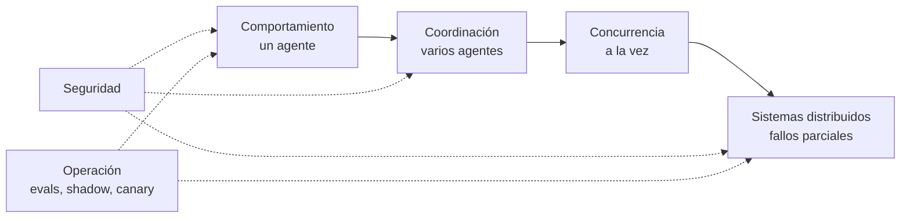

---

## 2. Cómo leer el catálogo

Cada patrón sigue la misma ficha:

- **Qué es:** una o dos frases.
- **Cuándo aplicarlo** y **cuándo no:** las señales que lo justifican y las que indican que sobra.
- **Detalle:** componentes, decisiones de diseño y riesgos.
- **Diagrama:** el flujo o la secuencia del patrón.

### 2.1 La escalera de complejidad

Cada peldaño añade coste, latencia y modos de fallo. Solo se sube cuando el peldaño anterior no alcanza el AC, y la eval lo demuestra.

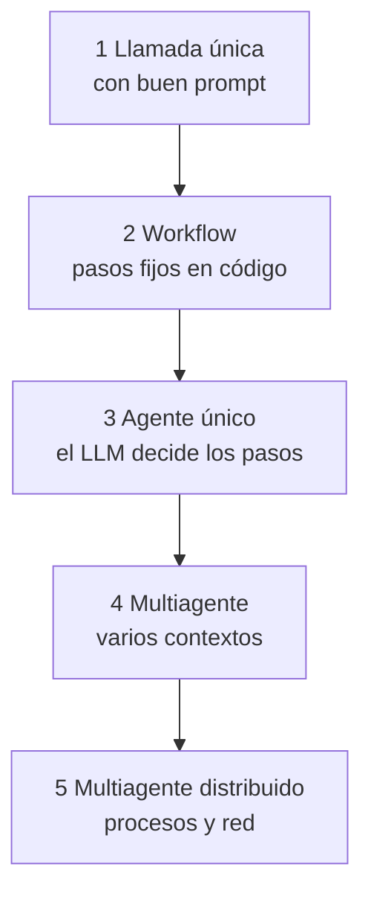

| Peldaño | Quién decide el siguiente paso | Coste relativo | Cuándo subir |
| --- | --- | --- | --- |
| Llamada única | Nadie, es un paso | 1x | El prompt no basta aunque se mejore |
| Workflow | El código | Bajo | Los pasos no se pueden fijar de antemano |
| Agente único | El LLM, en un solo contexto | Medio | El contexto no cabe o hay subtareas independientes |
| Multiagente | Un orquestador o los propios agentes | Alto (Anthropic mide unas 15 veces los tokens de un chat en su sistema de research) | El valor de la tarea paga ese coste |
| Distribuido | Agentes en procesos o equipos distintos | Alto, más la operación | Escala, propiedad entre equipos o aislamiento |

**Workflow frente a agente.** En un workflow el código fija el recorrido y el LLM ejecuta cada paso. En un agente el LLM decide el recorrido. Los workflows son más predecibles y baratos. Los agentes son más flexibles, pero exigen guardrails, presupuesto y evals más exigentes.

---

## 3. Patrones de comportamiento

### 3.1 Augmented LLM

**Qué es.** El bloque base de cualquier agente: un LLM con acceso a tools, retrieval y memoria, que decide cuándo usarlos.

**Cuándo aplicarlo.** Siempre. Es el punto de partida de los demás patrones.

**Cuándo no.** Si la tarea se resuelve solo con el conocimiento del modelo, sin datos ni acciones externas.

**Detalle.**

- Cada tool necesita nombre, descripción y esquema de parámetros claros. El LLM elige por la descripción, así que se diseña con el mismo cuidado que una API pública (Anthropic lo llama agent-computer interface).
- Es preferible tener pocas tools bien delimitadas a muchas que se solapan.
- MCP estandariza cómo se exponen las tools y los datos (sección 6.9).

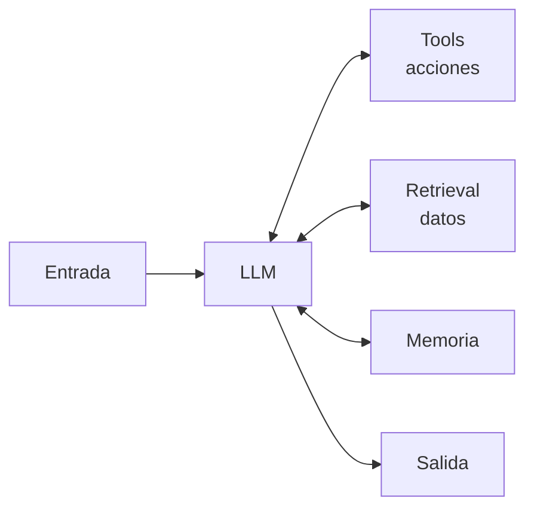

### 3.2 ReAct (Reason + Act)

**Qué es.** Un bucle en el que el modelo razona, ejecuta una acción con una tool, observa el resultado y vuelve a razonar hasta tener la respuesta.

**Cuándo aplicarlo.** Cuando los pasos dependen de lo que se va descubriendo: búsqueda, diagnóstico, navegación por un repositorio.

**Cuándo no.** Si los pasos se conocen de antemano (usa un workflow), o si cada iteración es cara y el número de iteraciones no tiene límite.

**Detalle.**

- Es el bucle por defecto de los agentes actuales: tool use nativo dentro del ciclo de mensajes.
- Cada observación entra en el contexto. Recorta la salida de las tools (paginar, resumir, devolver solo los campos necesarios).
- **Riesgo principal: el bucle infinito.** El modelo decide cuándo parar, y nada garantiza que lo haga. Las causas habituales son:

| Causa | Cómo se ve | Control |
| --- | --- | --- |
| Error de tool que se repite | Misma llamada, mismo error, una y otra vez | Errores descriptivos que digan qué cambiar. Tras 2 errores iguales, no repetir esa llamada |
| Repetición exacta | Misma tool con los mismos parámetros | Hash de (tool, parámetros) por ejecución. Si se repite, se devuelve el resultado anterior con un aviso o se corta |
| Oscilación | Alterna entre dos acciones (A, B, A, B) | Ventana de las últimas N llamadas. Un ciclo detectado fuerza la parada o la replanificación |
| Sin progreso | Llamadas distintas que no aportan información nueva | Contador de pasos sin progreso (sin hechos nuevos ni avance en el plan). Al llegar a 3, se para |
| Objetivo ambiguo o imposible | Sigue buscando algo que no existe | Condición de terminación explícita en el prompt y la opción de responder "no encontrado" |
| Ausencia de salida | El modelo no sabe cómo terminar | Tool `final_answer` (o salida estructurada) como única forma de terminar |

- **Los controles van en el código del bucle, no en el prompt.** Antes de cada iteración, el orquestador comprueba en código el presupuesto (pasos, tokens, tiempo, coste) y los detectores de bucle. El prompt puede pedir al modelo que no repita, pero no lo garantiza.
- **Al cortar, se termina de forma controlada:** se pide al modelo una última respuesta sin tools, con lo que tenga y lo que falta. Si eso tampoco funciona, se escala a una persona (Bounded autonomy, 3.10).
- **Eval obligatoria:** un caso con una tool que siempre falla y otro con un objetivo imposible. El AC exige que el agente termine dentro del presupuesto con una respuesta parcial explicada.

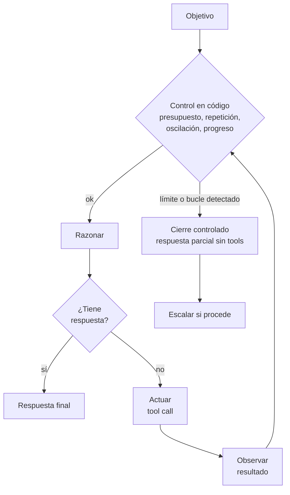

Pseudocódigo del bucle con los controles:

```python
seen, history, no_progress = set(), [], 0
for step in range(MAX_STEPS):                      # presupuesto de pasos
    if over_budget(tokens, elapsed, cost):         # tokens, tiempo, coste
        break
    msg = llm(context, tools=TOOLS + [final_answer])
    if msg.tool == "final_answer":
        return msg.args
    key = hash((msg.tool, canonical(msg.args)))
    if key in seen or is_cycle(history, key):      # repetición u oscilación
        context.append(note("Llamada repetida: cambia de estrategia o termina"))
        no_progress += 1
    else:
        seen.add(key); history.append(key)
        result = run_tool(msg)                     # con timeout y errores descriptivos
        no_progress = 0 if adds_new_info(result) else no_progress + 1
        context.append(result)
    if no_progress >= 3:
        break
return forced_final_answer(context)                # sin tools: lo que hay y lo que falta
```

### 3.3 Plan-and-Execute

**Qué es.** Un planner genera un plan explícito de pasos, un executor los ejecuta uno a uno y un replanner revisa el plan con los resultados.

**Cuándo aplicarlo.** En tareas largas, con muchos pasos, donde conviene que el plan sea visible y auditable, y donde se puede usar un modelo potente para planificar y otro más barato para ejecutar.

**Cuándo no.** Si el entorno cambia tanto que el plan queda obsoleto en cada paso (ReAct es más natural), o si la tarea tiene dos o tres pasos.

**Detalle.**

- El plan es un artefacto: se guarda, se muestra al usuario y se puede aprobar (Human-in-the-loop).
- Es la base del patrón de seguridad Plan-then-execute (7.3) y se parece a cómo trabaja ODD: tareas antes del primer write.
- Limita el número de replanificaciones.

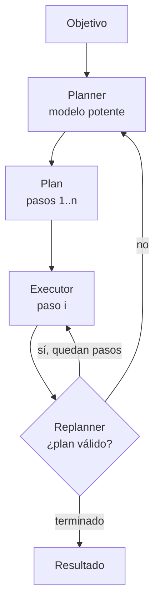

### 3.4 Evaluator-Optimizer (Reflection)

**Qué es.** Un generador produce un candidato y un evaluador lo critica contra una rúbrica. El generador corrige con esa crítica hasta cumplir el criterio o agotar los intentos.

**Cuándo aplicarlo.** Cuando hay un criterio de calidad claro y la crítica mejora el resultado: traducción, redacción, código con tests, consultas SQL.

**Cuándo no.** Si el evaluador no sabe distinguir bien de mal (solo añade coste), o si la latencia es crítica.

**Detalle.**

- El evaluador es más fiable si usa señales objetivas (tests, validación de esquema, compilación) que si solo opina otro LLM.
- Si el evaluador es un LLM, conviene un modelo distinto, con rúbrica y temperatura 0, igual que el juez de las evals.
- Máximo de iteraciones fijo (2 o 3 suele bastar).

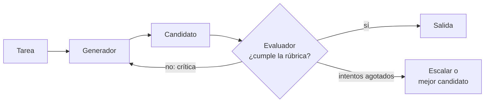

### 3.5 Prompt chaining con gates

**Qué es.** La tarea se divide en pasos fijos, cada uno con su prompt. Entre pasos hay gates: comprobaciones en código que deciden si se continúa.

**Cuándo aplicarlo.** Cuando la tarea se descompone limpiamente en pasos conocidos (extraer, validar, redactar, traducir) y se quiere cambiar latencia por precisión.

**Cuándo no.** Si los pasos dependen del contenido de forma imprevisible.

**Detalle.**

- Cada paso tiene un contrato de entrada y salida (JSON Schema o tipos). El gate valida el contrato.
- Cada paso se puede probar y evaluar por separado.
- Un gate fallido corta pronto y barato.

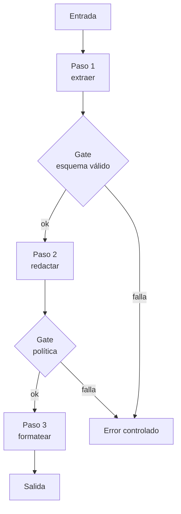

### 3.6 Routing

**Qué es.** Un clasificador (un LLM barato, un modelo clásico o reglas) dirige cada entrada al flujo, prompt o modelo especializado que le corresponde.

**Cuándo aplicarlo.** Con entradas de categorías distintas que se tratan mejor por separado, o para mandar lo fácil a un modelo barato (o local) y lo difícil a uno potente.

**Cuándo no.** Si las categorías no son separables o el router se equivoca más de lo que ahorra.

**Detalle.**

- La precisión del router se mide con su propia eval (matriz de confusión).
- Prevé siempre una ruta por defecto y otra a revisión humana para lo ambiguo.
- Es una forma muy eficaz de ahorrar coste: por ejemplo, Ollama local para lo rutinario y un modelo en la nube para lo complejo.

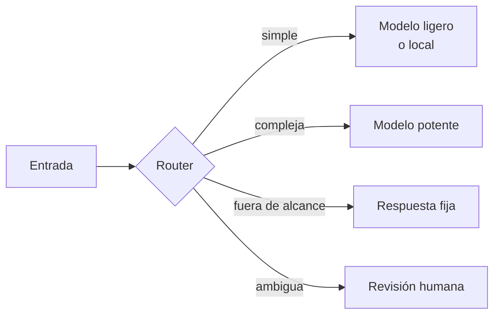

### 3.7 Human-in-the-loop

**Qué es.** El agente se detiene antes de una acción de riesgo, guarda su estado y espera a que una persona apruebe, edite o rechace. Después reanuda desde ese punto.

**Cuándo aplicarlo.** En acciones irreversibles o caras (pagos, borrados, envíos externos, cambios en producción) y cuando el nivel de riesgo de la spec lo exige.

**Cuándo no.** En acciones de solo lectura o fácilmente reversibles: interrumpir de más entrena a las personas a aprobar sin leer.

**Detalle.**

- Requiere estado persistente (Durable execution, 6.1): la aprobación puede tardar horas.
- La petición de aprobación muestra la acción exacta, sus parámetros y por qué el agente la propone.
- Se define qué ocurre si nadie responde (timeout, que por defecto rechaza).

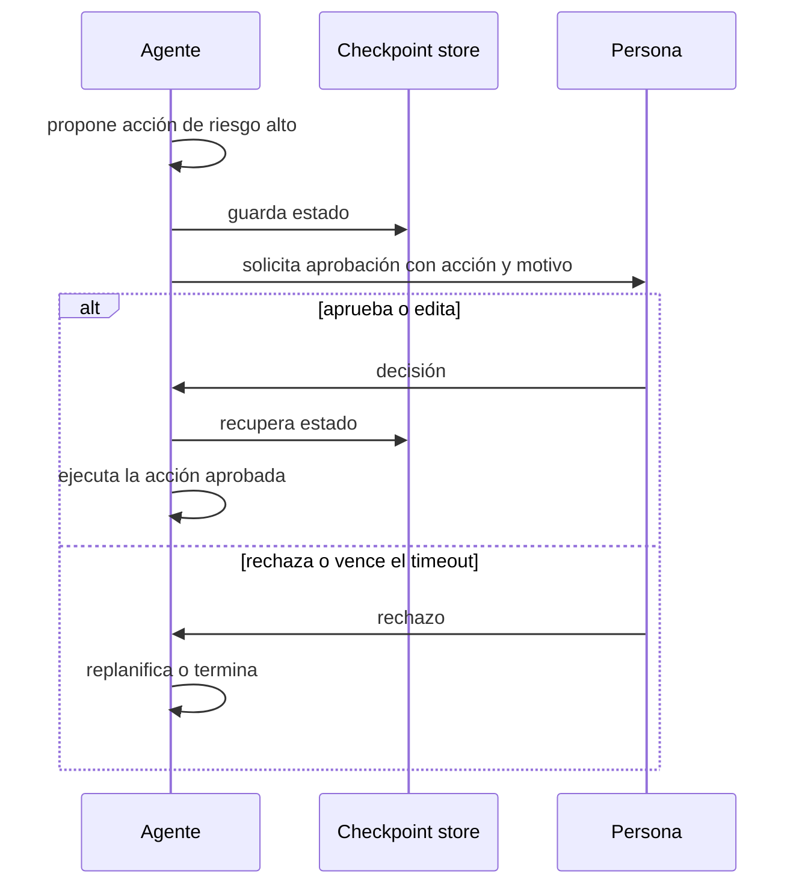

### 3.8 Memoria por capas (context engineering)

**Qué es.** Gestionar qué entra en la ventana de contexto en cada momento. Se combinan memoria de trabajo (el contexto), compaction, notas externas, memoria de largo plazo y subagentes con contexto limpio.

**Cuándo aplicarlo.** En cualquier agente que trabaje más de unos pocos turnos o maneje documentos grandes.

**Cuándo no.** En tareas de un solo turno.

**Detalle.**

- **Compaction:** resumir el historial cuando se acerca al límite y seguir con el resumen.
- **Notas externas:** el agente escribe su progreso en ficheros o en una memoria (Engram) y lo relee cuando lo necesita, en lugar de llevarlo siempre en el contexto.
- **Retrieval just-in-time:** guardar referencias (rutas, IDs) y cargar el contenido solo cuando hace falta.
- **Subagentes:** una subtarea se resuelve en un contexto limpio y devuelve un resumen corto.
- El contexto es un recurso escaso: cuanto más se llena, peor recuerda el modelo lo que hay dentro.

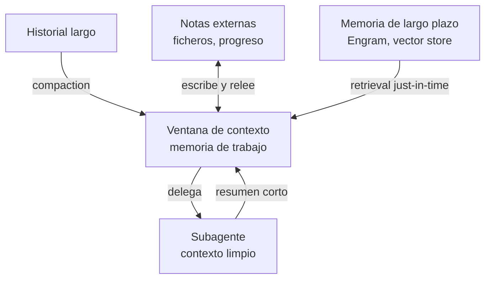

### 3.9 Guardrails

**Qué es.** Controles deterministas o con modelos clasificadores alrededor del agente: en la entrada, en cada tool call y en la salida.

**Cuándo aplicarlo.** Siempre que el agente reciba entradas de terceros o pueda actuar fuera de su proceso.

**Cuándo no.** No se omiten. Lo que varía es cuántos y de qué tipo, según el riesgo.

**Detalle.**

- **Entrada:** alcance permitido, detección de PII y de intentos de injection.
- **Tool call:** allowlist de tools, validación de parámetros, límites (importes, destinatarios, rutas).
- **Salida:** formato, política de contenido y fuga de datos.
- Los guardrails en código son los más fiables. Un guardrail basado en LLM reduce el riesgo, pero no lo elimina: la seguridad de verdad está en los patrones de la sección 7.

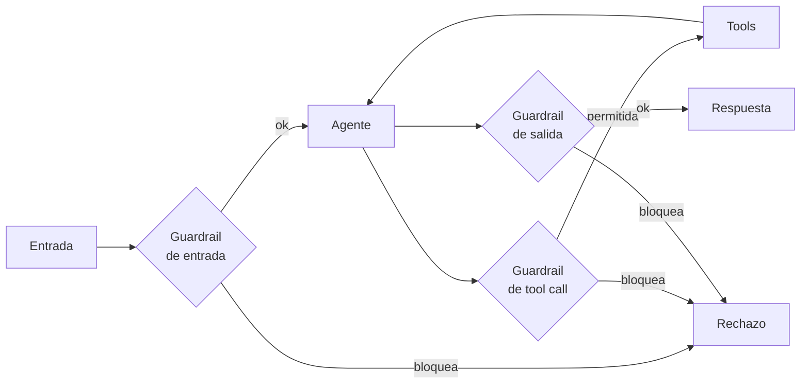

### 3.10 Bounded autonomy (presupuesto y condición de parada)

**Qué es.** Todo agente se ejecuta con límites explícitos de pasos, tokens, tiempo y coste, y con condiciones de parada claras: éxito, fallo o escalado.

**Cuándo aplicarlo.** En todos los agentes con bucle.

**Cuándo no.** No hay excepción.

**Detalle.**

- Los límites se fijan en los requisitos no funcionales de la spec (por ejemplo, máximo 8 tool calls y p95 inferior a 30 s) y se verifican con un AC.
- Al agotar el presupuesto, el agente entrega el mejor resultado parcial y explica qué falta, en lugar de fallar en silencio.
- Detecta bucles en código: repetición, oscilación y pasos sin progreso (detalle y pseudocódigo en 3.2).

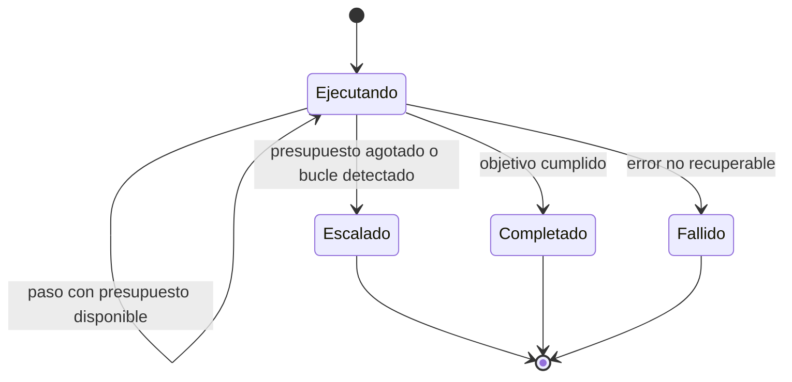

---

## 4. Patrones de coordinación entre agentes

**Antes de elegir uno:** un sistema multiagente solo compensa si las subtareas son de verdad separables. Cognition (equipo de Devin) advierte que los agentes que trabajan en paralelo sin compartir el contexto completo toman decisiones implícitas incompatibles. Anthropic, en su sistema de research, obtiene mejoras claras precisamente porque la búsqueda se divide en líneas independientes. Las dos cosas son ciertas: depende de la tarea.

### 4.1 Orchestrator-workers (supervisor)

**Qué es.** Un orquestador descompone la tarea en tiempo de ejecución, lanza workers con instrucciones concretas y sintetiza sus resultados.

**Cuándo aplicarlo.** Cuando las subtareas no se conocen de antemano, pero, una vez definidas, son independientes: research, análisis de varios repositorios, revisión de muchos ficheros.

**Cuándo no.** Si las subtareas dependen mucho unas de otras o comparten decisiones de diseño, como escribir partes del mismo código.

**Detalle.**

- Cada worker recibe un encargo completo: objetivo, formato de salida, tools permitidas y límites. Los encargos vagos generan trabajo duplicado.
- Los workers devuelven resúmenes, no transcripciones: así se protege el contexto del orquestador.
- El orquestador decide cuántos workers lanza según la complejidad, con un tope.

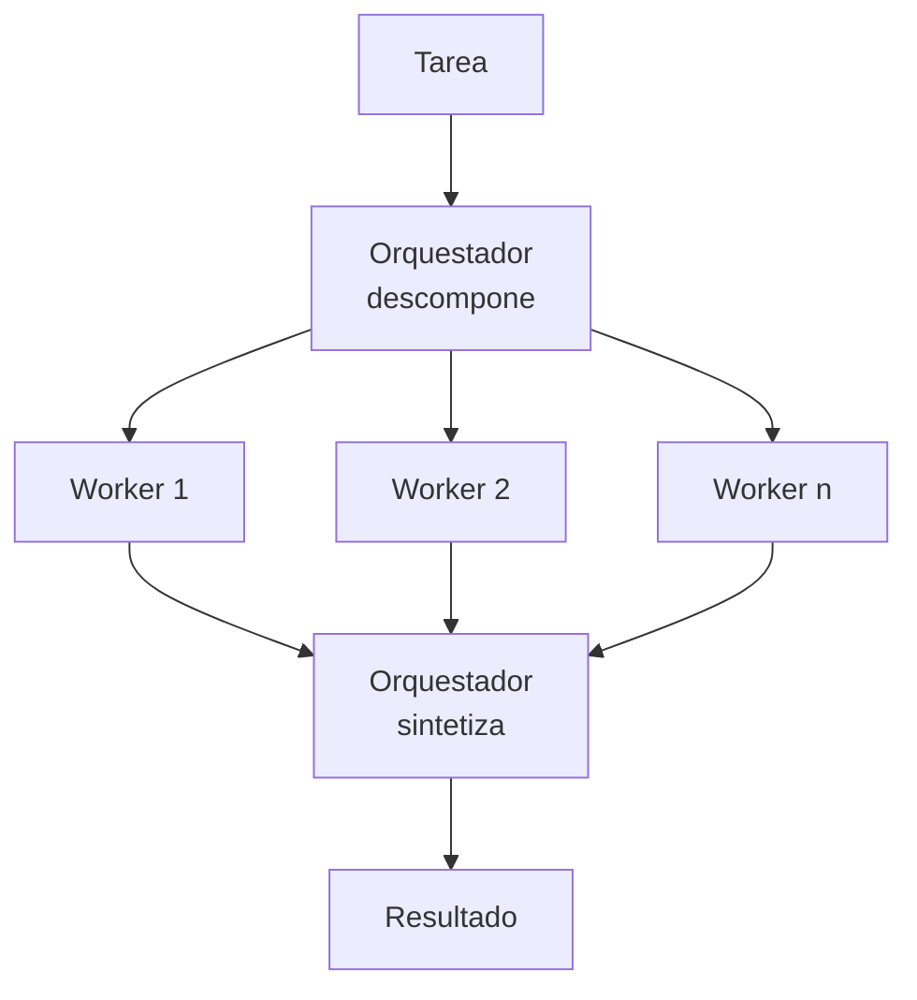

### 4.2 Jerárquico

**Qué es.** Supervisores de supervisores. Un supervisor de primer nivel delega en supervisores de equipo, y cada uno coordina a sus workers.

**Cuándo aplicarlo.** Cuando un único supervisor tendría demasiadas tools o workers que elegir, o cuando los equipos corresponden a dominios o unidades organizativas distintas.

**Cuándo no.** Cuando basta un nivel. Cada nivel añade latencia y una oportunidad más de perder información.

**Detalle.**

- Cada nivel solo ve los resúmenes del nivel inferior.
- Encaja con agentes de propiedad distinta: cada equipo publica su supervisor como un servicio (A2A, 6.9).

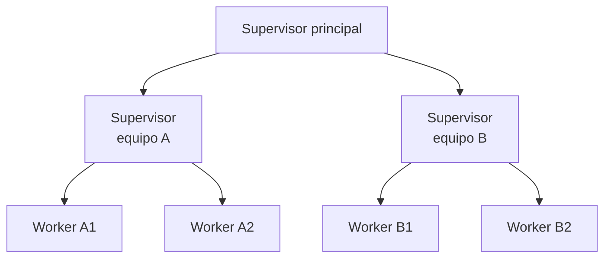

### 4.3 Handoff (traspaso)

**Qué es.** El agente activo transfiere el control de la conversación a otro agente más adecuado, junto con el contexto necesario. Solo actúa un agente a la vez.

**Cuándo aplicarlo.** En atención a usuarios con áreas especializadas (triage que pasa a facturación o a soporte técnico), cuando la especialidad necesaria aparece durante la conversación.

**Cuándo no.** Si hace falta combinar el trabajo de varios especialistas en una sola respuesta (usa Orchestrator-workers).

**Detalle.**

- Hay que decidir qué contexto viaja: todo el historial (caro, pero fiel) o un resumen estructurado (barato, pero se pierde información).
- Evita el ping-pong: limita el número de handoffs por conversación.
- El usuario no debe repetir lo que ya dijo.

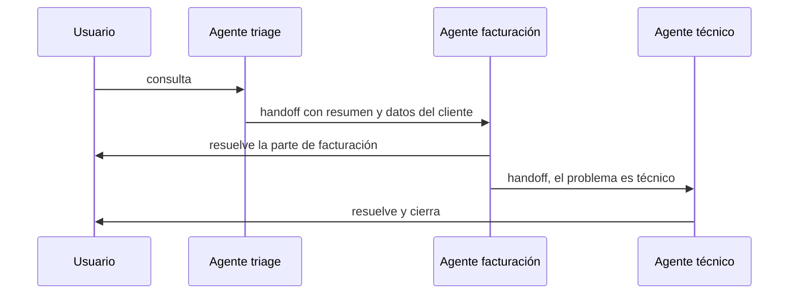

### 4.4 Group chat y debate

**Qué es.** Varios agentes con roles distintos comparten una conversación. Un moderador (un LLM o reglas) decide quién habla y cuándo se termina.

**Cuándo aplicarlo.** Para revisar desde varios puntos de vista (seguridad, coste, arquitectura), contrastar hipótesis o lograr un consenso con supervisión humana.

**Cuándo no.** En tareas de ejecución. Las conversaciones abiertas consumen muchos tokens y tienden a converger en lo que dice el primero.

**Detalle.**

- Hace falta una condición de terminación explícita: número de rondas, consenso o decisión del moderador.
- Asigna roles enfrentados de verdad (por ejemplo, un "abogado del diablo") para evitar el acuerdo complaciente.
- Mantén el número de participantes bajo (3 o 4).

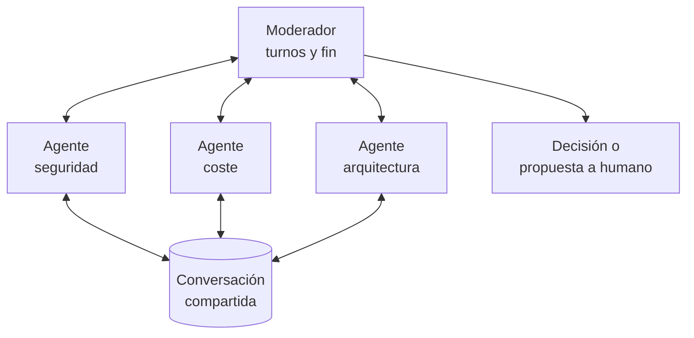

### 4.5 Blackboard (pizarra compartida)

**Qué es.** Los agentes no se hablan entre sí: leen y escriben en un espacio común (la pizarra). Un controlador decide qué agente actúa según el estado de la pizarra.

**Cuándo aplicarlo.** En problemas que se resuelven por aportaciones incrementales de especialistas sin un orden fijo: diagnóstico, investigación, análisis de incidentes.

**Cuándo no.** Si el orden es conocido (usa Pipeline) o si no se puede controlar la concurrencia sobre la pizarra.

**Detalle.**

- La pizarra es estado compartido: necesita los patrones de concurrencia de la sección 5 (lease o control optimista).
- Cada entrada lleva autor, versión y procedencia para poder auditarla.
- Engram puede actuar como pizarra entre sesiones de agentes de desarrollo.

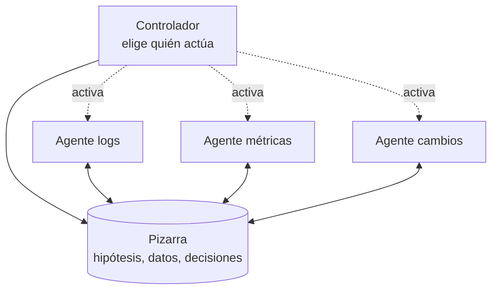

### 4.6 Pipeline secuencial

**Qué es.** Agentes en cadena: la salida de uno es la entrada del siguiente, con contratos tipados entre ellos. Es Prompt chaining (3.5) con agentes en lugar de pasos.

**Cuándo aplicarlo.** En procesos con etapas claras y especialistas distintos: ingesta, clasificación, enriquecimiento, redacción, revisión.

**Cuándo no.** Si las etapas necesitan volver atrás con frecuencia.

**Detalle.**

- Los contratos entre etapas (esquemas) permiten probar y desplegar cada agente por separado.
- Si las etapas se comunican por colas, el pipeline gana resiliencia y backpressure (5.7).

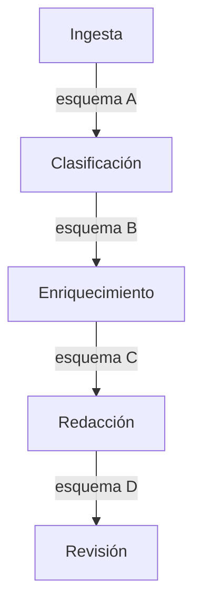

---

## 5. Patrones de concurrencia

Cuando varios agentes, o varias instancias del mismo, trabajan a la vez, aparecen los problemas de siempre: condiciones de carrera, escrituras perdidas, interbloqueos y saturación. Con un agravante: un LLM no garantiza que dos ejecuciones decidan lo mismo, así que las salvaguardas tienen que estar en el código y en la infraestructura, no en el prompt.

### 5.1 Fan-out / fan-in (scatter-gather)

**Qué es.** Se lanza en paralelo la misma tarea sobre partes distintas, o tareas distintas sobre la misma entrada, y después se agregan los resultados.

**Cuándo aplicarlo.** Con subtareas independientes en las que la latencia importa: buscar en varias fuentes, revisar varios ficheros, aplicar varios controles de seguridad.

**Cuándo no.** Si las subtareas comparten estado que se modifica, o si el proveedor limita la concurrencia por debajo del paralelismo que se quiere.

**Detalle.**

- Define un timeout global y qué se hace con los resultados parciales: agregar lo que haya llegado y marcar lo que falta.
- Limita el grado de paralelismo (5.7).
- El agregador debe tolerar resultados contradictorios o duplicados.

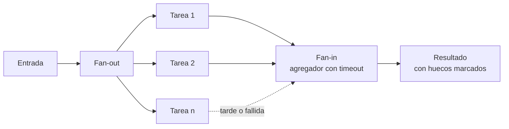

### 5.2 Map-reduce sobre documentos

**Qué es.** Un documento o corpus que no cabe en el contexto se divide en trozos. Se aplica el LLM a cada trozo (map) y después se combinan los resultados, en uno o varios niveles (reduce).

**Cuándo aplicarlo.** Para resumir o extraer información de corpus grandes, sobre todo con modelos locales de contexto limitado (por ejemplo, 16k en un Mac de 16 GB).

**Cuándo no.** Si la respuesta depende de relaciones entre partes lejanas del documento: el map pierde esas relaciones.

**Detalle.**

- Los trozos se solapan un poco para no cortar ideas por la mitad.
- El reduce puede ser jerárquico si hay muchos trozos.
- Como cada map ve solo su trozo, es también una defensa útil contra la prompt injection (sección 7).

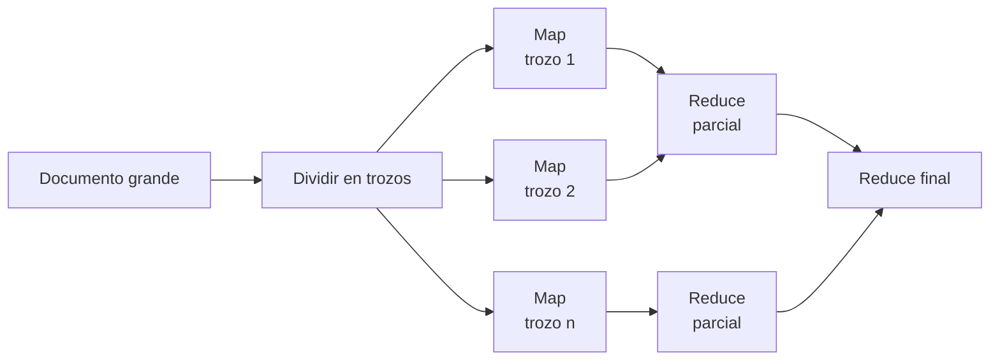

### 5.3 Voting (self-consistency)

**Qué es.** Se ejecuta la misma tarea varias veces (con distinta temperatura, prompt o modelo) y se elige la respuesta por mayoría o con un juez.

**Cuándo aplicarlo.** En decisiones de alto impacto con respuesta discreta (clasificar, aprobar o rechazar, detectar una vulnerabilidad) donde un falso negativo o positivo cuesta mucho más que varias llamadas.

**Cuándo no.** En generación abierta (no hay mayoría clara) o con presupuesto ajustado.

**Detalle.**

- Se puede fijar un umbral: por ejemplo, marcar como vulnerable si 1 de 3 lo detecta (alta sensibilidad) o solo si lo detectan 2 de 3 (alta precisión).
- El desacuerdo entre votos es una señal útil para escalar a una persona.

```mermaid
flowchart LR
  IN["Entrada"] --> V1["Ejecución 1"]
  IN --> V2["Ejecución 2"]
  IN --> V3["Ejecución 3"]
  V1 --> AG{"Votación<br/>o juez"}
  V2 --> AG
  V3 --> AG
  AG -- "consenso" --> OUT["Decisión"]
  AG -- "desacuerdo" --> H["Revisión humana"]
```

### 5.4 Aislamiento del workspace

**Qué es.** Cada agente trabaja en su propia copia del recurso (un worktree, una rama, un sandbox, un esquema de base de datos) y los cambios se integran por un único punto controlado (PR con CI).

**Cuándo aplicarlo.** Cuando varios agentes modifican el mismo repositorio o recurso a la vez, como varias sesiones de Claude Code en paralelo.

**Cuándo no.** Si los cambios se solapan tanto que la integración cuesta más que hacerlos en serie.

**Detalle.**

- Convierte un problema de concurrencia en uno de merge, que ya sabemos resolver con git y CI.
- En Claude Code: una sesión por worktree (`.claude/worktrees/`). Detalle en la guía de worktrees.
- Reparte las tareas para que toquen ficheros distintos.

```mermaid
flowchart LR
  REPO[("Repositorio<br/>main")] --> WA["Worktree A<br/>agente A, rama a"]
  REPO --> WB["Worktree B<br/>agente B, rama b"]
  WA --> PRA["PR a + CI"]
  WB --> PRB["PR b + CI"]
  PRA --> REPO
  PRB --> REPO
```

### 5.5 Lease con fencing token

**Qué es.** Para modificar un recurso compartido, un agente obtiene un lease: un bloqueo con caducidad. Cada lease lleva un fencing token creciente, y el recurso rechaza escrituras con un token antiguo.

**Cuándo aplicarlo.** Cuando solo un agente debe actuar a la vez sobre un recurso (un ticket, un despliegue, un fichero de estado) y los agentes pueden colgarse o tardar.

**Cuándo no.** Si los conflictos son raros y se pueden resolver al escribir (usa Control optimista, 5.6).

**Detalle.**

- La caducidad evita que un agente caído bloquee el recurso para siempre.
- El fencing token evita el caso peligroso: un agente que estaba pausado (por ejemplo, esperando al LLM) despierta creyendo que aún tiene el lease.
- Las llamadas al LLM son lentas e impredecibles: haz el lease más largo que el p99 del paso o renuévalo.

```mermaid
sequenceDiagram
  participant A as Agente A
  participant L as Servicio de lease
  participant B as Agente B
  participant R as Recurso
  A->>L: pide lease
  L-->>A: concedido, token 34
  B->>L: pide lease
  L-->>B: denegado
  Note over A: se queda bloqueado esperando al LLM
  Note over L: el lease caduca
  B->>L: pide lease
  L-->>B: concedido, token 35
  B->>R: escribe con token 35
  R-->>B: ok
  A->>R: escribe con token 34
  R-->>A: rechazado, token antiguo
```

### 5.6 Control optimista de concurrencia

**Qué es.** No se bloquea nada. Cada agente lee el recurso con su versión y escribe solo si la versión no ha cambiado (compare-and-set). Si ha cambiado, relee, vuelve a decidir y reintenta.

**Cuándo aplicarlo.** En estado compartido con conflictos poco frecuentes: una pizarra, el documento de tareas, la memoria compartida.

**Cuándo no.** Con mucha contención: los reintentos se encadenan y cada uno cuesta una llamada al LLM.

**Detalle.**

- En HTTP: `ETag` con `If-Match`. En bases de datos: columna de versión. En git: el propio push rechazado.
- Tras un conflicto, el agente debe volver a razonar con el estado nuevo, no reaplicar a ciegas su cambio.

```mermaid
sequenceDiagram
  participant A as Agente A
  participant S as Estado compartido
  participant B as Agente B
  A->>S: lee, versión 7
  B->>S: lee, versión 7
  A->>S: escribe si versión 7
  S-->>A: ok, versión 8
  B->>S: escribe si versión 7
  S-->>B: conflicto
  B->>S: relee, versión 8
  B->>B: vuelve a decidir con el estado nuevo
  B->>S: escribe si versión 8
  S-->>B: ok, versión 9
```

### 5.7 Backpressure y límite de concurrencia

**Qué es.** Se limita cuántas tareas se ejecutan a la vez (semáforo o pool) y se deja que el resto espere en cola. Ante señales de saturación del proveedor (HTTP 429, latencia creciente) se reduce la concurrencia.

**Cuándo aplicarlo.** Siempre que haya fan-out o colas de trabajo contra un LLM con rate limits, o con un modelo local que solo admite unas pocas peticiones simultáneas.

**Cuándo no.** Con tareas aisladas y de bajo volumen.

**Detalle.**

- Respeta la cabecera `retry-after` cuando el proveedor la envía.
- Una estrategia sencilla: subir la concurrencia de uno en uno mientras todo vaya bien y dividirla a la mitad ante un 429 (AIMD).
- En local con Ollama, `OLLAMA_NUM_PARALLEL` limita las peticiones simultáneas, y cada una consume memoria.

```mermaid
flowchart LR
  Q[("Cola de tareas")] --> SEM{"Semáforo<br/>máx. N"}
  SEM --> W["Workers"]
  W --> API["API del LLM"]
  API -- "429 o latencia alta" --> CTRL["Control<br/>reduce N"]
  API -- "ok sostenido" --> CTRL2["Control<br/>sube N"]
  CTRL --> SEM
  CTRL2 --> SEM
```

### 5.8 Ejecución especulativa (hedged requests)

**Qué es.** Se lanza la misma petición a dos destinos (dos modelos, dos regiones) o se lanza una segunda copia si la primera tarda más que el p95. Gana la primera respuesta válida y se cancela la otra.

**Cuándo aplicarlo.** Cuando la latencia de cola importa más que el coste, en operaciones idempotentes y de solo lectura.

**Cuándo no.** En acciones con efectos (se ejecutarían dos veces) o con presupuesto ajustado.

**Detalle.**

- Solo con operaciones idempotentes (6.2).
- Mide cuántas veces gana la copia: si casi nunca gana, sobra.

```mermaid
sequenceDiagram
  participant C as Cliente
  participant M1 as Modelo A
  participant M2 as Modelo B
  C->>M1: petición
  Note over C: supera el p95 sin respuesta
  C->>M2: misma petición
  M2-->>C: respuesta válida
  C->>M1: cancela
```

---

## 6. Agentes como sistemas distribuidos

Un agente que llama a un LLM remoto, a tools por MCP y a otros agentes por A2A es un sistema distribuido, y las falacias de la computación distribuida se cumplen igual:

| Falacia | Cómo se manifiesta en agentes | Patrón |
| --- | --- | --- |
| La red es fiable | Timeouts del proveedor del LLM, MCP servers caídos | Retry (6.6), Circuit breaker (6.7) |
| La latencia es cero | Llamadas de 10 a 60 s, p99 muy superior a la media | Timeouts, Ejecución especulativa (5.8) |
| El ancho de banda es infinito | Contexto y salidas de tools enormes | Memoria por capas (3.8), Map-reduce (5.2) |
| La red es segura | Contenido no confiable en páginas, correos y documentos | Sección 7 |
| La topología no cambia | Modelos que se retiran o cambian de versión | Routing (3.6), evals de regresión (8.1) |
| El coste de transporte es cero | Tokens: cada vuelta de contexto se paga | Bounded autonomy (3.10) |

Hay además una diferencia esencial: **el componente central no es determinista**. Reintentar una llamada al LLM no devuelve la misma respuesta, así que la recuperación ante fallos se basa en guardar los resultados de cada paso, no en volver a calcularlos.

### 6.1 Durable execution (checkpointing)

**Qué es.** Cada paso del agente (llamada al LLM, tool call, decisión) se persiste en un registro antes de continuar. Si el proceso cae, se reanuda desde el último paso guardado, reutilizando los resultados ya obtenidos en lugar de repetirlos.

**Cuándo aplicarlo.** En agentes de larga duración (minutos u horas), con Human-in-the-loop, o cuyos pasos son caros o tienen efectos.

**Cuándo no.** En agentes cortos, de una sola petición, que se pueden relanzar desde cero.

**Detalle.**

- Herramientas: Temporal, Restate, AWS Step Functions o el checkpointing de LangGraph.
- Las llamadas al LLM se tratan como actividades: su resultado se guarda y, al reanudar, no se vuelve a llamar. Así se evita que el agente decida otra cosa al recuperarse.
- Es lo que permite pausar semanas a la espera de una aprobación.

```mermaid
sequenceDiagram
  participant W as Motor de workflow
  participant LOG as Registro de eventos
  participant AG as Paso del agente
  W->>AG: paso 1, llamar al LLM
  AG-->>W: resultado 1
  W->>LOG: guarda resultado 1
  W->>AG: paso 2, tool call
  AG-->>W: resultado 2
  W->>LOG: guarda resultado 2
  Note over W: el proceso cae
  W->>LOG: reanuda y lee el registro
  Note over W: pasos 1 y 2 se reutilizan, no se repiten
  W->>AG: paso 3
```

### 6.2 Idempotency key en tool calls

**Qué es.** Cada acción con efectos lleva una clave única. Si la petición se repite (por un retry, por reanudar o porque el LLM decide repetirla), el sistema destino devuelve el resultado ya registrado en lugar de ejecutarla otra vez.

**Cuándo aplicarlo.** En toda tool que cree, modifique o envíe algo: pagos, tickets, correos, despliegues.

**Cuándo no.** En lecturas puras, que ya son idempotentes.

**Detalle.**

- La clave la genera el código del agente a partir de la intención (por ejemplo, `ticket:<incidente>:<acción>`), no el LLM, que podría inventarla distinta cada vez.
- Si la API destino no admite claves, la tool debe comprobar primero si la acción ya existe.

```mermaid
sequenceDiagram
  participant AG as Agente
  participant API as API destino
  AG->>API: crear ticket, clave k1
  API->>API: crea ticket 123 y guarda k1
  API--xAG: timeout, no llega la respuesta
  AG->>API: reintento, clave k1
  API-->>AG: ticket 123, ya existía
  Note over AG,API: un solo ticket aunque haya dos peticiones
```

### 6.3 Saga con compensación

**Qué es.** Una operación que abarca varios sistemas se divide en pasos locales, cada uno con su acción compensatoria. Si un paso falla, se ejecutan las compensaciones de los anteriores en orden inverso.

**Cuándo aplicarlo.** Cuando el agente encadena acciones con efectos en varios sistemas sin una transacción común: reservar, cobrar, aprovisionar.

**Cuándo no.** Si todas las acciones caen en el mismo sistema transaccional.

**Detalle.**

- Las compensaciones se definen en código y en la spec, no las improvisa el LLM en el momento del fallo.
- Algunas acciones no se pueden compensar (un correo enviado): colócalas al final y protégelas con Human-in-the-loop.
- Con Durable execution (6.1), la saga sobrevive a caídas en mitad de la compensación.

```mermaid
flowchart LR
  S1["1 Reservar vuelo"] --> S2["2 Reservar hotel"]
  S2 --> S3["3 Cobrar"]
  S3 -- "falla" --> C2["Compensar 2<br/>cancelar hotel"]
  C2 --> C1["Compensar 1<br/>cancelar vuelo"]
  S3 -- "ok" --> OK["Completado"]
```

### 6.4 Transactional outbox

**Qué es.** El agente guarda su cambio de estado y el evento que quiere publicar en la misma transacción local. Un proceso aparte (relay) lee la tabla outbox y publica los eventos en el broker.

**Cuándo aplicarlo.** Cuando un agente actualiza su estado y debe avisar a otros agentes, y no se puede permitir que ocurra lo uno sin lo otro.

**Cuándo no.** Si no hay estado propio persistente o la pérdida ocasional de un evento es aceptable.

**Detalle.**

- El relay entrega al menos una vez (at-least-once): los consumidores deben ser idempotentes (6.2).

```mermaid
flowchart LR
  AG["Agente"] --> TX["Transacción local"]
  TX --> ST[("Estado")]
  TX --> OB[("Outbox")]
  OB --> RL["Relay"]
  RL --> BR[("Broker")]
  BR --> A2["Otros agentes"]
```

### 6.5 Coreografía por eventos frente a orquestación

**Qué es.** En la coreografía, los agentes reaccionan a eventos publicados en un broker y nadie dirige el conjunto. En la orquestación (4.1), un agente o motor central decide el flujo.

**Cuándo aplicar la coreografía.** Con agentes de equipos distintos y muy desacoplados, procesos que crecen añadiendo consumidores, o mucho volumen asíncrono.

**Cuándo no.** Si hace falta ver y controlar el proceso de punta a punta, o con flujos con compensaciones complejas: ahí la orquestación es más fácil de razonar.

**Detalle.**

| Criterio | Orquestación | Coreografía |
| --- | --- | --- |
| Visibilidad del flujo | En un sitio | Repartida, hace falta tracing (6.10) |
| Acoplamiento | Al orquestador | Al esquema de los eventos |
| Añadir un paso | Cambiar el orquestador | Añadir un consumidor |
| Depuración | Más sencilla | Más difícil |

```mermaid
flowchart LR
  A1["Agente ingesta"] -- "documento.recibido" --> BR[("Broker")]
  BR -- "documento.recibido" --> A2["Agente clasificación"]
  A2 -- "documento.clasificado" --> BR
  BR -- "documento.clasificado" --> A3["Agente cumplimiento"]
  BR -- "documento.clasificado" --> A4["Agente archivo"]
```

### 6.6 Retry con backoff, timeout y dead letter

**Qué es.** Los errores transitorios se reintentan con espera exponencial y jitter, hasta un máximo. Cada llamada tiene timeout. Lo que sigue fallando va a una cola de dead letter para revisarlo.

**Cuándo aplicarlo.** En todas las llamadas remotas: LLM, MCP, APIs.

**Cuándo no.** Con errores permanentes (400, validación, permisos): reintentar solo gasta.

**Detalle.**

- Clasifica los errores: transitorios (429, 5xx, timeout), que se reintentan, y permanentes, que no.
- El jitter evita que todos los agentes reintenten a la vez.
- Reintenta solo operaciones idempotentes, o con idempotency key (6.2).
- Si una salida del LLM no cumple el esquema, no es un error de red: es mejor reintentar con el error de validación en el prompt, una o dos veces.

```mermaid
flowchart LR
  CALL["Llamada<br/>con timeout"] --> OK{"¿Ok?"}
  OK -- "sí" --> R["Resultado"]
  OK -- "no" --> TR{"¿Transitorio?"}
  TR -- "no" --> DLQ[("Dead letter<br/>revisión")]
  TR -- "sí" --> N{"¿Intentos<br/>restantes?"}
  N -- "sí" --> W["Esperar<br/>backoff + jitter"]
  W --> CALL
  N -- "no" --> DLQ
```

### 6.7 Circuit breaker con fallback de modelo

**Qué es.** Si un proveedor o tool falla repetidamente, el circuito se abre y las llamadas fallan al instante o van a un fallback (otro modelo, un modelo local, una respuesta degradada), sin esperar timeouts. Pasado un tiempo, se prueba de nuevo.

**Cuándo aplicarlo.** Con dependencias externas que pueden degradarse (APIs de LLM, MCP servers) y cuando existe una alternativa aceptable.

**Cuándo no.** Si no hay fallback y fallar rápido no aporta nada al usuario.

**Detalle.**

- El fallback debe estar evaluado: un modelo local (por ejemplo, qwen3.5:9b en Ollama) pasa las mismas evals con su propio umbral.
- Registra cuándo se usa el fallback: es una degradación, no un éxito normal.

```mermaid
stateDiagram-v2
  [*] --> Cerrado
  Cerrado --> Abierto: fallos sobre el umbral
  Abierto --> SemiAbierto: pasa el tiempo de espera
  SemiAbierto --> Cerrado: la llamada de prueba funciona
  SemiAbierto --> Abierto: la llamada de prueba falla
  note right of Abierto
    Las llamadas van al fallback
    modelo alternativo o local
  end note
```

### 6.8 Bulkhead

**Qué es.** Se separan los recursos (cupos de concurrencia, claves de API, presupuestos de tokens, colas) por tipo de agente o de cliente, para que uno desbocado no deje sin servicio a los demás.

**Cuándo aplicarlo.** Cuando conviven agentes críticos e interactivos con agentes batch, o varios equipos comparten la cuenta del proveedor del LLM.

**Cuándo no.** Con un solo agente y poco volumen.

**Detalle.**

- Usa claves de API o workspaces separados por agente: así también se mide el coste de cada uno.
- Combínalo con presupuestos por agente (3.10).

```mermaid
flowchart TB
  subgraph P1["Compartimento crítico"]
    A1["Agente de soporte"] --> Q1["Cupo 20<br/>clave 1"]
  end
  subgraph P2["Compartimento batch"]
    A2["Agente de informes"] --> Q2["Cupo 5<br/>clave 2"]
  end
  Q1 --> LLM["Proveedor LLM"]
  Q2 --> LLM
```

### 6.9 Protocolos: MCP y A2A

**Qué es.** Dos protocolos abiertos que separan responsabilidades. **MCP** (Model Context Protocol) conecta un agente con tools y datos. **A2A** (Agent2Agent, ahora en la Linux Foundation) conecta agentes entre sí, aunque usen frameworks distintos o sean de equipos distintos.

**Cuándo aplicarlo.** MCP, siempre que una tool se vaya a reutilizar entre agentes o clientes. A2A, cuando los agentes los poseen y despliegan equipos distintos, o hay que integrar agentes de terceros.

**Cuándo no.** A2A no compensa entre agentes del mismo proceso y del mismo equipo: una llamada de función es más sencilla.

**Detalle.**

- En A2A, cada agente publica una **Agent Card** con sus capacidades, su endpoint y su autenticación. Las tareas tienen ciclo de vida (enviada, en curso, requiere entrada, completada, fallida) y admiten streaming y notificaciones.
- Trata cada agente remoto como cualquier dependencia remota: timeouts, retry, circuit breaker y autenticación.
- Lo que devuelve otro agente es contenido no confiable a efectos de prompt injection (sección 7).

```mermaid
flowchart LR
  subgraph EA["Equipo A"]
    AA["Agente A"] -- "MCP" --> TA["MCP servers<br/>tools y datos de A"]
  end
  subgraph EB["Equipo B"]
    AB["Agente B"] -- "MCP" --> TB["MCP servers<br/>tools y datos de B"]
  end
  AA -- "A2A<br/>Agent Card, tareas" --> AB
```

### 6.10 Tracing distribuido

**Qué es.** Cada ejecución genera una traza con spans para cada llamada al LLM, tool call e invocación de agente, propagando el contexto entre procesos. OpenTelemetry tiene convenciones semánticas específicas para GenAI (atributos `gen_ai.*`).

**Cuándo aplicarlo.** Desde el primer agente que salga de tu portátil, y siempre en sistemas multiagente.

**Cuándo no.** No hay excepción en producción.

**Detalle.**

- Registra por span el modelo, los tokens de entrada y salida, la latencia, la tool, el resultado y el coste.
- Ten cuidado con prompts y respuestas en las trazas: pueden contener datos personales. Decide qué se guarda y durante cuánto tiempo.
- Las trazas reales son la mejor fuente para nuevos casos de eval (8.1).

```mermaid
flowchart TB
  R["invoke_agent orquestador"] --> C1["chat<br/>modelo, tokens"]
  R --> T1["execute_tool buscar"]
  R --> S["invoke_agent worker<br/>otro proceso"]
  S --> C2["chat"]
  S --> T2["execute_tool leer"]
  R --> C3["chat síntesis"]
```

---

## 7. Patrones de seguridad (prompt injection)

**Conclusión:** hoy no existe un filtro que detecte la prompt injection de forma fiable. La defensa sólida es de arquitectura: limitar lo que un agente puede hacer después de haber leído contenido no confiable. Los patrones de esta sección proceden del artículo "Design Patterns for Securing LLM Agents against Prompt Injections" (Beurer-Kellner et al., 2025) y del trabajo de Simon Willison.

### 7.1 Lethal trifecta y mínimo privilegio

**Qué es.** Un diagnóstico más que un patrón. Un agente es vulnerable a la exfiltración si combina tres cosas: acceso a **datos privados**, exposición a **contenido no confiable** y un **canal para comunicar hacia fuera**. La defensa consiste en quitar al menos una de las tres.

**Cuándo aplicarlo.** En la revisión de diseño de cualquier agente, antes de elegir tools.

**Cuándo no.** Siempre aplica.

**Detalle.**

- Enumera en la spec las tools de cada agente y marca cuál aporta cada lado del triángulo.
- Los canales de salida son más que el correo: una petición web con datos en la URL, una imagen en Markdown o un comentario público también lo son.
- Divide el sistema en agentes que nunca reúnan las tres a la vez.

```mermaid
flowchart LR
  P["Datos privados"] --> X{"Las tres juntas<br/>= riesgo de exfiltración"}
  U["Contenido no confiable"] --> X
  E["Canal de salida"] --> X
  X --> D["Defensa: quitar al menos una"]
```

### 7.2 Dual LLM

**Qué es.** Un LLM privilegiado planifica y usa tools, pero nunca ve contenido no confiable. Un LLM en cuarentena procesa ese contenido, pero no tiene tools. El privilegiado solo maneja referencias simbólicas (`$VAR1`) a los resultados de la cuarentena, y el código las sustituye al final.

**Cuándo aplicarlo.** Cuando el agente debe procesar contenido no confiable (correos, páginas web) y además ejecutar acciones.

**Cuándo no.** Si el agente necesita razonar sobre el contenido para decidir la siguiente acción: este patrón lo impide por diseño.

**Detalle.**

- El controlador es código determinista, no un LLM.
- El LLM en cuarentena devuelve datos con formato restringido (por ejemplo, un JSON validado), nunca instrucciones.

```mermaid
flowchart TB
  U["Usuario"] --> PL["LLM privilegiado<br/>tools, sin datos no confiables"]
  PL -- "procesa $DOC" --> CT["Controlador<br/>código"]
  CT --> QL["LLM en cuarentena<br/>sin tools"]
  EXT["Contenido no confiable"] --> QL
  QL -- "resultado como $VAR1" --> CT
  CT -- "solo la referencia $VAR1" --> PL
  PL -- "enviar $VAR1" --> CT
  CT --> T["Tool<br/>con el valor real"]
```

### 7.3 Plan-then-execute (seguridad)

**Qué es.** El agente fija su plan de acciones antes de leer cualquier contenido no confiable. Después, el contenido puede influir en los parámetros, pero no puede añadir acciones nuevas.

**Cuándo aplicarlo.** En tareas cuyo plan se conoce a partir de la petición del usuario ("resume mis correos de hoy y envíame el resumen").

**Cuándo no.** Si el plan depende del contenido.

**Detalle.**

- Sigue siendo posible manipular los parámetros (por ejemplo, el contenido del resumen), pero no añadir un "reenvía todo a esta dirección".
- Fija también los destinatarios y los parámetros sensibles en el plan.

```mermaid
flowchart LR
  REQ["Petición del usuario"] --> PLAN["Plan fijado<br/>1 leer, 2 resumir, 3 enviar al usuario"]
  PLAN --> EX["Ejecución"]
  EXT["Contenido no confiable"] --> EX
  EX -- "solo acciones del plan" --> T["Tools"]
  EX -. "acción nueva" .-> BL["Bloqueada"]
```

### 7.4 Action-selector

**Qué es.** El LLM solo elige una acción de una lista fija y predefinida. El resultado de la acción no vuelve al LLM, así que no puede influir en otra decisión.

**Cuándo aplicarlo.** En asistentes que traducen una petición en lenguaje natural a una acción conocida: un menú inteligente, un router de comandos.

**Cuándo no.** Si se necesitan varios pasos encadenados o razonar sobre resultados.

**Detalle.**

- Es el patrón más restrictivo y el más seguro.

```mermaid
flowchart LR
  U["Petición"] --> LLM["LLM selector"]
  LLM --> L{"Lista fija<br/>de acciones"}
  L --> A1["Ver pedido"]
  L --> A2["Cambiar dirección"]
  L --> A3["Hablar con una persona"]
  A1 --> OUT["Respuesta al usuario<br/>sin volver al LLM"]
  A2 --> OUT
  A3 --> OUT
```

### 7.5 Context minimization

**Qué es.** Una vez extraída la intención del usuario (por ejemplo, convertida en una consulta estructurada), se elimina el texto original del contexto antes de los pasos siguientes. Así, lo que pudiera inyectar no llega a la respuesta.

**Cuándo aplicarlo.** En chatbots sobre datos, donde la petición se traduce en una consulta y la respuesta se construye a partir del resultado.

**Cuándo no.** Si el texto original hace falta para responder bien.

**Detalle.**

- Combínalo con Map-reduce (5.2) cuando el contenido no confiable sea un corpus: cada trozo se procesa aislado.

```mermaid
flowchart TB
  U["Petición del usuario"] --> LLM1["LLM<br/>extrae la consulta"]
  LLM1 --> Q["Consulta estructurada"]
  Q --> DB[("Datos")]
  DB --> LLM2["LLM<br/>redacta la respuesta"]
  U -. "eliminada del contexto" .-x LLM2
  LLM2 --> OUT["Respuesta"]
```

---

## 8. Patrones de operación

### 8.1 Evals como quality gates

**Qué es.** Cada cambio (prompt, modelo, tool, patrón) pasa un conjunto de evals con umbrales por AC antes de integrarse.

**Cuándo aplicarlo.** Siempre. Es la red de seguridad que permite cambiar de patrón o de modelo con datos.

**Detalle.**

- Las evals miden también lo que añade cada patrón: si un Evaluator-Optimizer no mejora la puntuación de su AC, se elimina.
- Las tres capas de CI (pre-commit, CI con LLM fake y evals con modelo real) están detalladas en la guía de CI.

```mermaid
flowchart TB
  CH["Cambio"] --> PC["pre-commit"]
  PC --> CI["CI con LLM fake"]
  CI --> EV["Evals con modelo real"]
  EV --> TH{"¿Supera los<br/>umbrales por AC?"}
  TH -- "sí" --> M["Merge"]
  TH -- "no" --> FX["Corregir o<br/>revisar la spec"]
```

### 8.2 Shadow mode

**Qué es.** El agente nuevo recibe el tráfico real en paralelo al sistema actual, pero su salida no llega al usuario ni ejecuta acciones: solo se registra y se compara.

**Cuándo aplicarlo.** Antes de sustituir un proceso existente (humano o automático) o de cambiar de modelo en un agente crítico.

**Cuándo no.** Si las tools del agente tienen efectos que no se pueden simular (hace falta un modo dry-run).

**Detalle.**

- Las tools con efectos se sustituyen por versiones dry-run que registran lo que habrían hecho.
- Los desacuerdos con el sistema actual son candidatos a casos de eval.

```mermaid
flowchart LR
  T["Tráfico real"] --> CUR["Sistema actual"]
  T --> NEW["Agente nuevo<br/>en sombra, dry-run"]
  CUR --> U["Usuario"]
  CUR --> CMP["Comparación"]
  NEW --> CMP
  CMP --> EV["Nuevos casos de eval"]
```

### 8.3 Canary con kill switch

**Qué es.** La versión nueva recibe un porcentaje pequeño del tráfico, que se amplía si las métricas son buenas. Un kill switch permite desactivar el agente o una tool al instante sin desplegar.

**Cuándo aplicarlo.** En cualquier cambio de modelo, prompt o tool de un agente en producción.

**Detalle.**

- Las métricas del canary incluyen calidad (muestreo con un juez), coste por ejecución, tasa de escalados y errores de tools.
- El kill switch es un feature flag consultado en cada ejecución, no una variable de entorno que exige redesplegar.

```mermaid
flowchart LR
  T["Tráfico"] --> RT{"Router<br/>por porcentaje"}
  RT -- "95 %" --> V1["Versión actual"]
  RT -- "5 %" --> V2["Versión nueva"]
  V2 --> MET{"¿Métricas<br/>dentro de umbral?"}
  MET -- "sí" --> UP["Ampliar porcentaje"]
  MET -- "no" --> RB["Revertir"]
  KS["Kill switch"] -. "desactiva" .-> V2
```

---

## 9. Antipatrones

El estudio "Why Do Multi-Agent LLM Systems Fail?" (Cemri et al., 2025) agrupa los fallos de los sistemas multiagente en tres categorías: **especificación y diseño del sistema**, **desalineación entre agentes** y **verificación y terminación de la tarea**. Los antipatrones más habituales encajan en ellas:

| Antipatrón | Síntoma | Categoría | Patrón que lo corrige |
| --- | --- | --- | --- |
| Multiagente por defecto | Más coste y latencia sin mejora en las evals | Diseño | Escalera de complejidad (2.1) |
| Encargos vagos a los workers | Trabajo duplicado o fuera de alcance | Especificación | Orchestrator-workers con encargos completos (4.1) |
| Agentes paralelos que deciden lo mismo por su cuenta | Resultados incompatibles al integrarlos | Desalineación | Aislamiento (5.4), compartir contexto, o hacerlo en serie |
| Bucle sin límites | Coste disparado, el agente no termina | Terminación | Controles del bucle ReAct (3.2), Bounded autonomy (3.10) |
| Nadie verifica | Resultado plausible pero incorrecto | Verificación | Evaluator-Optimizer (3.4), evals (8.1) |
| Retry de acciones con efectos | Correos o tickets duplicados | Distribuido | Idempotency key (6.2) |
| Reintentar el LLM para recuperarse | El agente cambia de decisión tras una caída | Distribuido | Durable execution (6.1) |
| Estado compartido sin control | Escrituras perdidas | Concurrencia | Lease (5.5) o control optimista (5.6) |
| Confiar en un filtro de injection | Exfiltración pese al filtro | Seguridad | Lethal trifecta (7.1), Dual LLM (7.2) |
| Tools que devuelven todo | Contexto saturado y peor razonamiento | Comportamiento | Memoria por capas (3.8) |
| Group chat sin moderador | Conversación sin fin o consenso complaciente | Terminación | Group chat con condición de fin (4.4) |

---

## 10. Cómo elegir

```mermaid
flowchart LR
  Q1{"¿Basta una llamada<br/>con buen prompt?"} -- "sí" --> R1["Llamada única"]
  Q1 -- "no" --> Q2{"¿Los pasos se<br/>conocen de antemano?"}
  Q2 -- "sí" --> R2["Workflow: Prompt chaining,<br/>Routing, Fan-out"]
  Q2 -- "no" --> Q3{"¿Cabe en un contexto<br/>y es una sola línea de trabajo?"}
  Q3 -- "sí" --> R3["Agente único: ReAct o<br/>Plan-and-Execute"]
  Q3 -- "no" --> Q4{"¿Subtareas<br/>independientes?"}
  Q4 -- "sí" --> R4["Orchestrator-workers<br/>o Fan-out"]
  Q4 -- "no" --> R5["Agente único con<br/>memoria por capas, o Pipeline"]
```

Después de elegir la forma, se añaden los patrones transversales según las características de la tarea:

| Si la tarea… | Añade |
| --- | --- |
| Tiene acciones irreversibles | Human-in-the-loop, Idempotency key, Saga |
| Dura más de unos minutos | Durable execution |
| Lee contenido de terceros | Lethal trifecta, Dual LLM o Plan-then-execute |
| Comparte estado entre agentes | Lease o control optimista |
| Lanza muchas llamadas en paralelo | Backpressure, Bulkhead |
| Depende de un proveedor externo | Retry, Circuit breaker con fallback |
| Cruza equipos u organizaciones | A2A, tracing distribuido |
| Va a producción | Evals, Shadow mode, Canary con kill switch |

---

## 11. Los patrones en el ciclo ODD

Elegir un patrón es una decisión de diseño, y en ODD las decisiones quedan escritas antes del primer write:

1. **Spec:** registra el patrón elegido y por qué en la sección de diseño o arquitectura, y los límites de Bounded autonomy en los requisitos no funcionales.
2. **AC por patrón:** cada patrón transversal se verifica con un AC. Por ejemplo, "si se repite la tool call `crear_ticket` con la misma clave, existe un solo ticket" (Idempotency key) o "tras 8 tool calls el agente entrega un resultado parcial" (Bounded autonomy).
3. **Evals:** cubren el comportamiento (calidad de la respuesta), y los tests en CI cubren los patrones deterministas (retry, idempotency, lease), con un LLM fake.
4. **Revisión:** el subagente `spec-reviewer` puede comprobar que cada tool con efectos tiene idempotency key y que la lethal trifecta está analizada.
5. **Riesgo:** los patrones de seguridad y Human-in-the-loop son obligatorios en agentes de riesgo alto, y su cumplimiento forma parte de la revisión RDD.

Detalles en las guías "ODD aplicado a la generación de agentes", "RDD en el ciclo ODD" y "CI para agentes y PoCs".

---

## 12. Lecturas recomendadas

### Imprescindibles

- **[Building effective agents](https://www.anthropic.com/engineering/building-effective-agents)** (Anthropic, 2024). Origen de la distinción entre workflow y agente y de los patrones Prompt chaining, Routing, Parallelization, Orchestrator-workers y Evaluator-optimizer. El mejor punto de partida.
- **[How we built our multi-agent research system](https://www.anthropic.com/engineering/multi-agent-research-system)** (Anthropic, 2025). Orchestrator-workers en producción: cómo redactar encargos, cuánto cuesta en tokens y cómo evaluarlo.
- **[Effective context engineering for AI agents](https://www.anthropic.com/engineering/effective-context-engineering-for-ai-agents)** (Anthropic, 2025). Compaction, notas externas, retrieval just-in-time y subagentes: la base de la Memoria por capas.
- **[Don't Build Multi-Agents](https://cognition.ai/blog/dont-build-multi-agents)** (Cognition, 2025). El contrapunto: por qué los agentes paralelos sin contexto compartido fallan. Léelo junto al anterior.

### Catálogos de patrones

- **[Agentic Design Patterns](https://link.springer.com/doi/10.1007/978-3-032-01402-3)** (Antonio Gulli, Springer, 2025). Catálogo práctico extenso: routing, reflection, planning, multiagente, memoria, guardrails, HITL.
- **[AI agent design patterns](https://learn.microsoft.com/azure/architecture/ai-ml/guide/ai-agent-design-patterns)** (Azure Architecture Center) y **[orquestaciones de Microsoft Agent Framework](https://learn.microsoft.com/en-us/agent-framework/workflows/orchestrations)**. Sequential, concurrent, group chat, handoff y magentic, con criterios de uso.
- **[12-Factor Agents](https://github.com/humanlayer/12-factor-agents)** (HumanLayer). Principios para agentes de producción: control del flujo, estado, pausar y reanudar, contexto propio.

### Comportamiento (artículos de referencia)

- **[ReAct: Synergizing Reasoning and Acting in Language Models](https://arxiv.org/abs/2210.03629)** (Yao et al., 2022).
- **[Reflexion: Language Agents with Verbal Reinforcement Learning](https://arxiv.org/abs/2303.11366)** (Shinn et al., 2023).
- **[Self-Consistency Improves Chain of Thought Reasoning](https://arxiv.org/abs/2203.11171)** (Wang et al., 2022). Base del patrón Voting.

### Multiagente y fallos

- **[Why Do Multi-Agent LLM Systems Fail?](https://arxiv.org/abs/2503.13657)** (Cemri et al., 2025). Taxonomía MAST de modos de fallo. Útil como checklist de revisión.

### Sistemas distribuidos

- **[Designing Data-Intensive Applications, 2.ª ed.](https://www.oreilly.com/library/view/designing-data-intensive-applications/9781098119058/)** (Kleppmann y Riccomini, O'Reilly, 2026). Consistencia, leases y fencing tokens, transacciones, procesamiento de eventos.
- **Release It!, 2.ª ed.** (Michael Nygard, Pragmatic Bookshelf, 2018). Circuit breaker, bulkhead, timeouts: los patrones de estabilidad.
- **Enterprise Integration Patterns** (Hohpe y Woolf, Addison-Wesley, 2003). Mensajería, routers, agregadores, dead letter: el vocabulario de la coordinación por mensajes.
- **[Pattern: Saga](https://microservices.io/patterns/data/saga.html)** y **[Transactional outbox](https://microservices.io/patterns/data/transactional-outbox.html)** (Chris Richardson, microservices.io).
- **[Temporal: durable execution](https://docs.temporal.io/)**. Documentación de referencia para workflows duraderos, aplicable a agentes.

### Seguridad

- **[Design Patterns for Securing LLM Agents against Prompt Injections](https://arxiv.org/abs/2506.08837)** (Beurer-Kellner et al., 2025). Origen de Action-selector, Plan-then-execute, Map-reduce, Dual LLM y Context minimization aplicados a la seguridad.
- **[The lethal trifecta for AI agents](https://simonwillison.net/2025/Jun/16/the-lethal-trifecta/)** (Simon Willison, 2025).
- **[OWASP GenAI Security Project](https://genai.owasp.org/)**. Top 10 para aplicaciones LLM y para aplicaciones agénticas.

### Protocolos y observabilidad

- **[Model Context Protocol](https://modelcontextprotocol.io/)**. Especificación y guías.
- **[Agent2Agent (A2A) Protocol](https://a2a-protocol.org/)**. Especificación, Agent Card y ciclo de vida de tareas.
- **[OpenTelemetry: semantic conventions for GenAI agent spans](https://opentelemetry.io/docs/specs/semconv/gen-ai/gen-ai-agent-spans/)**.

### Orden de lectura sugerido

1. Building effective agents.
2. Effective context engineering.
3. Multi-agent research system y Don't Build Multi-Agents, juntos.
4. Design Patterns for Securing LLM Agents.
5. Why Do Multi-Agent LLM Systems Fail?
6. Los capítulos de DDIA sobre sistemas distribuidos y Release It!, cuando el agente vaya a producción.
