# Patrones aplicados al desarrollo de agentes · Cheatsheet

*Resumen de los 42 patrones de la guía para arquitectos empresariales y de soluciones*

9 de noviembre de 2026 · @whinedo · Hector Gracia de Azcoitia

> Los diagramas están en formato Mermaid: se visualizan en GitHub, GitLab, Obsidian, VS Code y la mayoría de editores Markdown.

**Licencia:** [CC BY-SA 4.0](https://creativecommons.org/licenses/by-sa/4.0/deed.es). Detalles, contenido de terceros y aviso de responsabilidad en la sección «Licencia y avisos», al final del documento.

## Índice

- [Resumen](#resumen)
- Patrones
  - [Comportamiento](#comportamiento): un solo agente (§3)
  - [Coordinación](#coordinación): varios agentes (§4)
  - [Concurrencia](#concurrencia): trabajo a la vez (§5)
  - [Sistemas distribuidos](#sistemas-distribuidos): fallos parciales (§6)
  - [Seguridad](#seguridad): defensa frente a la prompt injection (§7)
  - [Operación](#operación): puesta en producción (§8)
- [Sobre la autoría](#sobre-la-autoría)
- [Licencia y avisos](#licencia-y-avisos)

## Resumen

Este cheatsheet condensa en una sola consulta los 42 patrones de la guía «Patrones aplicados al desarrollo de agentes». Para cada patrón recoge su diagrama y la señal que indica cuándo aplicarlo, agrupados en seis familias: comportamiento de un agente, coordinación entre agentes, concurrencia, sistemas distribuidos, seguridad frente a la prompt injection y operación en producción.

La idea que lo recorre es que un agente es un sistema distribuido con un componente no determinista en el centro. Por eso conviven los patrones clásicos (retry, idempotency key, saga, circuit breaker) con otros propios del LLM. La regla general es empezar por lo más simple (llamada única → workflow → agente → multiagente) y subir solo cuando la eval lo justifique.

El número de cada patrón (§3.1, §4.2…) remite a la sección de la guía con el detalle completo. La línea «Cuándo aplicarlo» sirve como primer filtro, no como sustituto del análisis de compromisos de la guía.

**Palabras clave:** agentes de IA, patrones de diseño, arquitectura de agentes, multiagente, sistemas distribuidos, prompt injection, evals.

## Comportamiento

Patrones de un solo agente: cómo razona, actúa y se controla.

### Augmented LLM · §3.1

**Cuándo aplicarlo.** Siempre: es el bloque base. Sobra solo si basta el conocimiento del modelo, sin datos ni acciones.

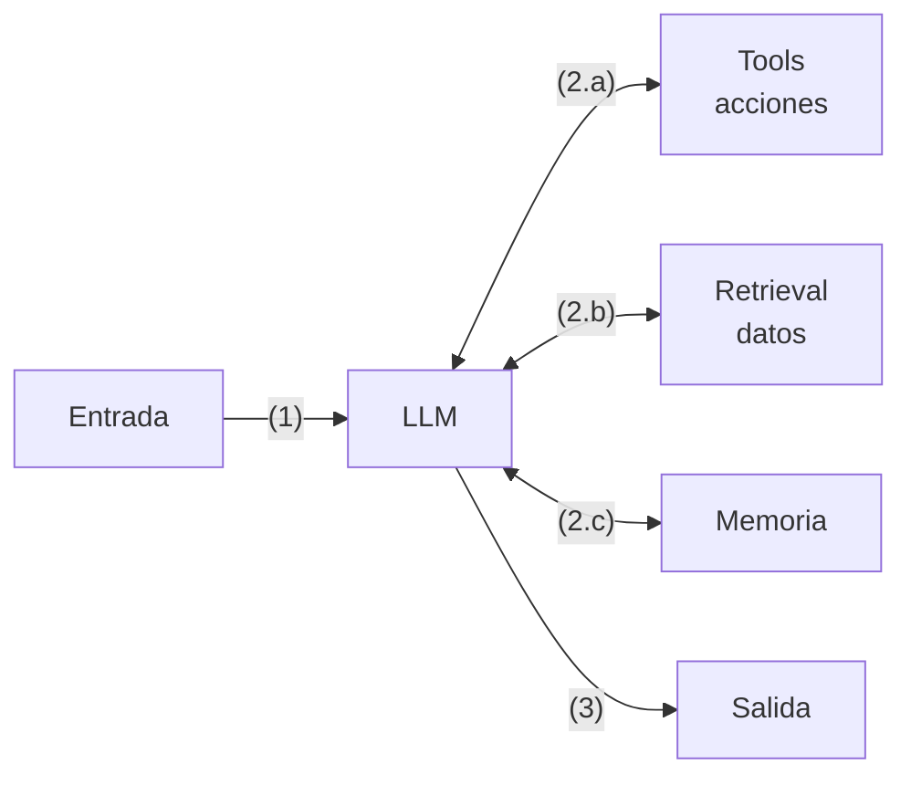

### ReAct · §3.2

**Cuándo aplicarlo.** Los pasos dependen de lo que se descubre (búsqueda, diagnóstico). Siempre con control de bucles y presupuesto.

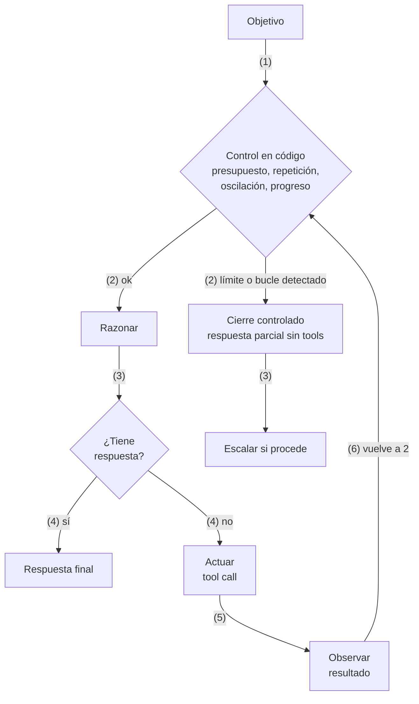

### Plan-and-Execute · §3.3

**Cuándo aplicarlo.** Tareas largas con plan visible y aprobable; modelo potente para planificar y barato para ejecutar.

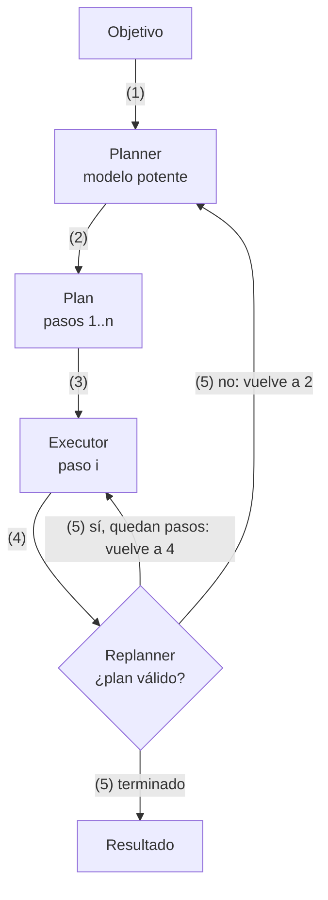

### Evaluator-Optimizer · §3.4

**Cuándo aplicarlo.** Hay un criterio de calidad claro (tests, esquema, rúbrica) y la crítica mejora el resultado.

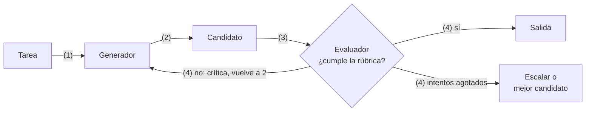

### Prompt chaining con gates · §3.5

**Cuándo aplicarlo.** Tarea que se divide en pasos fijos y conocidos, con contratos verificables entre pasos.

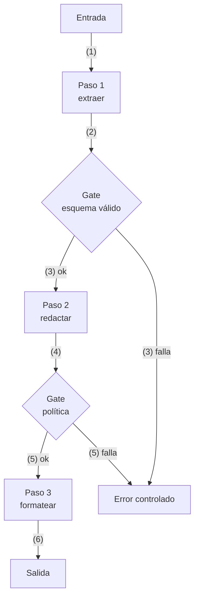

### Routing · §3.6

**Cuándo aplicarlo.** Entradas de categorías distintas, o mandar lo fácil a un modelo barato o local y lo difícil a uno potente.

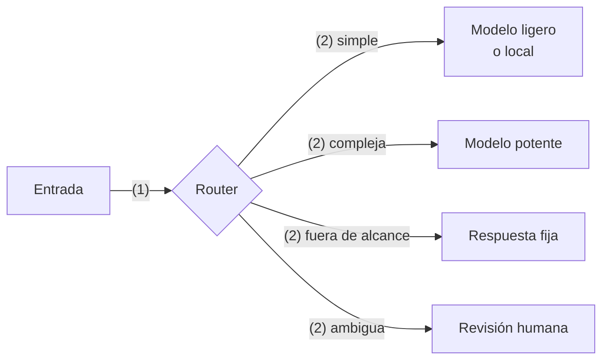

### Human-in-the-loop · §3.7

**Cuándo aplicarlo.** Acciones irreversibles o caras (pagos, borrados, envíos, producción) o riesgo alto en la spec.

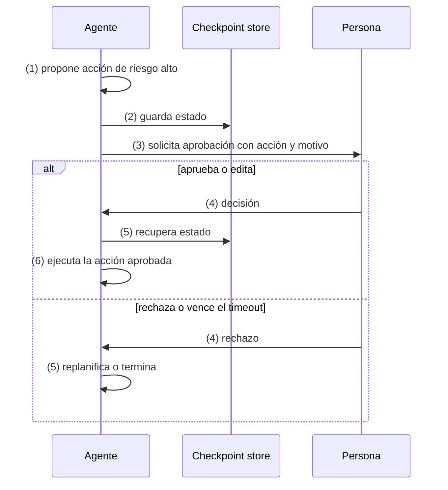

### Memoria por capas · §3.8

**Cuándo aplicarlo.** Agentes de muchos turnos o documentos grandes: el contexto es un recurso escaso.

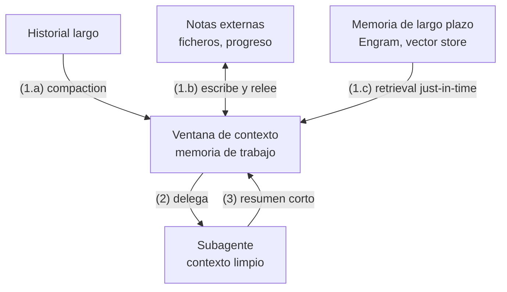

### Guardrails · §3.9

**Cuándo aplicarlo.** Siempre que el agente reciba entradas de terceros o pueda actuar fuera de su proceso.

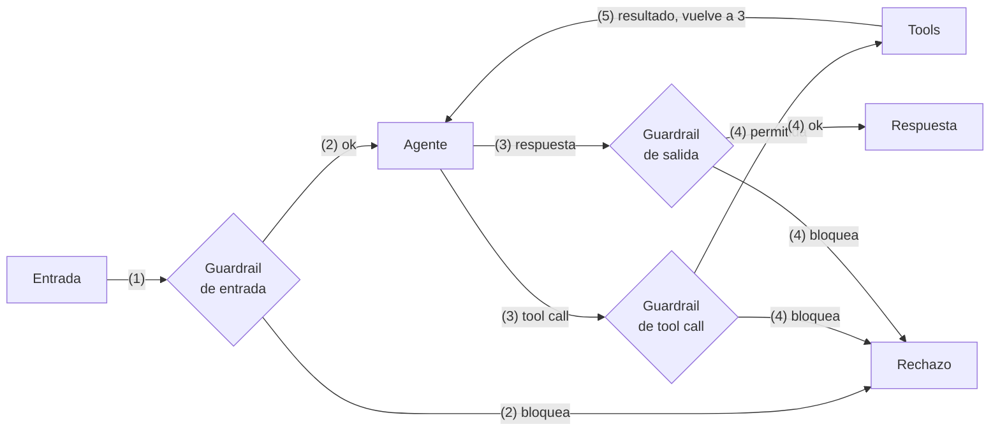

### Bounded autonomy · §3.10

**Cuándo aplicarlo.** Todo agente con bucle: límites de pasos, tokens, tiempo y coste, con condición de parada.

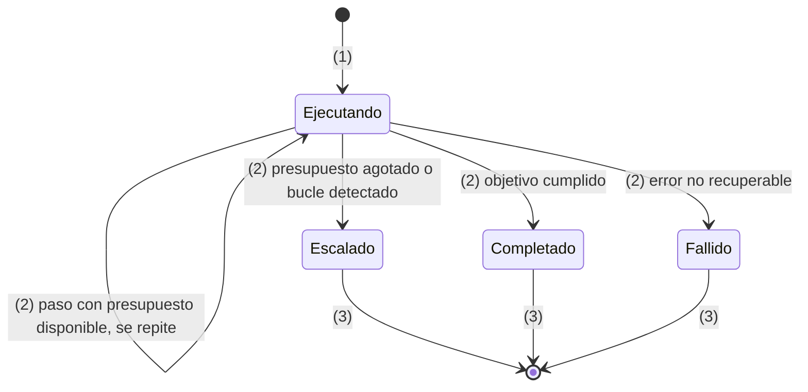

## Coordinación

Cómo se reparten el trabajo varios agentes.

### Orchestrator-workers · §4.1

**Cuándo aplicarlo.** Subtareas que no se conocen de antemano pero, una vez definidas, son independientes (research).

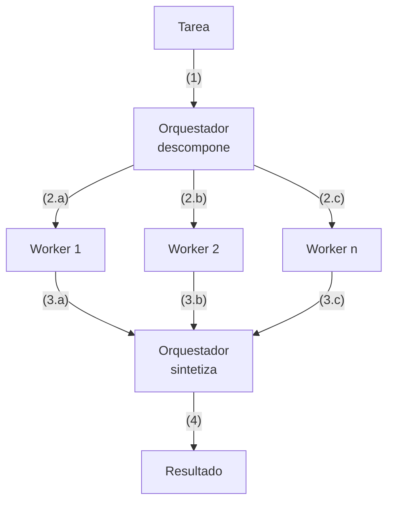

### Jerárquico · §4.2

**Cuándo aplicarlo.** Un supervisor tendría demasiados workers o tools, o los equipos son dominios distintos.

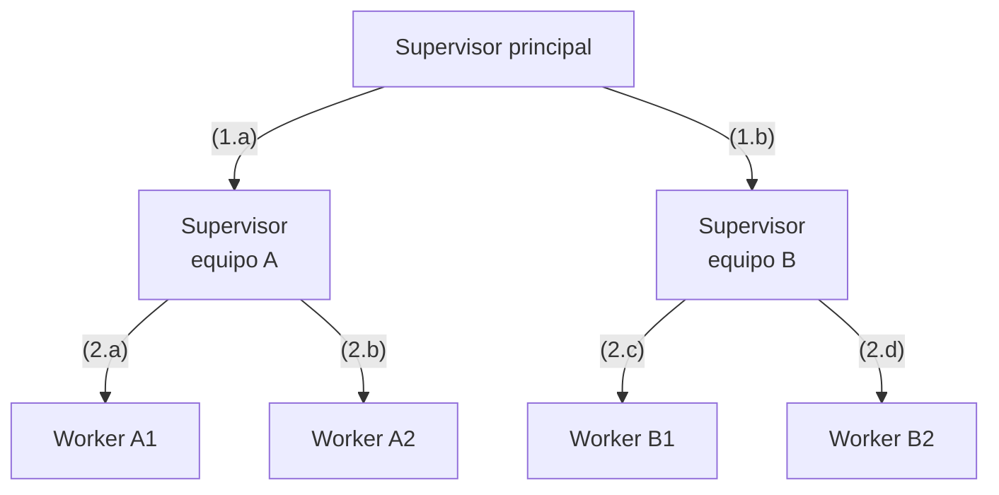

### Handoff · §4.3

**Cuándo aplicarlo.** Atención con áreas especializadas que se descubren durante la conversación. Un agente activo cada vez.

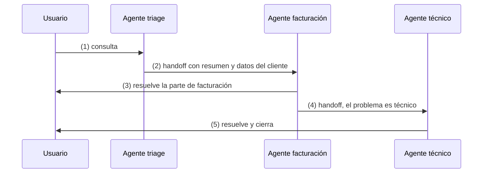

### Group chat / debate · §4.4

**Cuándo aplicarlo.** Revisión desde varios puntos de vista o contraste de hipótesis, con condición de fin explícita.

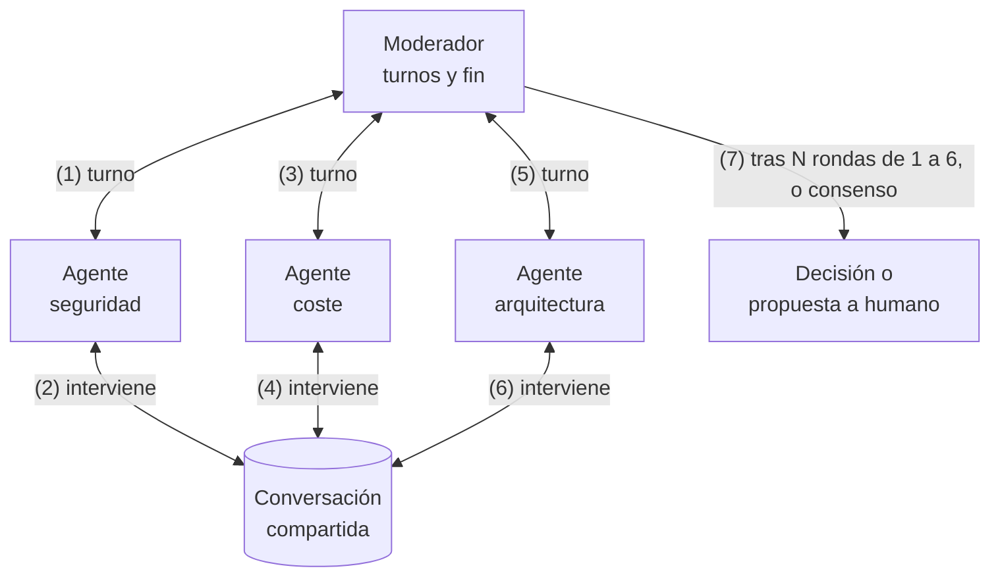

### Blackboard · §4.5

**Cuándo aplicarlo.** Problemas resueltos por aportaciones incrementales de especialistas sin orden fijo (diagnóstico).

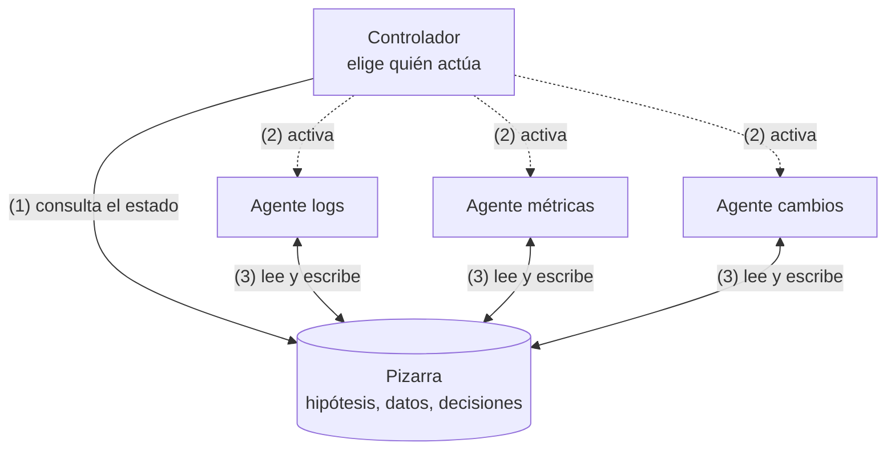

### Pipeline secuencial · §4.6

**Cuándo aplicarlo.** Proceso con etapas claras y especialistas distintos, con contratos tipados entre etapas.

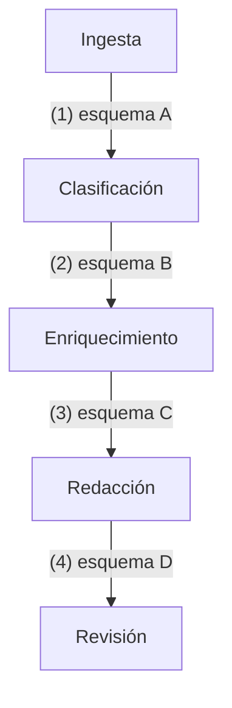

## Concurrencia

Qué hacer cuando varios agentes o instancias trabajan a la vez.

### Fan-out / fan-in · §5.1

**Cuándo aplicarlo.** Subtareas independientes donde importa la latencia: varias fuentes, ficheros o controles.

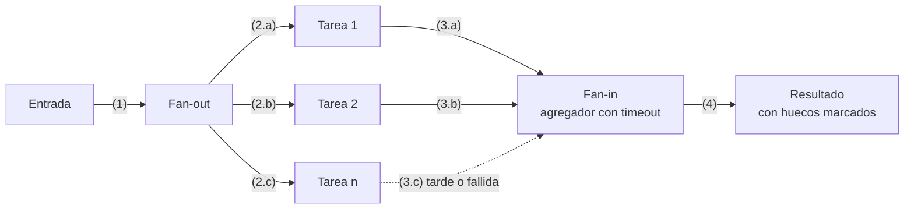

### Map-reduce · §5.2

**Cuándo aplicarlo.** Corpus que no cabe en el contexto, sobre todo con modelos locales de contexto limitado.

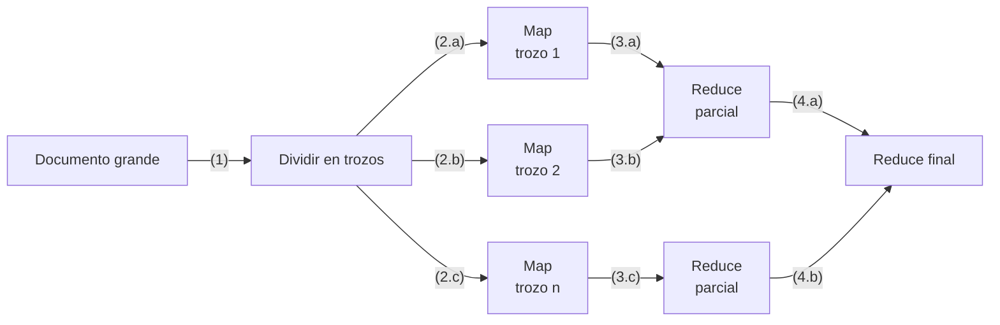

### Voting · §5.3

**Cuándo aplicarlo.** Decisiones discretas de alto impacto donde un error cuesta más que varias llamadas.

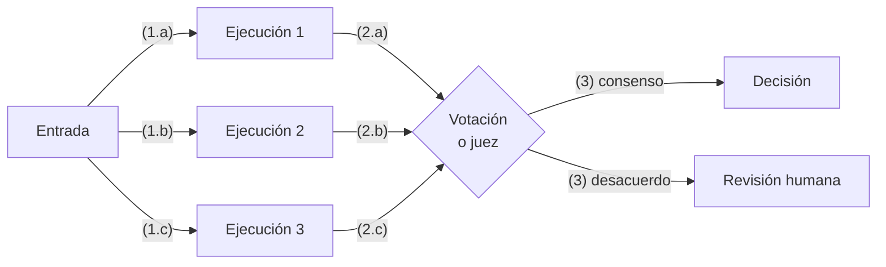

### Aislamiento del workspace · §5.4

**Cuándo aplicarlo.** Varios agentes modifican el mismo repositorio o recurso a la vez.

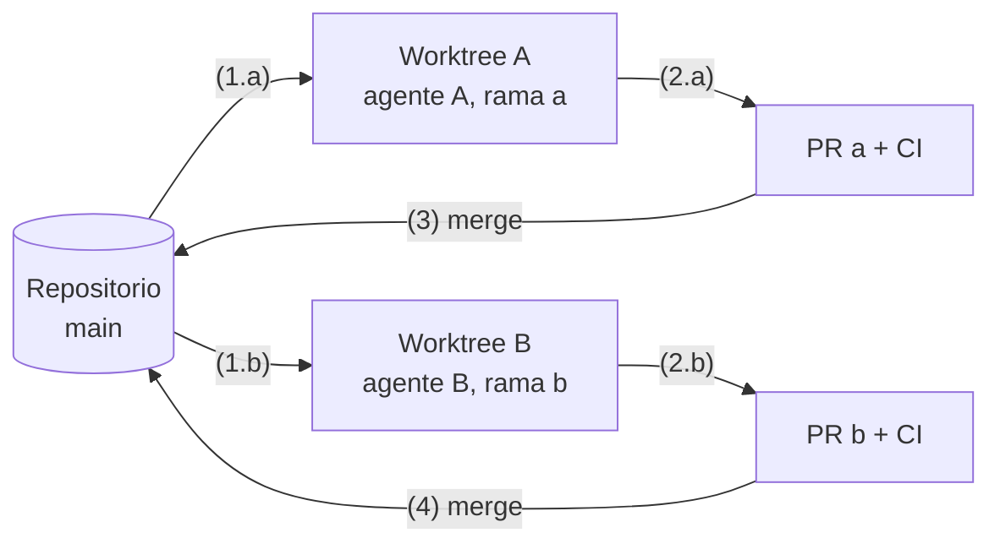

### Lease con fencing token · §5.5

**Cuándo aplicarlo.** Solo un agente debe actuar sobre un recurso y los agentes pueden colgarse o tardar.

```mermaid
sequenceDiagram
  participant A as Agente A
  participant L as Servicio de lease
  participant B as Agente B
  participant R as Recurso
  A->>L: (1) pide lease
  L-->>A: (2) concedido, token 34
  B->>L: (3) pide lease
  L-->>B: (4) denegado
  Note over A: se queda bloqueado esperando al LLM
  Note over L: el lease caduca
  B->>L: (5) pide lease
  L-->>B: (6) concedido, token 35
  B->>R: (7) escribe con token 35
  R-->>B: (8) ok
  A->>R: (9) escribe con token 34
  R-->>A: (10) rechazado, token antiguo
```

### Control optimista · §5.6

**Cuándo aplicarlo.** Estado compartido con conflictos poco frecuentes (pizarra, documento de tareas).

```mermaid
sequenceDiagram
  participant A as Agente A
  participant S as Estado compartido
  participant B as Agente B
  A->>S: (1.a) lee, versión 7
  B->>S: (1.b) lee, versión 7
  A->>S: (2) escribe si versión 7
  S-->>A: (3) ok, versión 8
  B->>S: (4) escribe si versión 7
  S-->>B: (5) conflicto
  B->>S: (6) relee, versión 8
  B->>B: (7) vuelve a decidir con el estado nuevo
  B->>S: (8) escribe si versión 8
  S-->>B: (9) ok, versión 9
```

### Backpressure · §5.7

**Cuándo aplicarlo.** Fan-out o colas contra un LLM con rate limits, o un modelo local con pocas peticiones simultáneas.

```mermaid
flowchart LR
  Q[("Cola de tareas")] -- "(1)" --> SEM{"Semáforo<br/>máx. N"}
  SEM -- "(2)" --> W["Workers"]
  W -- "(3)" --> API["API del LLM"]
  API -- "(4) 429 o latencia alta" --> CTRL["Control<br/>reduce N"]
  API -- "(4) ok sostenido" --> CTRL2["Control<br/>sube N"]
  CTRL -- "(5) vuelve a 2" --> SEM
  CTRL2 -- "(5) vuelve a 2" --> SEM
```

### Ejecución especulativa · §5.8

**Cuándo aplicarlo.** La latencia de cola importa más que el coste, solo con operaciones idempotentes.

```mermaid
sequenceDiagram
  participant C as Cliente
  participant M1 as Modelo A
  participant M2 as Modelo B
  C->>M1: (1) petición
  Note over C: supera el p95 sin respuesta
  C->>M2: (2) misma petición
  M2-->>C: (3) respuesta válida
  C->>M1: (4) cancela
```

## Sistemas distribuidos

Cómo sobrevivir a fallos parciales, red y no determinismo.

### Durable execution · §6.1

**Cuándo aplicarlo.** Agentes de larga duración, con aprobaciones humanas o pasos caros o con efectos.

```mermaid
sequenceDiagram
  participant W as Motor de workflow
  participant LOG as Registro de eventos
  participant AG as Paso del agente
  W->>AG: (1) paso 1, llamar al LLM
  AG-->>W: (2) resultado 1
  W->>LOG: (3) guarda resultado 1
  W->>AG: (4) paso 2, tool call
  AG-->>W: (5) resultado 2
  W->>LOG: (6) guarda resultado 2
  Note over W: el proceso cae
  W->>LOG: (7) reanuda y lee el registro
  Note over W: pasos 1 y 2 se reutilizan, no se repiten
  W->>AG: (8) paso 3
```

### Idempotency key · §6.2

**Cuándo aplicarlo.** Toda tool que crea, modifica o envía algo (pagos, tickets, correos, despliegues).

```mermaid
sequenceDiagram
  participant AG as Agente
  participant API as API destino
  AG->>API: (1) crear ticket, clave k1
  API->>API: (2) crea ticket 123 y guarda k1
  API--xAG: (3) timeout, no llega la respuesta
  AG->>API: (4) reintento, clave k1
  API-->>AG: (5) ticket 123, ya existía
  Note over AG,API: un solo ticket aunque haya dos peticiones
```

### Saga · §6.3

**Cuándo aplicarlo.** Acciones con efectos en varios sistemas sin transacción común.

```mermaid
flowchart LR
  S1["1 Reservar vuelo"] -- "(1)" --> S2["2 Reservar hotel"]
  S2 -- "(2)" --> S3["3 Cobrar"]
  S3 -- "(3) falla" --> C2["Compensar 2<br/>cancelar hotel"]
  C2 -- "(4)" --> C1["Compensar 1<br/>cancelar vuelo"]
  S3 -- "(3) ok" --> OK["Completado"]
```

### Transactional outbox · §6.4

**Cuándo aplicarlo.** El agente actualiza su estado y debe avisar a otros sin que ocurra lo uno sin lo otro.

```mermaid
flowchart LR
  AG["Agente"] -- "(1)" --> TX["Transacción local"]
  TX -- "(2.a)" --> ST[("Estado")]
  TX -- "(2.b)" --> OB[("Outbox")]
  OB -- "(3)" --> RL["Relay"]
  RL -- "(4)" --> BR[("Broker")]
  BR -- "(5)" --> A2["Otros agentes"]
```

### Coreografía por eventos · §6.5

**Cuándo aplicarlo.** Agentes de equipos distintos y muy desacoplados, procesos que crecen añadiendo consumidores.

```mermaid
flowchart LR
  A1["Agente ingesta"] -- "(1) documento.recibido" --> BR[("Broker")]
  BR -- "(2) documento.recibido" --> A2["Agente clasificación"]
  A2 -- "(3) documento.clasificado" --> BR
  BR -- "(4.a) documento.clasificado" --> A3["Agente cumplimiento"]
  BR -- "(4.b) documento.clasificado" --> A4["Agente archivo"]
```

### Retry con backoff y dead letter · §6.6

**Cuándo aplicarlo.** Todas las llamadas remotas (LLM, MCP, APIs). Nunca con errores permanentes.

```mermaid
flowchart LR
  CALL["Llamada<br/>con timeout"] -- "(1)" --> OK{"¿Ok?"}
  OK -- "(2) sí" --> R["Resultado"]
  OK -- "(2) no" --> TR{"¿Transitorio?"}
  TR -- "(3) no" --> DLQ[("Dead letter<br/>revisión")]
  TR -- "(3) sí" --> N{"¿Intentos<br/>restantes?"}
  N -- "(4) sí" --> W["Esperar<br/>backoff + jitter"]
  W -- "(5) vuelve a 1" --> CALL
  N -- "(4) no" --> DLQ
```

### Circuit breaker con fallback · §6.7

**Cuándo aplicarlo.** Dependencias externas que se degradan y existe una alternativa evaluada (otro modelo, local).

```mermaid
stateDiagram-v2
  [*] --> Cerrado: (1)
  Cerrado --> Abierto: (2) fallos sobre el umbral
  Abierto --> SemiAbierto: (3) pasa el tiempo de espera
  SemiAbierto --> Cerrado: (4) la llamada de prueba funciona, vuelve a 2
  SemiAbierto --> Abierto: (4) la llamada de prueba falla, vuelve a 3
  note right of Abierto
    Las llamadas van al fallback
    modelo alternativo o local
  end note
```

### Bulkhead · §6.8

**Cuándo aplicarlo.** Conviven agentes críticos e interactivos con batch, o varios equipos comparten proveedor.

```mermaid
flowchart TB
  subgraph P1["Compartimento crítico"]
    A1["Agente de soporte"] -- "(1.a)" --> Q1["Cupo 20<br/>clave 1"]
  end
  subgraph P2["Compartimento batch"]
    A2["Agente de informes"] -- "(1.b)" --> Q2["Cupo 5<br/>clave 2"]
  end
  Q1 -- "(2.a)" --> LLM["Proveedor LLM"]
  Q2 -- "(2.b)" --> LLM
```

### MCP y A2A · §6.9

**Cuándo aplicarlo.** MCP: tools reutilizables entre agentes. A2A: agentes de equipos distintos o de terceros.

```mermaid
flowchart LR
  subgraph EA["Equipo A"]
    AA["Agente A"] -- "(1) MCP" --> TA["MCP servers<br/>tools y datos de A"]
  end
  subgraph EB["Equipo B"]
    AB["Agente B"] -- "(3) MCP" --> TB["MCP servers<br/>tools y datos de B"]
  end
  AA -- "(2) A2A<br/>Agent Card, tareas" --> AB
```

### Tracing distribuido · §6.10

**Cuándo aplicarlo.** Desde el primer agente que sale del portátil, y siempre en multiagente.

```mermaid
flowchart TB
  R["invoke_agent orquestador"] -- "(1)" --> C1["chat<br/>modelo, tokens"]
  R -- "(2)" --> T1["execute_tool buscar"]
  R -- "(3)" --> S["invoke_agent worker<br/>otro proceso"]
  S -- "(4)" --> C2["chat"]
  S -- "(5)" --> T2["execute_tool leer"]
  R -- "(6)" --> C3["chat síntesis"]
```

## Seguridad

Defensas de arquitectura contra la prompt injection.

### Lethal trifecta · §7.1

**Cuándo aplicarlo.** Revisión de diseño de cualquier agente, antes de elegir sus tools.

```mermaid
flowchart LR
  P["Datos privados"] -- "(1.a)" --> X{"Las tres juntas<br/>= riesgo de exfiltración"}
  U["Contenido no confiable"] -- "(1.b)" --> X
  E["Canal de salida"] -- "(1.c)" --> X
  X -- "(2)" --> D["Defensa: quitar al menos una"]
```

### Dual LLM · §7.2

**Cuándo aplicarlo.** El agente procesa contenido no confiable y además ejecuta acciones.

```mermaid
flowchart TB
  U["Usuario"] -- "(1)" --> PL["LLM privilegiado<br/>tools, sin datos no confiables"]
  PL -- "(2) procesa $DOC" --> CT["Controlador<br/>código"]
  CT -- "(3.a)" --> QL["LLM en cuarentena<br/>sin tools"]
  EXT["Contenido no confiable"] -- "(3.b)" --> QL
  QL -- "(4) resultado como $VAR1" --> CT
  CT -- "(5) solo la referencia $VAR1" --> PL
  PL -- "(6) enviar $VAR1" --> CT
  CT -- "(7)" --> T["Tool<br/>con el valor real"]
```

### Plan-then-execute · §7.3

**Cuándo aplicarlo.** El plan se deduce de la petición del usuario, antes de leer contenido externo.

```mermaid
flowchart LR
  REQ["Petición del usuario"] -- "(1)" --> PLAN["Plan fijado<br/>1 leer, 2 resumir, 3 enviar al usuario"]
  PLAN -- "(2)" --> EX["Ejecución"]
  EXT["Contenido no confiable"] -- "(3)" --> EX
  EX -- "(4) solo acciones del plan" --> T["Tools"]
  EX -. "(4) acción nueva" .-> BL["Bloqueada"]
```

### Action-selector · §7.4

**Cuándo aplicarlo.** Traducir lenguaje natural a una acción conocida, sin encadenar pasos.

```mermaid
flowchart LR
  U["Petición"] -- "(1)" --> LLM["LLM selector"]
  LLM -- "(2)" --> L{"Lista fija<br/>de acciones"}
  L -- "(3)" --> A1["Ver pedido"]
  L -- "(3)" --> A2["Cambiar dirección"]
  L -- "(3)" --> A3["Hablar con una persona"]
  A1 -- "(4)" --> OUT["Respuesta al usuario<br/>sin volver al LLM"]
  A2 -- "(4)" --> OUT
  A3 -- "(4)" --> OUT
```

### Context minimization · §7.5

**Cuándo aplicarlo.** Chatbots sobre datos: la petición se convierte en consulta y se descarta el texto original.

```mermaid
flowchart TB
  U["Petición del usuario"] -- "(1)" --> LLM1["LLM<br/>extrae la consulta"]
  LLM1 -- "(2.a)" --> Q["Consulta estructurada"]
  Q -- "(3)" --> DB[("Datos")]
  DB -- "(4)" --> LLM2["LLM<br/>redacta la respuesta"]
  U -. "(2.b) eliminada del contexto" .-x LLM2
  LLM2 -- "(5)" --> OUT["Respuesta"]
```

## Operación

Cómo se pone en producción con confianza.

### Evals como quality gates · §8.1

**Cuándo aplicarlo.** Siempre: cualquier cambio de prompt, modelo, tool o patrón.

```mermaid
flowchart TB
  CH["Cambio"] -- "(1)" --> PC["pre-commit"]
  PC -- "(2)" --> CI["CI con LLM fake"]
  CI -- "(3)" --> EV["Evals con modelo real"]
  EV -- "(4)" --> TH{"¿Supera los<br/>umbrales por AC?"}
  TH -- "(5) sí" --> M["Merge"]
  TH -- "(5) no" --> FX["Corregir o<br/>revisar la spec"]
```

### Shadow mode · §8.2

**Cuándo aplicarlo.** Antes de sustituir un proceso existente o cambiar de modelo en un agente crítico.

```mermaid
flowchart LR
  T["Tráfico real"] -- "(1.a)" --> CUR["Sistema actual"]
  T -- "(1.b)" --> NEW["Agente nuevo<br/>en sombra, dry-run"]
  CUR -- "(2.a)" --> U["Usuario"]
  CUR -- "(2.b)" --> CMP["Comparación"]
  NEW -- "(2.c)" --> CMP
  CMP -- "(3)" --> EV["Nuevos casos de eval"]
```

### Canary con kill switch · §8.3

**Cuándo aplicarlo.** Cualquier cambio de modelo, prompt o tool en un agente en producción.

```mermaid
flowchart LR
  T["Tráfico"] -- "(1)" --> RT{"Router<br/>por porcentaje"}
  RT -- "(2) 95 %" --> V1["Versión actual"]
  RT -- "(2) 5 %" --> V2["Versión nueva"]
  V2 -- "(3)" --> MET{"¿Métricas<br/>dentro de umbral?"}
  MET -- "(4) sí" --> UP["Ampliar porcentaje"]
  MET -- "(4) no" --> RB["Revertir"]
  KS["Kill switch"] -. "en cualquier momento: desactiva" .-> V2
```

## Sobre la autoría

**Autor:** Hector Gracia de Azcoitia (@whinedo).

## Licencia y avisos

### Licencia

© 2026 Hector Gracia de Azcoitia. Este documento se distribuye bajo la licencia Creative Commons Atribución-CompartirIgual 4.0 Internacional ([CC BY-SA 4.0](https://creativecommons.org/licenses/by-sa/4.0/deed.es)). Puedes copiarlo, redistribuirlo y adaptarlo para cualquier fin, también comercial, con dos condiciones:

- **Atribución:** reconocer la autoría, enlazar la licencia e indicar si has hecho cambios.
- **Compartir igual:** distribuir tus adaptaciones con esta misma licencia.

Atribución sugerida: «Patrones aplicados al desarrollo de agentes · Cheatsheet», de Hector Gracia de Azcoitia, licencia CC BY-SA 4.0.

### Contenido de terceros

- Los patrones se describen con palabras propias a partir de la guía «Patrones aplicados al desarrollo de agentes» y de las fuentes que esta cita; esas fuentes conservan sus propios derechos y no quedan cubiertas por esta licencia.
- Los nombres de patrones, protocolos (MCP, A2A) y marcos se mencionan por su nombre; sus especificaciones pertenecen a sus editores.
- Las marcas y nombres de productos pertenecen a sus titulares. Su mención no implica afiliación ni respaldo.

### Aviso de responsabilidad

Este cheatsheet tiene fines formativos y divulgativos. Su contenido es orientativo, puede contener errores y no sustituye el detalle de la guía ni una evaluación profesional de la arquitectura. Las herramientas, protocolos y prácticas citados cambian con rapidez, así que conviene verificar su estado antes de aplicar cualquier recomendación. El autor no se responsabiliza de las decisiones tomadas a partir de este documento.
