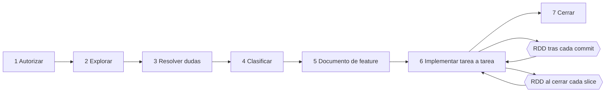
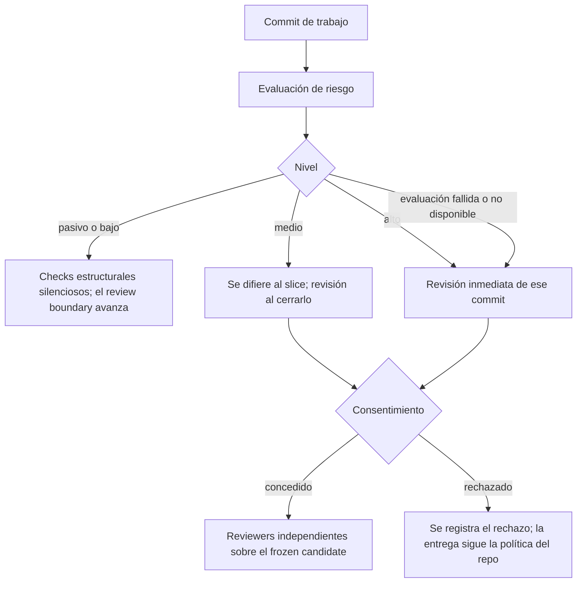
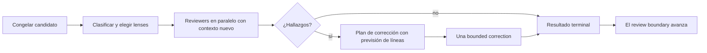
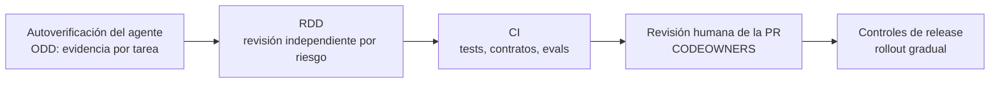

# RDD en el ciclo ODD: revisión independiente basada en riesgo

**Guía para arquitectos empresariales y de soluciones** · 26 de octubre de 2026 · Gentle AI 4.x

---

## 1. Resumen ejecutivo

**Conclusión:** RDD (Receipt-Driven Development) es la capa de **revisión independiente** que Gentle AI puede añadir al ciclo ODD. Tras cada commit evalúa el riesgo del cambio y, solo cuando hay riesgo, lanza reviewers con contexto nuevo sobre una versión congelada del cambio, con una bounded correction si hace falta. **No sustituye a la CI ni a la revisión humana, y nunca autoriza una entrega.** Para una organización, RDD es un control intermedio útil, más barato que revisarlo todo y más fiable que la autoverificación del agente que escribió el código. Debe activarse por política según el riesgo del repositorio y complementarse con reglas propias, porque el nivel de riesgo lo decide el clasificador de la herramienta.

- **Dónde actúa en ODD:** en el paso 6, *implementar tarea a tarea*. Tras cada commit de trabajo, y al cerrar cada slice (unas 400 líneas cambiadas).
- **Cómo decide:** por evidencia, no por tamaño. Un cambio grande que solo toca documentación no recibe reviewers; un cambio de dos líneas en autenticación recibe varios.
- **Qué deja:** el nivel de riesgo y el resultado de la revisión, registrados por tarea en el documento de feature.
- **Quién lo controla:** el usuario o la organización. ODD nunca lo activa por su cuenta. Su estado se consulta con `gentle-ai review mode status`.
- **Recomendación:** activarlo en repositorios de riesgo medio y alto, como agentes con herramientas que tienen efectos, seguridad o datos personales. Mantener CI y revisión humana como quality gates de integración en todos los casos.

---

## 2. Qué es RDD y qué no es

RDD registra evidencia de revisión independiente y acotada sobre un candidato de cambio congelado, y permite un proceso de corrección también acotado. Sus principios de diseño son:

| Principio | Significado |
| --- | --- |
| La revisión llega después del candidato | No hay plan previo que aprobar: se revisa lo que realmente se ha escrito |
| El nivel lo decide la evidencia | El clasificador nombra su propio motivo, así que el coste nunca queda sin explicar |
| Congelación del candidato | Lo revisado es una versión inmutable del cambio, identificada por su hash; los resultados se ligan a ese hash |
| Independencia | Los reviewers trabajan con contexto nuevo, separados del agente que implementó |
| Bounded correction | Si hay hallazgos, la corrección tiene un presupuesto de líneas fijado al congelar el candidato |
| Fallo seguro | Una evaluación fallida nunca equivale a riesgo bajo; un interruptor ilegible no equivale a desactivado |
| Separado de la entrega | La evidencia de RDD nunca autoriza commits, push, PR ni releases; manda la política del repositorio |

| RDD **es** | RDD **no es** |
| --- | --- |
| Una revisión adversarial e independiente, proporcional al riesgo | Una aprobación de entrega |
| Evidencia registrada por tarea | Un sustituto de la CI, de los tests ni de la revisión humana de la PR |
| Un control opcional, gestionado por el usuario | Algo que ODD active por su cuenta |
| Una forma de detectar fallos antes de la PR | Una garantía de ausencia de fallos |

**Glosario:**

| Término | Qué es |
| --- | --- |
| Candidato | El conjunto de commits que se revisa, congelado e identificado por su hash |
| Review boundary | El último punto revisado; el primero es el punto de ramificación y cada revisión lo hace avanzar |
| Nivel de riesgo | Pasivo, bajo, medio o alto, asignado por la evaluación tras cada commit |
| Lens | Un ángulo de revisión con su propio reviewer; el nivel más alto usa cuatro |
| Consentimiento | La confirmación que se pide antes de lanzar reviewers en riesgo medio o alto |
| Bounded correction | El único ciclo de corrección permitido, limitado por un presupuesto de líneas |
| Slice | Bloque de entrega revisable, de unas 400 líneas cambiadas |

---

## 3. Cómo ha evolucionado

| Versión | Cambio relevante para RDD |
| --- | --- |
| 2.3–2.4 (candidatas) | Ciclo completo de revisión con receipts, consentimiento registrado, lenses, refuter y validator; transporte de reviewers común para Claude Code, Codex y OpenCode |
| 2.4.0 | **Cambio de valor por defecto:** RDD pasa de activado a desactivado; "una instalación que nadie configuró ya no empieza a revisar sola"; la entrega vuelve a la política del repositorio (hooks, tests, CI) |
| 2.5.0 (candidatas) | Se retiran los receipts compactos y sus delivery gates; "ningún receipt retirado es una aprobación" |
| 3.0 | RDD sale de las fases SDD y queda como interruptor de revisión controlado por el usuario |
| 4.0 | La guía de RDD solo se instala para Claude Code, Codex y OpenCode |
| 4.2 | El independent verifier solo se ejecuta para un elemento de alto riesgo nombrado |

**Valor por defecto: compruébalo, no lo supongas.** La documentación no es coherente. La guía de uso indica que el instalador propone desactivado, la guía de uso previsto lo describe como activado por defecto, y hay una propuesta abierta para activarlo por defecto. Antes de estandarizar, ejecuta `gentle-ai review mode status` en cada equipo y fija el valor de forma explícita.

---

## 4. Dónde encaja en el ciclo ODD



| Paso de ODD | Papel de RDD |
| --- | --- |
| 1–4. Autorizar, explorar, resolver dudas, clasificar | Ninguno: RDD no revisa planes, solo cambios ya escritos |
| 5. Registrar el documento de feature | Se elige la delivery strategy, que define los slices que revisará RDD en riesgo medio |
| 6. Implementar tarea a tarea | **Punto de integración principal:** evaluación tras cada commit y revisión inmediata o diferida según el riesgo |
| 6. Cierre de slice | Revisión de los commits de riesgo medio acumulados desde el último review boundary |
| 7. Cerrar | El informe final incluye los checks fallidos o pendientes; los resultados de RDD ya están en el documento de feature |

---

## 5. Decisión tras cada commit

Con RDD activado, cada commit de trabajo se evalúa contra el último review boundary:

```bash
gentle-ai review assess --cwd <repo> --base-ref <último review boundary> --committed-only --json
```



| Nivel | Acción | Coste | Resultado registrado |
| --- | --- | --- | --- |
| Pasivo o bajo | Checks estructurales sin reviewer ni consentimiento | Mínimo | `passive` |
| Medio | Consentimiento; revisión al cerrar el slice | Una revisión por slice | `deferred to slice`, después `granted` o `declined` |
| Alto | Consentimiento; revisión inmediata del commit | Varios reviewers | `granted` o `declined` |
| Evaluación fallida o no disponible | Se trata como alto | Como alto | `unavailable` y se sigue la continuación nativa |

**Por qué importa la regla de fallo seguro:** si el clasificador falla, el cambio no pasa como inocuo. Es el comportamiento que exigiría cualquier control de seguridad.

---

## 6. Ciclo de vida de una revisión



1. **Congelar:** el candidato queda fijado e identificado por su hash. Nada de lo que cambie después en el working directory altera lo revisado.
2. **Clasificar y elegir lenses:** el nivel determina cuántos reviewers intervienen. El nivel más alto usa cuatro lenses, y en algunas versiones intervienen además roles de refuter y validator.
3. **Revisar:** cada lens produce un resultado ligado al hash congelado. Las citas de los reviewers deben apuntar a ficheros del candidato.
4. **Corregir, una sola vez:** si hay hallazgos, se pide un plan con la previsión de líneas (`--correction-lines`) y se comprueba contra el presupuesto fijado al congelar. Una corrección que se pasa del presupuesto sale por una vía de abandono auditada.
5. **Cerrar:** la revisión termina en un estado final y el review boundary avanza; la siguiente evaluación parte de ahí.

Los detalles internos de este ciclo, como estados, roles y comandos de bajo nivel, proceden de la documentación de arquitectura y de las notas de versión del proyecto, y han cambiado entre versiones. Para gobierno basta con el contrato externo: nivel, consentimiento, revisión independiente, una corrección y resultado registrado.

---

## 7. Slices y delivery strategies

ODD prevé las líneas cambiadas a partir de la lista de tareas y lleva la cuenta con cada commit. Al superar unas 400 líneas, aplica la estrategia elegida antes del siguiente commit y registra los límites de slice en el documento de feature. La revisión de riesgo medio cubre los commits acumulados desde el último review boundary, dentro de ese presupuesto.

| Estrategia | Comportamiento | Cuándo elegirla |
| --- | --- | --- |
| `ask-on-risk` (por defecto) | Pregunta cuando el riesgo lo justifica | Estándar recomendado |
| `auto-chain` | Encadena slices automáticamente | Cambios largos de bajo riesgo |
| `single-pr` | Una sola PR para toda la feature | Cambios que deben revisarse juntos |
| `exception-ok` | Acepta superar el presupuesto como excepción | Casos justificados y documentados |

**Encaje con la política de PR:** alinea el tamaño de slice con el tamaño máximo de PR que acepta tu organización. Así cada PR llega con su revisión RDD ya hecha.

---

## 8. Qué queda registrado

Cada tarea del documento de feature `odd/tasks/<feature>.md` anota su nivel de riesgo y el resultado de RDD, y el documento incluye los límites de slice. Ejemplo ilustrativo; el formato exacto lo genera la herramienta:

```markdown
## Tareas
- [x] T1 Contrato y tests de fetch_page · riesgo: bajo · RDD: passive · commit a1b2c3d
- [x] T2 Enmascarado de secretos en logs · riesgo: alto · RDD: granted (4 lenses, 1 corrección) · commit d4e5f6a
- [ ] T3 Casos de eval adversariales · riesgo: medio · RDD: deferred to slice

## Slices
- Slice 1: T1–T2 · 312 líneas · cerrada
```

Para auditoría, este registro responde a tres preguntas: qué cambios se consideraron de riesgo, si se revisaron de forma independiente y qué se corrigió. Consérvalo en el repositorio junto con la PR.

---

## 9. Lo que RDD nunca hace

- **No autoriza la entrega.** "La evidencia de RDD no autoriza commits, push, pull requests ni releases." La entrega sigue la política del repositorio: hooks, tests, CI y revisión humana.
- **No se salta quality gates existentes.** Los delivery gates que ya tengas se aplican igual, con RDD activado o desactivado.
- **No se activa solo.** ODD nunca lo enciende; la automatización tampoco cambia el interruptor.
- **No inventa aprobaciones.** Desactivarlo no convierte nada en aprobado, y rechazar una revisión queda registrado como rechazo, nunca como aprobación.
- **No revisa planes.** Revisa cambios ya escritos y congelados.

---

## 10. Configuración y operación

```bash
gentle-ai review mode status                   # estado efectivo y su origen (solo lectura)
gentle-ai review mode enable --scope global    # activar para todos los repositorios del equipo
gentle-ai review mode disable                  # desactivar; la entrega sigue la política del repo
```

- **Alcance:** existe un valor global y overrides por clon de repositorio. Una desactivación explícita, global o por clon, siempre se respeta. Usa `gentle-ai review mode --help` para ver las opciones de alcance de tu versión.
- **Instalador:** ofrece RDD activado o desactivado y guarda la elección solo si la instalación termina bien.
- **Tras actualizar Gentle AI:** `gentle-ai sync`, porque los activos gestionados deben coincidir con el binario y las revisiones se niegan a ejecutarse contra activos desalineados.
- **En la app de Claude:** RDD actúa dentro de tus sesiones locales de la pestaña Code. Cuando el riesgo es medio o alto, el agente te pide consentimiento antes de lanzar reviewers.

---

## 11. Gobierno: RDD dentro de la defensa en profundidad



| Capa | Qué detecta | Quién la controla | ¿Bloquea la integración? |
| --- | --- | --- | --- |
| Autoverificación ODD | Fallos que el propio agente puede observar | Agente | No |
| RDD | Fallos que un reviewer independiente detecta en cambios de riesgo | Usuario u organización | No: aporta evidencia |
| CI | Regresiones, contratos rotos, evals por debajo del umbral | Organización | Sí |
| Revisión humana | Decisiones de diseño, alcance y riesgo de negocio | Organización | Sí |
| Release | Impacto en producción | Organización | Sí |

**Política recomendada según el riesgo del repositorio:**

| Riesgo del repositorio o agente | RDD | Complemento obligatorio |
| --- | --- | --- |
| Bajo (solo lectura, sin datos sensibles) | Opcional, a criterio del equipo | CI y revisión de PR estándar |
| Medio (herramientas reversibles, fuentes externas) | Activado | Evals de uso de herramientas y robustez en CI |
| Alto (seguridad, datos personales, acciones con efectos) | Activado y verificado en el arranque de cada sesión | CODEOWNERS de seguridad, evals adversariales, rollout gradual |

**Límite a tener en cuenta:** según la documentación pública, el nivel de riesgo lo asigna el clasificador de Gentle AI y la organización no puede fijarlo. Si una ruta del repositorio siempre debe considerarse de alto riesgo (por ejemplo, `specs/security-control-agent/` o `src/tools/` con efectos), no dependas solo de RDD. Exígelo también con CODEOWNERS y con jobs de CI específicos para esas rutas.

---

## 12. Aplicado a la generación de agentes

Con los tres agentes de la guía *ODD aplicado a la generación de agentes*. Los niveles son orientativos: el clasificador decide en cada caso por la evidencia del diff.

| Cambio | Agente | Nivel esperable | Comportamiento de RDD | Quality gate que sigue mandando |
| --- | --- | --- | --- | --- |
| Corregir una errata en la documentación | Resumen de incidencias | Pasivo | Checks silenciosos | CI estándar |
| Añadir un caso de eval | Investigación web | Bajo o medio | Silencioso o diferido al slice | CI con la suite de evals |
| Añadir la herramienta `fetch_page` | Investigación web | Medio | Revisión al cerrar el slice | Evals AC-01 y AC-04 en CI |
| Cambiar el prompt de citación | Investigación web | Medio | Revisión al cerrar el slice | Evals de regresión |
| Enmascarado de secretos en logs | Control de seguridad | Alto | Revisión inmediata con varios reviewers | AC-04 en CI y revisión de Seguridad |
| Ampliar límites de autonomía (§7), por ejemplo permitir `comment_pr` sin confirmación | Control de seguridad | Alto | Revisión inmediata | Aprobación de Seguridad y evals de traza AC-06 |
| Cambiar la lista cerrada de escáneres | Control de seguridad | Alto | Revisión inmediata | Revisión de Seguridad y corpus AC-01 a AC-03 |

**Recomendaciones específicas para agentes:**

- **Revisa con RDD el agente que construye agentes.** Lo que más riesgo añade a un agente son sus herramientas con efectos y sus límites de autonomía. Son justo los cambios en los que una revisión independiente aporta más.
- **Las evals no son opcionales aunque RDD apruebe.** RDD revisa código; las evals miden el comportamiento no determinista del agente sobre varias ejecuciones. Son controles complementarios.
- **Pide a los reviewers que lean la spec.** Que el documento de feature cite la spec del agente permite que la revisión compare el cambio con el contrato, no solo con el código.

---

## 13. Coste y rendimiento

- **El nivel es la palanca de coste.** El nivel más bajo no usa reviewers y el más alto usa cuatro, así que el coste sigue al riesgo y no al tamaño del cambio.
- **Añade tiempo de revisión y coste de modelo.** Con una suscripción de Claude, las revisiones consumen del mismo cupo que tus sesiones. En repositorios de bajo riesgo puede no compensar.
- **Rechazar una revisión es legítimo.** Rechazar el consentimiento en un candidato concreto no apaga RDD: el siguiente candidato vuelve a preguntar. Úsalo con criterio y no como costumbre, porque el rechazo queda registrado.
- **Mide antes de generalizar:** revisiones por semana, proporción por nivel y hallazgos por revisión. Si casi todo sale pasivo, el coste es bajo. Si casi todo sale alto, revisa la granularidad de los commits.

---

## 14. Riesgos y mitigaciones

| Riesgo | Señal | Mitigación |
| --- | --- | --- |
| Confundir evidencia con aprobación | PR integradas "porque RDD las revisó" | Política explícita: CI y revisión humana siguen siendo obligatorias |
| Valor por defecto distinto al esperado | Equipos sin revisiones creyendo que están activas | `gentle-ai review mode status` en la incorporación y en auditorías periódicas |
| Clasificación de riesgo insuficiente para tu contexto | Cambios críticos clasificados como bajos | CODEOWNERS y CI por rutas críticas, independientes de RDD |
| Rechazos sistemáticos | Muchos `declined` en los documentos de feature | Revisar los motivos; endurecer la política en repos de riesgo alto |
| Coste en cupo de la suscripción | Límites de uso alcanzados antes de lo previsto | Activarlo solo donde el riesgo lo justifique; vigilar `/status` |
| Deriva entre versiones | Comportamiento distinto tras actualizar | Leer notas de versión, `gentle-ai sync` y prueba piloto antes de generalizar |

---

## 15. Métricas

| Métrica | Qué indica |
| --- | --- |
| Distribución por nivel (pasivo, bajo, medio, alto) | Perfil de riesgo real del trabajo de los agentes |
| Hallazgos por revisión y proporción corregida | Valor que aporta RDD |
| Proporción de `declined` frente a `granted` | Disciplina de uso |
| Defectos detectados en CI o en producción tras una revisión RDD | Lo que RDD no está detectando |
| Coste o tiempo añadido por revisión | Si compensa en cada tipo de repositorio |

---

## 16. Checklist para arquitectos

- [ ] Estado de RDD verificado con `gentle-ai review mode status` y fijado de forma explícita por tipo de repositorio
- [ ] Política escrita: RDD aporta evidencia y nunca sustituye a CI ni a la revisión humana
- [ ] RDD activado en repositorios de riesgo medio y alto, incluidos todos los agentes con herramientas que tienen efectos
- [ ] CODEOWNERS y jobs de CI específicos para rutas críticas, independientes del clasificador
- [ ] Tamaño de slice alineado con el tamaño máximo de PR de la organización
- [ ] Documentos de feature conservados en el repositorio como evidencia de revisión
- [ ] Métricas de nivel, hallazgos y rechazos revisadas trimestralmente
- [ ] Notas de versión de Gentle AI revisadas antes de cada actualización mayor

---

## Fuentes

- [Gentle AI: uso, ODD y RDD](https://github.com/Gentleman-Programming/gentle-ai/blob/main/docs/usage.md)
- [Gentle AI: uso previsto](https://github.com/Gentleman-Programming/gentle-ai/blob/main/docs/intended-usage.md)
- [Gentle AI: arquitectura de RDD orgánico](https://github.com/Gentleman-Programming/gentle-ai/blob/main/docs/architecture/organic-rdd.md)
- [Notas de versión de Gentle AI (2.3–2.5)](https://github.com/Gentleman-Programming/gentle-ai/releases)
- [Bounded correction y frozen candidate (PR #3483)](https://github.com/Gentleman-Programming/gentle-ai/pull/3483)
- [Propuesta de RDD activado por defecto (issue #4801)](https://github.com/Gentleman-Programming/gentle-ai/issues/4801) · [PR #4803](https://github.com/Gentleman-Programming/gentle-ai/pull/4803)
- [Gentle AI v4.0.0](https://github.com/Gentleman-Programming/gentle-ai/releases/tag/v4.0.0) · [v4.2.0](https://newreleases.io/project/github/Gentleman-Programming/gentle-ai/release/v4.2.0)
