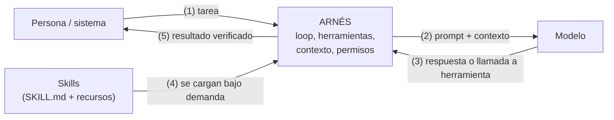
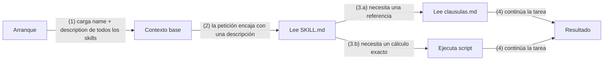
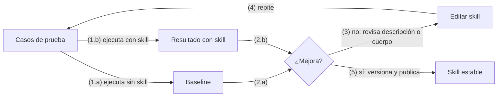
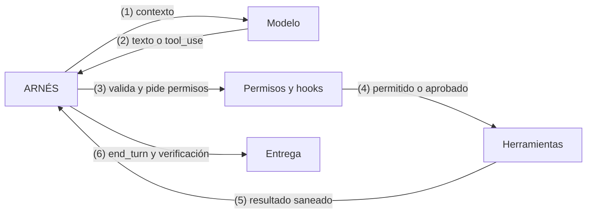
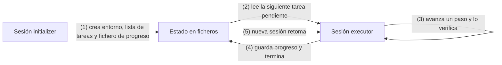
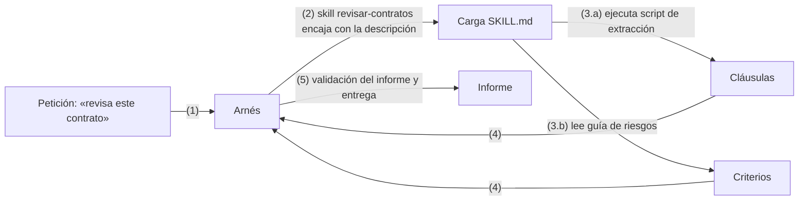
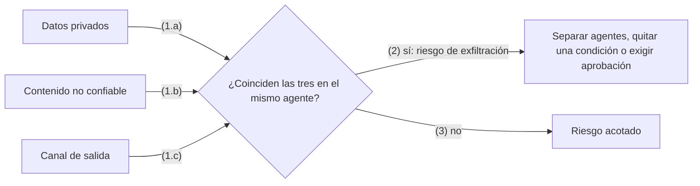

# Skills y arneses (harness) aplicados a la IA

Guía breve: qué son, cuándo aplicarlos y cómo aplicarlos

## Índice

- [1. Resumen](#1-resumen)
  - [1.1 Mapa rápido](#11-mapa-rápido)
- [2. Skills](#2-skills)
  - [2.1 Qué son](#21-qué-son)
  - [2.2 Cuándo aplicarlos](#22-cuándo-aplicarlos)
  - [2.3 Cómo aplicarlos](#23-cómo-aplicarlos)
  - [2.4 Más ejemplos de skills](#24-más-ejemplos-de-skills)
  - [2.5 Evaluar y probar un skill](#25-evaluar-y-probar-un-skill)
- [3. Arnés (harness)](#3-arnés-harness)
  - [3.1 Qué es](#31-qué-es)
  - [3.2 Componentes](#32-componentes)
  - [3.3 Cuándo aplicarlo](#33-cuándo-aplicarlo)
  - [3.4 Cómo aplicarlo](#34-cómo-aplicarlo)
  - [3.5 El arnés en la práctica](#35-el-arnés-en-la-práctica)
- [4. Cómo se combinan](#4-cómo-se-combinan)
- [5. Seguridad](#5-seguridad)
  - [5.1 Riesgos principales](#51-riesgos-principales)
  - [5.2 La lethal trifecta](#52-la-lethal-trifecta)
  - [5.3 Revisar un skill de terceros](#53-revisar-un-skill-de-terceros)
  - [5.4 Qué va en cada capa](#54-qué-va-en-cada-capa)
- [6. Checklist](#6-checklist)
- [7. Glosario](#7-glosario)
- [8. Fuentes](#8-fuentes)

---

## 1. Resumen

Cuando se pasa de «chatear con un modelo» a «delegarle trabajo real», aparecen dos preguntas de ingeniería distintas:

- **¿Cómo le enseño a hacer bien una tarea concreta que se repite?** La respuesta habitual son los **skills**: paquetes de instrucciones, scripts y recursos que el agente carga solo cuando los necesita.
- **¿Qué sistema rodea al modelo para que pueda actuar, recordar, equivocarse y recuperarse sin supervisión constante?** La respuesta es el **arnés** (*harness*): todo el software que hay alrededor del modelo salvo su razonamiento.

Una forma útil de resumirlo: **un agente es un modelo más un arnés, y los skills son una de las piezas que se enchufan al arnés** para darle conocimiento procedimental especializado.

### 1.1 Mapa rápido

| | Skill | Arnés (harness) |
|:--------------|:------------------------------------|:------------------------------------|
| **Qué es** | Carpeta con instrucciones, scripts y recursos para una tarea | Infraestructura que ejecuta el loop del agente: herramientas, contexto, memoria, permisos, verificación |
| **Responde a** | «¿Cómo se hace bien *esta* tarea?» | «¿Cómo funciona el agente de forma fiable y segura?» |
| **Alcance** | Una capacidad o procedimiento | Todo el sistema de ejecución |
| **Quién lo escribe** | Equipos de dominio, a menudo en Markdown | Ingeniería de plataforma o el proveedor del agente |
| **Coste en contexto** | Mínimo hasta que se activa (progressive disclosure) | Es quien decide qué entra en el contexto |
| **Fallo típico** | Descripción vaga: nunca se activa | Sin verificación: el agente declara éxito sin comprobarlo |



Leyenda: los números indican el orden de las llamadas. Los skills no son el agente: son conocimiento que el arnés carga en el contexto cuando procede.

## 2. Skills

### 2.1 Qué son

Un **skill** (en la terminología de Anthropic, *Agent Skill*) es un paquete en forma de carpeta con instrucciones, scripts y recursos que un agente puede descubrir y cargar cuando una tarea lo requiere. Su propósito es dar a un agente de propósito general **conocimiento procedimental** especializado sin construir un agente distinto para cada caso de uso.

**Anatomía mínima**

- Una carpeta con un fichero `SKILL.md`.
- **Frontmatter YAML** con, como mínimo, `name` y `description`.
- **Cuerpo** en Markdown con las instrucciones detalladas.
- **Ficheros opcionales** (guías de referencia, plantillas, scripts) a los que `SKILL.md` se refiere por nombre.

```text
revisar-contratos/
├── SKILL.md            # instrucciones y frontmatter
├── clausulas.md        # referencia: cláusulas de riesgo
├── plantilla-informe.md
└── scripts/
    └── extraer_clausulas.py   # se ejecuta; no hace falta leerlo
```

**Progressive disclosure**

La idea que hace viables los skills es que **no todo el contenido ocupa contexto desde el principio**. Se carga en tres niveles:

| Nivel | Qué se carga | Cuándo |
|:------|:--------------------------------------|:------------------------------|
| 1. Metadatos | `name` y `description` de cada skill instalado | Siempre, al arrancar (van al system prompt) |
| 2. Instrucciones | El `SKILL.md` completo | Cuando el agente decide que el skill es relevante |
| 3. Recursos | Ficheros adicionales y scripts | Solo cuando hacen falta durante la tarea |



Consecuencia práctica: puedes instalar decenas de skills y pagar en contexto solo el coste de sus descripciones. Por eso **la descripción es la parte más importante del skill**: es lo único que el agente ve para decidir si lo usa.

**Skills en Claude Code (ejemplo concreto)**

En Claude Code los skills viven en tres sitios:

- Personales: `~/.claude/skills/<nombre>/SKILL.md`
- De proyecto, compartibles por Git: `.claude/skills/<nombre>/SKILL.md`
- Dentro de plugins.

Se pueden invocar de dos formas: la persona escribe `/nombre`, o Claude lo carga solo cuando la petición encaja con la descripción. Dos campos controlan quién puede invocarlo: `disable-model-invocation: true` (solo la persona) y `user-invocable: false` (solo Claude). Otros campos útiles: `allowed-tools` (herramientas preaprobadas), `context: fork` (ejecutar en un subagente aislado), `paths` (cargar solo al trabajar con ciertos ficheros) y `argument-hint`. Una vez cargado, el contenido de un skill permanece en el contexto; tras compactar la conversación se reincorpora la invocación más reciente de cada skill con un límite de tokens, de modo que un skill muy largo tiene un coste real.

**Qué no es un skill**

- No es una herramienta nueva: no añade capacidades de acceso a sistemas (eso es MCP o una herramienta del arnés). Un skill puede *usar* herramientas y scripts, pero su valor principal es el *saber hacer*.
- No es un system prompt: no se carga siempre, y puede incluir ficheros y código.
- No es un agente: no tiene loop propio; lo ejecuta el agente que lo carga (salvo `context: fork`, que lo delega en un subagente).

### 2.2 Cuándo aplicarlos

**Señales de que necesitas un skill**

1. **Repites la misma explicación** al agente en varias conversaciones («cuando hagas X, sigue estos pasos…»).
2. La tarea tiene un **procedimiento o criterio de calidad** que el modelo no conoce por defecto (normas internas, plantillas de la empresa, formatos de entrega).
3. Hay **pasos que deben ser deterministas**: un cálculo, una validación o la manipulación de un formato de fichero que es más fiable y barato como código que como texto generado.
4. El conocimiento es **voluminoso pero se usa a ratos**: no quieres pagarlo en cada conversación.
5. Quieres **compartir y versionar** una práctica entre personas o equipos (Git, plugins, catálogo interno).

**Cuándo no usar un skill**

- Una regla corta y **siempre aplicable** (estilo de código, comandos de build): va mejor en el fichero de instrucciones permanente del proyecto (en Claude Code, `CLAUDE.md`).
- Necesitas **acceder a un sistema externo** (Jira, base de datos, API): es una herramienta (MCP o equivalente). El skill puede explicar *cómo usarla bien*.
- Necesitas una **garantía dura** (bloquear una acción siempre): es una regla del arnés, como un hook o un permiso. Un skill es una instrucción para el modelo, no un control.
- La tarea ocurre una vez: un buen prompt basta.

**Skill frente a otras piezas**

| Necesidad | Pieza adecuada | Por qué |
|:------------------------------|:------------------|:------------------------------------------|
| Reglas permanentes del proyecto | Fichero de instrucciones (`CLAUDE.md`) | Se carga siempre; debe ser corto |
| Procedimiento especializado y reutilizable | **Skill** | Se carga bajo demanda; admite ficheros y scripts |
| Acceso a datos o sistemas | Herramienta / servidor MCP | Aporta capacidad, no conocimiento |
| Garantía determinista (bloquear, formatear) | Hook / permiso del arnés | Se ejecuta siempre, no depende del modelo |
| Tarea con mucho ruido intermedio | Subagente (o skill con `context: fork`) | Aísla el contexto |
| Petición puntual | Prompt | Sin coste de mantenimiento |

**Regla práctica:** empieza por el prompt; si te repites, pásalo a un skill; si necesitas una garantía, súbelo al arnés.

### 2.3 Cómo aplicarlos

**Paso 1. Empieza por la evaluación, no por el skill.** Ejecuta el agente sobre tareas representativas, observa dónde falla o se desvía y construye el skill para cubrir *esos* huecos. Sin esa baseline no sabrás si el skill mejora algo.

**Paso 2. Escribe una descripción que dispare.** Indica qué hace el skill *y cuándo usarlo*, con las palabras que usaría la persona. Pon el caso de uso principal primero (en Claude Code, la descripción y `when_to_use` combinadas se truncan en el listado a unos 1.500 caracteres).

```yaml
---
name: revisar-contratos
description: Revisa contratos de proveedores y señala cláusulas de riesgo
  (renovación automática, penalizaciones, jurisdicción). Úsalo cuando la
  persona suba un contrato, pida «revisar» o «analizar» un acuerdo o
  mencione cláusulas.
---
```

**Paso 3. Estructura el contenido.**

- Mantén `SKILL.md` corto (en Claude Code, por debajo de unas 500 líneas) y mueve el detalle a ficheros referenciados.
- Separa en ficheros distintos los contextos que rara vez se usan juntos, para no cargar de más.
- Deja claro si cada script debe **ejecutarse** o **leerse**.

**Paso 4. Usa código donde la determinación importa.** Un script es mejor que texto generado cuando: es más eficiente (ordenar, transformar), el resultado debe ser repetible, o quieres que ni el script ni sus datos entren en el contexto (se ejecuta y solo se lee su salida).

**Paso 5. Controla la invocación y los permisos.** Decide si lo invoca la persona, el agente o ambos; preaprueba solo las herramientas necesarias (`allowed-tools: Bash(git diff *)`, por ejemplo) y usa `context: fork` para tareas con mucha salida intermedia.

**Paso 6. Prueba y observa** (método completo en 2.5). Mira cómo el agente usa el skill: si no se activa, reescribe la descripción; si se activa y se equivoca, aclara el cuerpo; si lee ficheros que no necesitaba, reestructura.

**Paso 7. Itera con el propio agente.** Pídele que capture en el skill los enfoques que han funcionado y los errores frecuentes, y que reflexione cuando se desvíe.

**Paso 8. Gobierna y protege** (ver sección 5). Un skill puede incluir scripts y dependencias: instala solo skills de fuentes de confianza, revisa antes los ficheros incluidos (scripts, dependencias, conexiones de red) y versiona los tuyos en Git.

**Ejemplo A. Skill de informe semanal**

```markdown
---
name: informe-semanal
description: Genera el informe semanal de actividad del equipo a partir de
  los commits y los tickets cerrados. Úsalo al pedir «informe semanal»,
  «resumen de la semana» o «qué hemos hecho esta semana».
argument-hint: "[branch]"
allowed-tools: Bash(git log *) Bash(python3 *)
---

# Informe semanal

1. Obtén los commits de los últimos 7 días de $ARGUMENTS (por defecto, la
   branch actual) con `git log --since="7 days ago" --oneline`.
2. Ejecuta `scripts/agrupar.py` con esa salida para agrupar por área.
3. Redacta el informe con la plantilla de `plantilla.md`.
4. No inventes tickets: si falta información, indícalo en «Pendiente de
   confirmar».
```

**Errores frecuentes**

| Error | Síntoma | Corrección |
|:-----------------------------|:-------------------------|:---------------------------|
| Descripción genérica («ayuda con documentos») | No se activa, o se activa fuera de lugar | Describir tarea, disparadores y ejemplos de petición |
| `SKILL.md` enorme | Mucho contexto gastado en cada uso | Dividir en ficheros referenciados |
| Instrucciones ambiguas | Resultados distintos en cada ejecución | Pasos numerados, criterios verificables, scripts para lo determinista |
| Usarlo como control de seguridad | El modelo lo ignora en un caso límite | Mover la garantía al arnés (permiso, hook) |
| Skills solapados | El agente duda o elige mal | Separar responsabilidades y afinar descripciones |
| Sin evaluación | No se sabe si mejora | Medir antes y después con tareas representativas |

### 2.4 Más ejemplos de skills

Los patrones se entienden mejor viendo variantes. Los tres primeros cubren los casos que más se repiten: skills con scripts, skills aislados y skills con datos dinámicos. El cuarto es un skill real, completo, que reúne casi todo lo visto hasta ahora.

**Ejemplo B. Skill con script y referencia (determinismo + conocimiento bajo demanda)**

```text
revisar-contratos/
├── SKILL.md
├── clausulas.md                   # criterios de riesgo (solo se lee si hace falta)
└── scripts/extraer_clausulas.py   # se ejecuta; su código no entra en el contexto
```

```markdown
---
name: revisar-contratos
description: Revisa contratos de proveedores y señala cláusulas de riesgo
  (renovación automática, penalizaciones, jurisdicción). Úsalo cuando la
  persona suba un contrato o pida revisar o analizar un acuerdo.
allowed-tools: Bash(python3 *)
---

# Revisión de contratos

1. Ejecuta `python3 ${CLAUDE_SKILL_DIR}/scripts/extraer_clausulas.py <fichero>`.
   Ejecútalo, no lo leas: devuelve JSON con las cláusulas detectadas.
2. Solo si hay cláusulas marcadas, consulta `clausulas.md` para valorar el riesgo.
3. Redacta el resumen: riesgos altos primero, cada uno con cita literal y página.
4. Si el script falla o no detecta nada, dilo. No deduzcas cláusulas por tu cuenta.
```

*Qué aporta cada pieza:* el script hace la extracción de forma repetible y barata; `clausulas.md` solo se carga si hay algo que valorar (nivel 3 de progressive disclosure); el paso 4 evita que el modelo «rellene» cuando la herramienta no encuentra nada.

**Ejemplo C. Skill aislado con `context: fork` (exploración ruidosa)**

```markdown
---
name: auditar-dependencias
description: Audita las dependencias del repositorio y devuelve un resumen de
  riesgos. Úsalo al pedir «auditar dependencias» o «revisar librerías».
context: fork
agent: Explore
---

Analiza los ficheros de dependencias del proyecto (versiones, librerías sin
mantenimiento, duplicadas o con versiones muy desfasadas). Devuelve como
máximo 10 líneas con: paquete, versión, problema y acción sugerida. No pegues
salidas completas.
```

El skill se ejecuta en un subagente sin el historial de la conversación: toda la exploración intermedia se queda allí y a la conversación principal solo llega el resumen. Sirve para tareas de lectura y análisis con mucha salida; si el skill debe depender de lo hablado antes, no uses `fork`.

**Ejemplo D. Skill con datos dinámicos y argumentos (invocado solo por la persona)**

```markdown
---
name: resumen-pr
description: Resume el pull request del branch actual y lista riesgos.
argument-hint: "[foco opcional]"
disable-model-invocation: true
allowed-tools: Bash(gh *)
---

## Datos del PR actual
!`gh pr view --json title,body,files`

## Diff
!`gh pr diff`

Resume el PR en tres viñetas y lista los riesgos. Foco pedido: $ARGUMENTS
```

Las líneas con `` !`comando` `` se ejecutan **antes** de enviar el skill a Claude, que recibe directamente su salida. Si un comando termina con código distinto de 0, se aborta toda la invocación (añade `|| true` si es aceptable). `disable-model-invocation: true` evita que Claude lo lance por su cuenta: conviene en acciones con efectos o en flujos que solo debe disparar una persona.

**Ejemplo E. Un skill real: `md-to-pdf` (reglas duras, script y verificación)**

Este es el skill que se usó para generar el PDF de esta misma guía. Convierte un fichero `.md` en un PDF con aspecto de paper pasando por LaTeX en un directorio temporal. Sirve de ejemplo porque combina condiciones de uso estrictas, normas explícitas, un script determinista, comprobaciones previas, verificación final y un fallback cuando falta una herramienta. Este es su esqueleto (el script completo va en el cuerpo del skill):

```markdown
---
name: md-to-pdf
description: Convierte un fichero Markdown (.md) en un PDF con aspecto de paper
  (A4, Lato, color de acento), pasando siempre por LaTeX en un directorio
  temporal que no se entrega. Úsalo solo cuando el usuario pida explícitamente
  el PDF de un .md; si solo quiere el .md, no lo uses.
argument-hint: "[ruta/al/fichero.md] [--break-sections]"
---

# Markdown a PDF (vía LaTeX, aspecto de paper)

## Normas (siempre)
1. Solo cuando se pida el PDF.
2. Siempre vía LaTeX: .md -> .tex -> PDF. El .tex vive en un directorio
   temporal y nunca se entrega.
3. El PDF se guarda junto al .md, con el mismo nombre.
4. Aspecto de paper: A4, márgenes de 2,2 cm, 10 pt, Lato, color #1F4E79.
5. Todos los diagramas Mermaid deben salir dibujados, del tipo que sean.

## Requisitos
Comprueba con `which`: pandoc, xelatex y python3 son obligatorios.
Si falta algo y no se puede instalar, dilo y detente.

## Dónde ejecutar
Si falta `mmdc` en el entorno del .md, copia el fichero a un workspace
que lo tenga, convierte allí y devuelve solo el PDF a la carpeta original.

## Procedimiento
1. Localiza el .md y léelo por encima (índice, tablas, diagramas).
2. Crea mdtopdf.py en un directorio temporal y ejecútalo.
3. Verifica y entrega la ruta del PDF y el número de páginas.

## Verificación antes de entregar
Páginas y avisos Overfull, ningún diagrama sin dibujar, mirada visual a
2-3 páginas, enlaces del índice, ningún .tex en la carpeta de la persona,
.md sin cambios.
```

| Qué se ve en el ejemplo | Para qué sirve |
|:------------------------------|:------------------------------------------|
| `description` con condición de uso («solo cuando el usuario pida…») | Evita que se active cuando solo se quiere el `.md` |
| Normas numeradas al principio | Reglas duras que el agente no debe reinterpretar |
| Requisitos comprobados con `which` | Falla pronto y con un mensaje claro, en lugar de a mitad de proceso |
| Script incluido en el skill | El paso crítico es determinista y repetible |
| Entorno alternativo y fallback (sin `mmdc` local, convierte en el workspace, que sí lo tiene; sin `mmdc` en ningún sitio, Graphviz solo para flowcharts simples y aviso del resto) | Degradación controlada en lugar de un resultado silenciosamente peor |
| Verificación y limpieza finales | Garantiza que el resultado es el esperado y no quedan ficheros intermedios |

Una decisión práctica: cuando un skill se guarda desde una propuesta, solo viaja el `SKILL.md`, por eso aquí el script va embebido en el cuerpo. Si el skill vive en una carpeta propia, es preferible dejarlo en `scripts/mdtopdf.py` y referenciarlo con `${CLAUDE_SKILL_DIR}`, como en el ejemplo B.

**Qué patrón elegir**

| Necesidad | Patrón | Campos clave |
|:-------------------------------|:------------------------------|:-----------------------------|
| Resultado repetible o cálculo exacto | Skill con script | `allowed-tools`, `${CLAUDE_SKILL_DIR}` |
| Mucho conocimiento, uso ocasional | Referencias en ficheros aparte | Enlaces desde `SKILL.md` |
| Exploración con mucha salida | Skill aislado | `context: fork`, `agent` |
| Datos que cambian en cada uso | Inyección dinámica | `` !`cmd` ``, `allowed-tools` |
| Acción con efectos secundarios | Solo invocación humana | `disable-model-invocation: true` |
| Solo debe aplicarse a ciertos ficheros | Carga condicionada | `paths` |
| Tarea con reglas estrictas, script y verificación | Skill con normas, script y checklist final | `description` con condición de uso, `allowed-tools` |

### 2.5 Evaluar y probar un skill

Un skill se parece más a un **componente de software** que a un texto: si no lo pruebas, no sabes si funciona. La evaluación responde a tres preguntas distintas.

| Pregunta | Qué se comprueba | Cómo |
|:----------------------|:------------------------------------|:------------------------------------|
| ¿Se activa cuando toca? | Que el agente carga el skill ante peticiones relevantes | Lista de peticiones que deben activarlo, con distintas formulaciones |
| ¿No se activa cuando no toca? | Falsos positivos con tareas cercanas | Peticiones parecidas que no deberían activarlo |
| ¿Mejora el resultado? | Calidad frente a trabajar sin el skill | Mismas tareas con y sin skill, con criterios de éxito comprobables |

**Procedimiento recomendado**

1. **Define la baseline.** Ejecuta las tareas representativas *sin* el skill y guarda los resultados. Sin esto no puedes demostrar mejora.
2. **Escribe los casos.** Mezcla peticiones de activación, de no activación y tareas completas con criterios verificables (no «que quede bien», sino «agrupa por área», «no cita tickets inexistentes»).
3. **Ejecuta con el skill** y compara. Revisa las transcripciones completas, no solo el resultado final: a menudo el skill funciona «por casualidad» o lee ficheros que no necesitaba.
4. **Cambia una cosa cada vez** (descripción, orden de pasos, un script) para saber qué produjo la mejora.
5. **Repite varias veces** los casos importantes: los modelos no son deterministas y un acierto aislado no prueba estabilidad.
6. **Guarda los casos** junto al skill y vuelve a ejecutarlos al cambiar el skill, el modelo o el arnés (regresión).

```yaml
# evals/informe-semanal.yaml  (formato propio, ilustrativo)
cases:
  - id: trigger-01
    request: "Hazme el resumen de la semana"
    expected: { triggers_skill: true }
  - id: trigger-02
    request: "¿Qué hemos sacado esta semana en el branch develop?"
    expected: { triggers_skill: true }
  - id: no-trigger-01
    request: "Explícame qué hace git rebase"
    expected: { triggers_skill: false }
  - id: task-01
    request: "Informe semanal del branch release"
    criteria:
      - "agrupa los cambios por área"
      - "no menciona tickets que no aparecen en los commits"
      - "incluye «Pendiente de confirmar» si falta información"
```



**Métricas útiles**

| Métrica | Qué indica |
|:-----------------------------|:---------------------------------------------|
| Tasa de activación correcta | Calidad de la descripción |
| Tasa de falsos positivos | Descripción demasiado amplia o skills solapados |
| Acierto frente a la baseline | Valor real del skill |
| Tokens y tiempo por tarea | Coste de cargarlo y ejecutarlo |
| Estabilidad entre repeticiones | Robustez de las instrucciones |
| Uso real y coste en contexto | En Claude Code, `/skill-doctor` muestra qué cuesta cada skill y cuánto se usa |

**Cautelas:** no ajustes el skill a tus casos hasta el punto de que solo funcione con ellos (reserva casos que no hayas usado al iterar); y reevalúa cuando cambie el modelo, porque lo que antes necesitaba un skill puede resolverse solo, o al revés.

## 3. Arnés (harness)

### 3.1 Qué es

El **arnés** es la infraestructura de software que rodea a un modelo de lenguaje y se encarga de todo lo que **no** es su razonamiento: ejecución de herramientas, gestión del contexto, memoria y estado, permisos, recuperación de errores y verificación. El modelo propone; el arnés valida, ejecuta, filtra y devuelve el resultado.

Hace falta porque los modelos, por sí solos, son **stateless** (cada sesión empieza sin memoria del trabajo previo) y sin un arnés tienden a intentar demasiado de una vez, a declarar éxito sin verificar, a formular llamadas a herramientas mal formadas y a perder el progreso cuando una sesión falla. Claude Code, el Claude Agent SDK o un loop de agente que escribas tú con la API son ejemplos de arneses con distinto grado de completitud.



En el paso (3), si la acción es sensible, el arnés pide aprobación a una persona antes del paso (4); si no está permitida, devuelve al modelo un error explicativo en lugar de ejecutarla.

El corazón es el **agentic loop**: el arnés llama al modelo, y mientras este solicite herramientas, las ejecuta y devuelve los resultados; el loop termina cuando el modelo da una respuesta final (en la API de Claude, `stop_reason` igual a `end_turn`). Lo que distingue a un buen arnés es todo lo que ocurre alrededor de ese loop.

**Arnés, framework, orquestador y modelo**

| Término | Rol |
|:-----------|:--------------------------------------------------------------|
| Modelo | Razona y decide la siguiente acción |
| Framework (p. ej. LangChain) | Bloques de construcción (conectores, cadenas, abstracciones) |
| Orquestador | Decide la secuencia de llamadas al modelo y a otros agentes |
| **Arnés** | Ensambla lo anterior en un sistema que se ejecuta, con valores por defecto, estado, seguridad y verificación |

### 3.2 Componentes

| Componente | Qué hace | Ejemplo |
|:------------------|:-------------------------------------|:--------------------------------------|
| Agentic loop | Itera modelo ↔ herramientas hasta terminar | Controlar por `stop_reason`, no por texto |
| Herramientas | Expone funciones, valida parámetros, devuelve resultados saneados | Lectura/escritura de ficheros, búsqueda, MCP |
| Contexto | Decide qué entra: compacta historial, recupera solo lo relevante, recorta salidas | Resumir, `/compact`, cargar skills bajo demanda |
| Memoria y estado | Separa contexto de trabajo, estado de sesión y memoria a largo plazo | Ficheros de progreso, `CLAUDE.md`, JSON de estado |
| Permisos y sandbox | Limita qué puede hacer el agente y dónde | Reglas allow/ask/deny, entorno aislado |
| Hooks y guardrails | Reglas deterministas antes o después de una acción | Bloquear reembolsos superiores a un umbral |
| Verificación | Comprueba el resultado antes de darlo por bueno | Ejecutar tests, comprobar schemas |
| Coordinación | Divide el trabajo entre agentes | Coordinador con subagentes de contexto aislado |
| Observabilidad y evaluación | Registra y mide el comportamiento | Traces, eval sets |
| Extensiones | Amplían capacidades sin tocar el núcleo | Skills, plugins, servidores MCP |

### 3.3 Cuándo aplicarlo

**Necesitas arnés (o ampliar el que tienes) cuando:**

- La tarea tiene **varios pasos** o dura más de una interacción.
- El agente **actúa sobre sistemas reales** (ficheros, correo, bases de datos, dinero): hacen falta permisos, sandbox y aprobaciones.
- Hay que **recuperarse de fallos** y no perder progreso entre sesiones.
- El resultado debe ser **verificable** (tests, schemas, reglas de negocio).
- Varias personas o agentes trabajan sobre el mismo sistema y se necesita **trazabilidad**.

**No necesitas un arnés elaborado cuando** la tarea es de un solo turno y sin efectos secundarios: basta una llamada al modelo con un buen prompt. Cualquier flujo multi-paso o de larga duración necesita al menos un arnés mínimo.

**Construir o reutilizar**

| Opción | Cuándo conviene |
|:----------------------------|:-------------------------------------------|
| Usar un arnés existente (Claude Code, Agent SDK) | Casos habituales: ahorra el trabajo más repetitivo y heredas mejoras |
| Ampliar con skills, hooks y MCP | Necesitas adaptar comportamiento sin tocar el núcleo |
| Construir uno propio | Requisitos de seguridad, integración o coste muy específicos; asumes mantenimiento |

Un arnés tiende a **crecer con los modelos**, no a encogerse: cuando mejora el modelo, aparecen tareas más ambiciosas que requieren más estructura alrededor.

### 3.4 Cómo aplicarlo

**Principios de diseño**

1. **Mantén el modelo intercambiable.** Integraciones de herramientas, memoria y lógica de negocio van en el arnés, no pegadas a un modelo concreto.
2. **Externaliza el estado** a ficheros e historial de versiones, para que una sesión nueva retome el trabajo sin depender de lo «recordado».
3. **Verifica mecánicamente** antes de dar algo por terminado: tests, validación de schema, comprobaciones de reglas.
4. **Garantías en código, juicio en el modelo.** Lo que debe cumplirse siempre (límites, formatos, bloqueos) se implementa como hook, validación o permiso; lo que requiere criterio se deja al modelo.
5. **Mensajes de error que enseñan.** Un error estructurado y accionable (categoría, si es retryable, qué falló) permite que el agente corrija en el siguiente intento.
6. **Carga solo el contexto necesario en cada paso.** Guarda las salidas grandes fuera de la context window y carga conocimiento bajo demanda (aquí es donde encajan los skills).
7. **Trata cada fallo como un fallo del sistema.** Añade una regla a las instrucciones o construye una herramienta que haga verificable el comportamiento correcto.

**Pasos para implantarlo**

| Paso | Acción |
|:----:|:--------------------------------------------------------------|
| 1 | Define la tarea, el resultado esperado y cómo se comprobará que es correcto |
| 2 | Empieza con un loop mínimo: modelo, 4–5 herramientas bien descritas y condición de parada |
| 3 | Añade permisos y sandbox proporcionales al riesgo de las acciones |
| 4 | Añade verificación y guardrails deterministas (hooks, validación de schema) |
| 5 | Gestiona contexto y estado: recortar salidas, compactar, ficheros de progreso |
| 6 | Introduce skills para el conocimiento especializado y servidores MCP para el acceso a sistemas |
| 7 | Añade traces y un eval set; mide antes de cada cambio |
| 8 | Itera: cada fallo observado se convierte en una regla, una herramienta o un test |

**Patrón para tareas largas: initializer y executors**



Cada sesión avanza de forma incremental y deja el estado listo para la siguiente, en lugar de intentar hacerlo todo de una vez. Para el fichero de estado, un formato estructurado como JSON suele ser más robusto que Markdown libre, porque el modelo lo corrompe con menos facilidad.

**Ejemplo: agente de soporte con arnés**

- *Loop y herramientas:* `get_customer`, `lookup_order`, `process_refund`, `escalate_to_human`.
- *Guardrail:* un hook que bloquea cualquier reembolso por encima de un umbral y lo redirige a escalado (la política se cumple siempre, no solo «si el modelo se acuerda»).
- *Prerrequisito:* no se permite `process_refund` hasta que `get_customer` haya verificado la identidad.
- *Contexto:* bloque persistente con los datos del caso; los resultados largos se recortan.
- *Skill:* `politica-devoluciones` con el procedimiento y los casos límite, cargado solo en consultas de devoluciones.
- *Evaluación:* un conjunto de conversaciones de prueba con la resolución esperada.

**Errores frecuentes**

| Error | Consecuencia | Corrección |
|:------------------------------|:------------------------|:---------------------------|
| Confiar en el prompt para reglas críticas | Incumplimientos ocasionales | Hook, permiso o validación |
| Demasiadas herramientas | Selección errónea | Pocas, con descripciones claras |
| Sin verificación | «Éxito» declarado sin comprobar | Tests y validadores antes de cerrar |
| Estado solo en la conversación | Se pierde al acabar la sesión | Ficheros de progreso y control de versiones |
| Todo el conocimiento en el system prompt | Contexto saturado | Skills y recuperación bajo demanda |
| Dar permisos amplios «por comodidad» | Riesgo en acciones destructivas | Least privilege y aprobación humana |

### 3.5 El arnés en la práctica

#### 3.5.1 Un agentic loop mínimo

El ejemplo siguiente usa la API de mensajes de Anthropic y es **ilustrativo** (no está listo para producción). Sirve para ver dónde vive cada responsabilidad del arnés.

```python
import anthropic

client = anthropic.Anthropic()
MAX_TURNS = 20
TOOLS = [{
    "name": "read_file",
    "description": "Lee un fichero de texto del proyecto. Úsalo para consultar "
                   "código o documentación; no sirve para ficheros binarios.",
    "input_schema": {"type": "object",
                     "properties": {"path": {"type": "string"}},
                     "required": ["path"]},
}]

def run_tool(name, args):
    """Valida, comprueba permisos, ejecuta y recorta la salida."""
    if name == "read_file":
        if ".." in args["path"] or args["path"].startswith("/"):
            return {"is_error": True, "content": "Ruta no permitida (fuera del proyecto)."}
        try:
            text = open(args["path"], encoding="utf-8").read()
        except FileNotFoundError:
            return {"is_error": True, "content": "No existe el fichero. Revisa la ruta."}
        return {"content": text[:8000]}          # recorte de salida
    return {"is_error": True, "content": f"Herramienta desconocida: {name}"}

def run_agent(task):
    messages = [{"role": "user", "content": task}]
    for _ in range(MAX_TURNS):                    # límite de turnos
        resp = client.messages.create(
            model="claude-sonnet-5-5", max_tokens=2048,
            tools=TOOLS, messages=messages)
        messages.append({"role": "assistant", "content": resp.content})
        if resp.stop_reason == "end_turn":         # condición de parada
            return "".join(b.text for b in resp.content if b.type == "text")
        results = []
        for b in resp.content:
            if b.type == "tool_use":
                r = run_tool(b.name, b.input)
                results.append({"type": "tool_result", "tool_use_id": b.id,
                                   "content": r["content"],
                                   "is_error": r.get("is_error", False)})
        messages.append({"role": "user", "content": results})
    raise RuntimeError("Se alcanzó el límite de turnos sin terminar")
```

| Línea o idea | Responsabilidad del arnés |
|:-----------------------------|:-----------------------------------------------|
| `for _ in range(MAX_TURNS)` | Evitar loops infinitos y costes descontrolados |
| `stop_reason == "end_turn"` | Parar según la señal estructurada del modelo, no por el texto |
| `run_tool` | Validar entradas, aplicar permisos, ejecutar y sanear |
| `text[:8000]` | Controlar qué entra en el contexto |
| `is_error` con mensaje accionable | Que el modelo pueda corregir en el siguiente intento |
| `messages` | Estado de la conversación que el arnés conserva y devuelve |

Todo lo que viene después (hooks, compactación, subagentes, permisos por reglas) son capas sobre este mismo esqueleto.

#### 3.5.2 Hooks: reglas deterministas

Un **hook** es un handler que se ejecuta automáticamente en un punto del ciclo de vida del agente. Es la forma estándar de poner «garantías en código» en lugar de pedirlas en el prompt. En Claude Code, un hook puede ser un comando de shell, una llamada HTTP, una herramienta MCP, un prompt para un modelo o un subagente.

**Eventos principales**

| Evento | Cuándo se dispara | Uso típico |
|:-------------------|:----------------------------------------|:-------------------------------------|
| `SessionStart` | Al empezar o reanudar una sesión | Inyectar contexto inicial |
| `UserPromptSubmit` | Al enviar un prompt, antes de procesarlo | Validar o enriquecer la petición |
| `PreToolUse` | Antes de ejecutar una herramienta; **puede bloquearla** | Bloquear comandos destructivos, imponer prerrequisitos |
| `PostToolUse` | Tras una herramienta con éxito | Normalizar o filtrar la salida, formatear, lanzar linters |
| `Stop` | Cuando Claude termina de responder | Verificar (p. ej. ejecutar tests) antes de dar por cerrado |
| `PreCompact` | Antes de compactar el contexto | Guardar lo que no debe perderse |
| `SubagentStop` | Al terminar un subagente | Validar su resultado |

**Configuración.** Se escribe en JSON con tres niveles (evento, grupo con `matcher`, handlers) en `~/.claude/settings.json` (todos tus proyectos), `.claude/settings.json` (proyecto, compartible), `.claude/settings.local.json` (proyecto, no versionado), en la política gestionada de la organización, en un plugin o en el frontmatter de un skill o subagente (mientras está activo). Los hooks de todos los niveles se combinan.

```json
{
  "hooks": {
    "PreToolUse": [
      {
        "matcher": "Bash",
        "hooks": [
          { "type": "command",
            "command": "${CLAUDE_PROJECT_DIR}/.claude/hooks/block-rm.sh" }
        ]
      }
    ]
  }
}
```

El `matcher` filtra por nombre de herramienta (`Bash`, `Edit|Write`, o una expresión regular como `mcp__memory__.*`).

**Un hook que bloquea.** El script recibe por la entrada estándar un JSON con `tool_name` y `tool_input`, y decide:

```bash
#!/bin/bash
# .claude/hooks/block-rm.sh   (requiere jq; chmod +x)
COMMAND=$(jq -r '.tool_input.command')

if echo "$COMMAND" | grep -q 'rm -rf'; then
  jq -n '{
    hookSpecificOutput: {
      hookEventName: "PreToolUse",
      permissionDecision: "deny",
      permissionDecisionReason: "Comando destructivo bloqueado por el hook"
    }
  }'
else
  exit 0   # sin decisión: sigue el flujo normal de permisos
fi
```

**Cómo comunica el hook su decisión**

| Resultado del hook | Efecto |
|:------------------------------------------|:------------------------------------------|
| Código de salida 0 | Éxito; si la salida es un objeto JSON, se interpreta |
| Código de salida 2 | **Error bloqueante**: se detiene la acción y se muestra stderr como motivo |
| Cualquier otro código | Error no bloqueante: la acción continúa |
| JSON con `permissionDecision` (`allow`, `deny`, `ask`, `defer`) | Decisión precisa sobre la herramienta (en `PreToolUse`) |
| JSON con `decision: "block"` y `reason` | Bloqueo en eventos como `UserPromptSubmit`, `PostToolUse` o `Stop` |
| `additionalContext` | Inyecta texto en el contexto de Claude |

Elige un único enfoque por hook: códigos de salida solos, o salida 0 con JSON.

**Aplicado al agente de soporte:** un hook `PreToolUse` sobre `process_refund` comprueba el importe y devuelve `deny` con el motivo «supera el umbral, escala a una persona» (el agente recibe la razón y deriva); un hook `PostToolUse` sobre las consultas normaliza fechas y códigos de estado antes de que el modelo los vea. Ninguna de las dos reglas depende de que el modelo «se acuerde».

Si construyes tu propio loop (como en 3.5.1), el equivalente es una función `before_tool(tool, args)` que puede vetar la llamada y otra `after_tool(tool, result)` que puede transformarla.

#### 3.5.3 Gestión del contexto

La context window es un recurso escaso y la calidad se degrada cuando se llena de ruido. El arnés decide qué entra, qué se recorta y qué se conserva.

| Problema | Técnica | Detalle |
|:----------------------------|:-----------------------------|:-----------------------------------|
| Salidas de herramientas enormes | Recortar o resumir antes de añadirlas | Conservar solo los campos relevantes |
| Conversación muy larga | Compactar | Resumir el historial; indicar qué debe preservar el resumen |
| Datos críticos (identificadores, importes, fechas) | Bloque de «hechos del caso» persistente | Se reinyecta fuera del resumen para que no se pierda |
| Exploración voluminosa | Delegar en un subagente | Devuelve un resumen; su ruido no entra en la conversación principal |
| Conocimiento que se usa a ratos | Skills | Se carga solo al necesitarlo |
| Trabajo que sobrevive a la sesión | Estado en ficheros | Progreso, decisiones y lista de tareas fuera del contexto |
| Información importante entre mucho texto | Colocarla al principio o al final | Los modelos atienden peor a lo que queda en medio |

#### 3.5.4 Permisos y sandbox

Aplica **least privilege** y aumenta la autonomía según el riesgo y la reversibilidad de lo que hace el agente.

| Nivel | Qué puede hacer el agente | Cuándo encaja |
|:------|:------------------------------------------|:------------------------------------|
| 1. Solo lectura | Consultar y proponer | Análisis, auditorías, primeros pilotos |
| 2. Escritura con aprobación | Cada acción sensible pide confirmación | Trabajo supervisado en entornos reales |
| 3. Lista de acciones permitidas | Reglas allow/ask/deny por herramienta y comando | Flujos repetidos y bien conocidos |
| 4. Autonomía en sandbox | Libertad dentro de un entorno aislado y desechable | Tareas largas, pruebas, CI |
| 5. Autonomía en producción | Solo con guardrails, verificación y trazabilidad completas | Procesos maduros con rollback |

En Claude Code, `/permissions` gestiona las reglas allow/ask/deny y `/sandbox` activa el modo sandbox donde esté disponible.

#### 3.5.5 Observabilidad y evaluación del arnés

Lo que no se mide no se puede mejorar. Registra como mínimo:

- Cada llamada a herramienta (nombre, parámetros, resultado resumido, duración y error).
- Tokens por turno y por tarea, y turnos hasta terminar.
- Decisiones de hooks y permisos (qué se bloqueó y por qué).
- Escaladas a personas y motivo.

| Métrica | Pregunta que responde |
|:---------------------------------|:------------------------------------------|
| Tareas completadas correctamente | ¿Funciona? |
| Turnos y tokens por tarea | ¿Cuánto cuesta? |
| Errores de herramienta y reintentos | ¿Las herramientas y sus descripciones son claras? |
| Bloqueos por hooks o permisos | ¿Se están intentando acciones no deseadas? |
| Escaladas correctas e incorrectas | ¿Los criterios de derivación son buenos? |

Mantén un conjunto de tareas de evaluación y ejecútalo **antes y después** de cada cambio de modelo, prompt, herramienta, skill o hook. Un cambio que mejora un caso puede empeorar otros.

## 4. Cómo se combinan

El arnés es el entorno de ejecución y los skills son conocimiento que se carga en él. Se refuerzan mutuamente:

- El arnés **descubre y carga** los skills (nivel 1 siempre, niveles 2 y 3 bajo demanda) y decide cuánto contexto consumen.
- Los skills **reducen la complejidad del arnés**: en lugar de un system prompt gigante, el conocimiento viaja en paquetes pequeños y versionados.
- El arnés **hace cumplir** lo que un skill solo puede recomendar: permisos, hooks y verificación.
- Los skills **aportan determinismo local** con scripts; el arnés lo aporta de forma global con reglas.



**Cómo decidir qué va dónde**

| Pregunta | Si la respuesta es sí… |
|:--------------------------------------------------|:----------------------------|
| ¿Es un procedimiento que se reutiliza y puede esperar a que se necesite? | Skill |
| ¿Debe cumplirse siempre, sin excepciones? | Arnés (hook, permiso, validación) |
| ¿Hay que acceder a un sistema externo? | Herramienta / MCP (y quizá un skill para usarla bien) |
| ¿Se necesita en cada conversación y es corto? | Instrucciones permanentes |
| ¿Genera mucho ruido intermedio? | Subagente o skill con contexto aislado |

## 5. Seguridad

Los skills y los arneses concentran poder: el agente lee, ejecuta y puede comunicar. La seguridad no se resuelve con un buen prompt, sino con **diseño del arnés**.

### 5.1 Riesgos principales

| Riesgo | Cómo ocurre | Mitigación |
|:-------------------------|:------------------------------------|:------------------------------------|
| Skill de origen dudoso | Instrucciones ocultas, scripts o dependencias maliciosas | Instalar solo de fuentes de confianza; revisar antes; fijar versiones |
| Indirect prompt injection | Una web, un correo, un PR o un fichero contiene órdenes dirigidas al agente | Tratar ese contenido como datos; limitar herramientas y salidas; pedir confirmación |
| Permisos excesivos | `allowed-tools` demasiado amplios o acceso a todo el sistema | Least privilege; sandbox; reglas deny explícitas |
| Exfiltración de datos | El agente combina datos privados, contenido no confiable y un canal de salida | Quitar al menos una de las tres condiciones (5.2) |
| Efectos irreversibles | Borrados, pagos, envíos | Aprobación humana y hooks de bloqueo |
| Secretos expuestos | Claves escritas en `SKILL.md` o en ficheros versionados | Variables de entorno; nunca secretos en skills |
| Confiar en el skill como control | El modelo ignora una instrucción en un caso límite | Mover la garantía al arnés (permiso, hook, validación) |

### 5.2 La lethal trifecta

El riesgo de exfiltración aparece cuando **un mismo agente** reúne a la vez tres condiciones: acceso a **datos privados**, exposición a **contenido no confiable** y una **vía de comunicación hacia fuera**. Con las tres, un texto malicioso en un documento puede ordenar al agente enviar los datos privados fuera.



Medidas prácticas: separar en agentes distintos la lectura de contenido externo y el acceso a datos sensibles; denegar la red salvo a destinos concretos; revisar con una persona cualquier envío al exterior.

### 5.3 Revisar un skill de terceros

1. Lee el `SKILL.md` completo y busca instrucciones fuera de tema (enviar datos, ignorar reglas, contactar con servidores).
2. Revisa **todos** los scripts y sus dependencias, y cualquier conexión de red.
3. Mira el frontmatter: `allowed-tools` (¿pide más de lo necesario?) y `hooks` (un skill puede registrar hooks mientras está activo).
4. Pruébalo primero en un entorno aislado, con permisos mínimos.
5. Ejecútalo contra tus casos de evaluación y comprueba que no se sale de su cometido.
6. Versiónalo y revisa los cambios (diff) cada vez que se actualice.

En Claude Code, el ajuste `disableSkillShellExecution` desactiva la ejecución de los comandos `` !`cmd` `` de los skills, útil si no quieres que ningún skill ejecute comandos al cargarse.

### 5.4 Qué va en cada capa

| Capa | Responsabilidad de seguridad |
|:-----------------|:---------------------------------------------------|
| Skill | Procedimiento correcto, sin secretos, con herramientas mínimas |
| Herramientas / MCP | Autenticación, ámbito de datos, errores claros |
| Arnés | Permisos, sandbox, hooks, aprobaciones, límites de turnos y de gasto |
| Organización | Política de skills permitidos, revisión, auditoría y formación |

## 6. Checklist

**Skill**

- [ ] La descripción dice qué hace y cuándo usarlo, con las palabras de quien lo pide.
- [ ] `SKILL.md` es breve y el detalle está en ficheros referenciados.
- [ ] Lo determinista está en scripts; queda claro si se ejecutan o se leen.
- [ ] Se probó con tareas representativas, antes y después.
- [ ] Permisos mínimos y origen de confianza; versionado en Git.
- [ ] Casos de activación, de no activación y de tarea guardados junto al skill; baseline medida.
- [ ] Sin secretos en el skill; scripts y dependencias revisados.

**Arnés**

- [ ] Condición de parada clara y límites del loop.
- [ ] Pocas herramientas, bien descritas, con errores estructurados.
- [ ] Reglas críticas implementadas como código, no como prompt.
- [ ] Permisos mínimos y aislamiento proporcionales al riesgo.
- [ ] Verificación antes de dar el trabajo por hecho.
- [ ] Estado fuera de la conversación; contexto gestionado.
- [ ] Traces y evaluaciones para medir cada cambio.
- [ ] Ninguna combinación de datos privados, contenido no confiable y canal de salida sin control.
- [ ] Aprobación humana en acciones irreversibles.

## 7. Glosario

| Término | Definición |
|:-----------------------|:------------------------------------------------------------|
| Agente | Modelo que, en un loop, decide acciones y usa herramientas para lograr un objetivo |
| Arnés (harness) | Infraestructura alrededor del modelo: herramientas, contexto, memoria, permisos, verificación |
| Skill | Carpeta con `SKILL.md`, scripts y recursos que se carga bajo demanda |
| Progressive disclosure | Cargar metadatos siempre, instrucciones al activarse y recursos solo si hacen falta |
| Agentic loop | Ciclo modelo → herramienta → resultado → modelo hasta una respuesta final |
| Hook | Regla determinista ejecutada antes o después de una acción del agente |
| MCP | Protocolo para exponer herramientas, recursos y prompts a un agente |
| Subagente | Agente delegado con contexto aislado |
| Compactación | Resumir la conversación para liberar contexto |
| Sandbox | Entorno aislado donde se ejecutan acciones con riesgo acotado |
| Baseline | Resultado de la tarea sin el skill o sin el cambio, para poder medir la mejora |
| Evaluación (eval) | Conjunto de casos con criterios de éxito para medir un skill o un agente |
| Indirect prompt injection | Órdenes ocultas en contenido externo (web, correo, fichero) dirigidas al agente |
| Lethal trifecta | Datos privados + contenido no confiable + canal de salida en el mismo agente |

## 8. Fuentes

- Anthropic Engineering, [Equipping agents for the real world with Agent Skills](https://www.anthropic.com/engineering/equipping-agents-for-the-real-world-with-agent-skills): definición, anatomía, progressive disclosure, desarrollo y seguridad de skills.
- Documentación de Claude Code, [Skills](https://code.claude.com/docs/en/skills): ubicaciones, campos del frontmatter, invocación y límites.
- Firecrawl, [What is an agent harness](https://www.firecrawl.dev/blog/what-is-an-agent-harness): definición de arnés, componentes y principios de diseño (artículo de un proveedor, útil como resumen; contrástalo con la documentación de tu plataforma).
- Documentación de Claude Code, [Hooks](https://code.claude.com/docs/en/hooks): eventos, configuración, códigos de salida y decisiones (sección 3.5.2).
- No he podido consultar la documentación del Agent SDK; el loop de la sección 3.5.1 usa la API de mensajes y es ilustrativo. Los formatos de evaluación y los niveles de autonomía son propuestas de esta guía, no estándares.
- La fórmula «agente = modelo + arnés» es una forma habitual de resumir el concepto, no una definición oficial única. Los ejemplos de soporte y contratos son ilustrativos.
