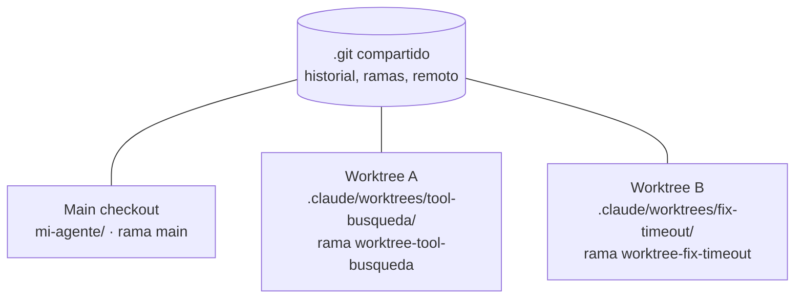
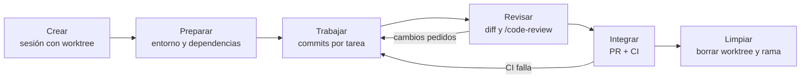

# Worktrees en Claude Code: cómo aislar el trabajo de los agentes

**Guía de trabajo para arquitectos empresariales y de soluciones** · 25 de octubre de 2026

---

## 1. Resumen ejecutivo

**Conclusión:** el worktree debería ser la unidad estándar de trabajo de un agente de código. Cada sesión o subagente trabaja en su propia copia del repositorio y en su propia rama, de modo que los cambios en paralelo no colisionan, el radio de impacto de un agente queda acotado y todo cambio llega a `main` por la misma vía revisable: commit, PR y CI.

- **Qué es:** un working directory adicional del mismo repositorio Git, con ficheros y rama propios, que comparte historial y remoto con el main checkout.
- **Qué aporta:** paralelismo sin conflictos, aislamiento verificable (Claude Code bloquea escrituras y comandos Git hacia el main checkout) y descarte barato de experimentos.
- **Qué exige:** un repositorio preparado. Hay que ignorar la carpeta de worktrees, declarar qué ficheros locales se copian (por ejemplo `.env`) y definir cómo se prepara el entorno en cada copia.
- **Decisión para la organización:** estandarizar en cada repositorio `.gitignore`, `.worktreeinclude`, base branch y convención de una sesión por cambio, y dejar la integración siempre en manos de PR y CI.

---

## 2. Qué es un worktree

Un worktree es una funcionalidad nativa de Git: varias carpetas de trabajo comparten un único directorio `.git`, y cada una tiene su propia rama activa y sus propios ficheros. No es un clon: no duplica el historial y los commits hechos en cualquier worktree están disponibles para todos.



En Claude Code, un worktree creado por la herramienta vive por defecto en `.claude/worktrees/<nombre>/`, en la raíz del repositorio, sobre una rama nueva llamada `worktree-<nombre>`. Si no se da nombre, Claude genera uno.

| Concepto | Clon | Rama en la misma carpeta | Worktree |
| --- | --- | --- | --- |
| Historial | Duplicado | Compartido | Compartido |
| Ficheros de trabajo | Propios | Compartidos (cambias de rama) | Propios |
| Trabajo en paralelo | Sí, pero sincronizando remotos | No | Sí |
| Coste de crear y descartar | Alto | Bajo | Bajo |

---

## 3. Por qué importa cuando trabajan agentes

**Paralelismo real.** Un desarrollador puede tener una sesión creando una herramienta del agente y otra corrigiendo un fallo, cada una en su worktree, sin pisarse ficheros ni cambiar de rama bajo los pies de la otra.

**Radio de impacto acotado.** Mientras una sesión está aislada en un worktree, Claude Code aplica cuatro checks:

| Check | Qué bloquea |
| --- | --- |
| Edición de ficheros | Escribir o editar rutas del main checkout |
| Working directory | Comandos cuyo directorio resuelve al main checkout o no se puede verificar |
| Redirecciones de Git | Comandos que apuntan Git al main checkout (`git -C`, `--git-dir`, `GIT_DIR`, `cd` previo) |
| Forma del comando | Comandos cuyo uso de Git no se puede verificar a partir del texto; no se puede desactivar |

Las mismas reglas se aplican a todos los subagentes que lance esa sesión. Límite a conocer: estos checks miran rutas y texto de comandos, no qué ficheros escribe un comando de shell; un `cp` hacia el main checkout no se bloquea por esta vía, sino por permisos y sandbox.

**Revisión obligatoria por diseño.** Lo que hace un agente vive en una rama hasta que alguien decide integrarlo. Encaja de forma natural con PR, CI y revisión humana.

**Experimentos desechables.** Una exploración que no convence se descarta borrando el worktree y su rama, sin restos en el main checkout.

---

## 4. Cómo se usa en la app de escritorio

1. En la pestaña **Code**, crea una sesión con entorno **Local** y elige la carpeta del repositorio. Debe ser un repositorio Git.
2. **Antes de enviar el primer mensaje**, activa la opción **worktree**.
3. Claude crea el worktree y trabaja en él. El diff de la app muestra los cambios de esa rama.
4. Pide a Claude que haga commits y abra la PR desde la sesión. Requiere la CLI de GitHub (`gh`) instalada y autenticada.
5. Al cerrar la sesión, si el worktree está limpio se elimina con su rama; si tiene trabajo, Claude pregunta si conservarlo.

También puedes pedir en mitad de una sesión "trabaja en un worktree"; Claude lo crea con su herramienta `EnterWorktree`. Equivalente en la CLI, por si lo necesitas en scripts o en la terminal integrada:

```bash
claude --worktree tool-busqueda     # worktree con nombre
claude --worktree "#1234"           # worktree desde una PR (GitHub o GitLab)
git worktree list                   # ver los worktrees del repositorio
```

---

## 5. Ciclo de vida de un cambio



| Fase | Qué ocurre | Responsable |
| --- | --- | --- |
| Crear | Se crea `.claude/worktrees/<nombre>/` con rama nueva desde la base branch | Claude Code |
| Preparar | Se copian los ficheros de `.worktreeinclude`; hay que instalar dependencias | Claude, a petición o por instrucción en `CLAUDE.md` |
| Trabajar | Commits pequeños y trazables en la rama del worktree | Agente |
| Revisar | Diff comentable en la app y `/code-review` | Persona |
| Integrar | PR, quality gates de CI, merge | Persona + CI |
| Limpiar | Borrado automático si está limpio; si no, decisión explícita | Claude Code + persona |

---

## 6. Preparar el repositorio (estándar de organización)

Estos cuatro elementos deberían formar parte del template de cualquier repositorio en el que trabajen agentes.

**1. Ignorar la carpeta de worktrees** en `.gitignore`, para que no aparezca como ficheros untracked en el main checkout:

```text
.claude/worktrees/
```

**2. Declarar los ficheros locales que se copian** en `.worktreeinclude`, en la raíz. Usa sintaxis de `.gitignore` y solo copia ficheros que, además, estén ignorados por Git, así que nunca duplica ficheros versionados:

```text
.env
.env.local
config/secrets.json
```

**3. Elegir la base branch** en la configuración del proyecto (`.claude/settings.json`):

| Valor de `worktree.baseRef` | Comportamiento | Cuándo |
| --- | --- | --- |
| `"fresh"` (por defecto) | Parte de la default branch del remoto, normalmente `main` | Trabajo nuevo: estándar recomendado |
| `"head"` | Parte del `HEAD` local, con commits sin publicar | Subagentes que deben trabajar sobre trabajo en curso |

No admite un nombre de rama. Para partir de una rama concreta existente, se crea el worktree con Git (`git worktree add`).

**4. Instrucción de preparación del entorno** en el `CLAUDE.md` del proyecto, porque un worktree no hereda virtualenvs ni dependencias instaladas:

```markdown
## Worktrees
- Al empezar en un worktree, crea el entorno con `python -m venv .venv && .venv/bin/pip install -r requirements.txt`.
- Una sesión por cambio; nunca trabajes directamente en `main`.
- Cada cambio termina en una PR; no hagas merge local a `main`.
```

---

## 7. Qué comparte un worktree y qué no

| Elemento | ¿Compartido con el main checkout? | Nota |
| --- | --- | --- |
| Directorio `.git` (historial, ramas, remoto) | Sí | Los commits en el worktree escriben en el `.git` común |
| Ficheros versionados | No (copia propia) | Cada worktree tiene su checkout |
| Ficheros ignorados (`.env`, `.venv`) | No | Solo los que declare `.worktreeinclude`; el entorno hay que crearlo |
| Plugins instalados a nivel de proyecto | Sí | No hace falta reinstalarlos por worktree |
| Aprobaciones de permisos ("no volver a preguntar") | Sí | Se guardan en `.claude/settings.local.json` del main checkout |
| Configuración de proyecto en la app (settings, hooks, skills, agentes, `.mcp.json`) | Se lee del main checkout | En sesiones iniciadas desde la app de escritorio |
| `CLAUDE.md` y `.claude/rules/` | Se leen del worktree | Permite reglas distintas por rama |
| Hooks | Se ejecutan en la raíz principal | El hook recibe la ruta del worktree en el campo `cwd` |

---

## 8. Patrones de trabajo

| Patrón | Cuándo | Cómo |
| --- | --- | --- |
| Una sesión, un cambio | Siempre que el cambio acabe en una PR | Sesión nueva con worktree por cada feature o corrección |
| Subagentes aislados | Refactors masivos o tareas en paralelo dentro de una sesión | `isolation: worktree` en el frontmatter del subagente, o pedir "usa worktrees para tus agentes" |
| Revisar una PR | Validar o corregir el trabajo de otro | `claude --worktree "#1234"` crea el worktree desde la PR |
| Trabajo sobre trabajo en curso | Subagentes que continúan una rama sin publicar | `worktree.baseRef: "head"` |
| Exploración desechable | Prototipos o spikes técnicos | Worktree sin nombre; se descarta al cerrar si no hay nada que conservar |
| Rama concreta existente | Retomar una rama que no creó Claude | `git worktree add ../proyecto-x rama-existente` y abrir esa carpeta |

Ejemplo de subagente que siempre trabaja aislado, en `.claude/agents/refactorer.md`:

```markdown
---
name: refactorer
description: Aplica refactors mecánicos en muchos ficheros
isolation: worktree
---
Aplica el refactor en todos los ficheros afectados, ejecuta los tests e informa del resultado.
```

---

## 9. Encaje con ODD, SDD y el gobierno del cambio

- **Unidad de trazabilidad:** un worktree, una rama, un documento de feature (ODD) o una spec (SDD), una PR. Esa correspondencia uno a uno es lo que hace auditable el trabajo de los agentes.
- **Tamaño revisable:** ODD corta las entregas en slices de unas 400 líneas cambiadas; cada slice es una PR desde el mismo worktree o desde uno nuevo.
- **Quality gates comunes:** tests, contract tests y evals en CI se aplican igual a cualquier rama de worktree. El worktree aísla; el quality gate sigue siendo CI.
- **Convención de nombres:** usa nombres de worktree que identifiquen el cambio (`tool-busqueda`, `fix-timeout`); la rama resultante (`worktree-<nombre>`) queda legible en la PR. Si tu organización exige otro prefijo de rama, renómbrala antes de abrir la PR o crea el worktree con Git.

---

## 10. Seguridad y cumplimiento

| Tema | Riesgo | Recomendación |
| --- | --- | --- |
| Secretos copiados con `.worktreeinclude` | Más copias de `.env` en disco, una por worktree | Copiar solo lo imprescindible; preferir gestor de secretos o variables de entorno del sistema; la limpieza de worktrees reduce la exposición |
| Aislamiento parcial | Comandos de shell que escriben fuera sin usar Git | Combinar con permisos y sandbox; no confiar solo en el worktree |
| Drivers de filtro y Git LFS | Un driver de filtro es un comando; Claude Code no los ejecuta al crear worktrees | Si usas LFS instalado con `--local`, ejecuta `git lfs pull` dentro del worktree |
| Symlinks | Rutas que salen del repositorio | Claude Code rechaza crear worktrees si `.claude`, `.claude/worktrees` o el destino son symlinks |
| Aprobaciones compartidas | Una aprobación en un worktree vale para todo el repositorio | Revisar `.claude/settings.local.json` periódicamente |
| Transcripciones | Lo que pasa por las herramientas queda en disco sin cifrar | Ajustar `cleanupPeriodDays` y denegar lectura de ficheros de credenciales |

---

## 11. Limpieza y retención

| Situación | Qué hace Claude Code |
| --- | --- |
| Sesión sin nombre, worktree limpio | Borra el worktree y su rama al salir |
| Sesión con nombre, worktree limpio | Pregunta antes de borrar |
| Worktree con cambios, ficheros untracked o commits nuevos | Pregunta si conservar o eliminar; eliminar borra también ese trabajo |
| Estado no verificable | Pregunta en lugar de borrar |
| Worktrees de subagentes y sesiones en segundo plano | Barrido periódico según `cleanupPeriodDays` (30 días por defecto), solo si no queda trabajo |
| Worktrees creados a mano con `git worktree add` | Nunca los borra el barrido |

Limpieza manual:

```bash
git worktree list
git worktree remove .claude/worktrees/<nombre>          # --force si hay cambios sin commit
git worktree unlock .claude/worktrees/<nombre>          # si está bloqueado por una sesión terminada
```

---

## 12. Problemas frecuentes

| Síntoma | Causa | Solución |
| --- | --- | --- |
| Falta `.env` o la app no arranca en el worktree | Los ficheros ignorados no se copian | Añadirlos a `.worktreeinclude` |
| Faltan dependencias o el virtualenv | Un worktree es un checkout limpio | Instrucción de preparación en `CLAUDE.md` o pedirlo a Claude |
| El IDE no muestra los cambios | El IDE tiene abierto el main checkout | Revisar en el diff de la app o abrir la carpeta del worktree |
| El worktree no parte de mi rama | La base por defecto es la default branch del remoto | `worktree.baseRef: "head"` o `git worktree add` desde la rama |
| La carpeta `.claude/worktrees/` aparece en `git status` | No está en `.gitignore` | Añadirla |
| Ficheros LFS son punteros | LFS configurado con `--local` | `git lfs pull` dentro del worktree |
| Un comando de Claude se rechaza | Checks de aislamiento | Dividirlo en comandos simples dentro del worktree, como indica el propio error |

---

## 13. Checklist del estándar

- [ ] `.claude/worktrees/` en el `.gitignore` del template de repositorio
- [ ] `.worktreeinclude` con la lista mínima de ficheros locales necesarios
- [ ] `worktree.baseRef` definido explícitamente en `.claude/settings.json`
- [ ] Instrucción de preparación del entorno en el `CLAUDE.md` del proyecto
- [ ] Convención: una sesión por cambio, siempre con worktree, siempre con PR
- [ ] `gh` instalado y autenticado en los equipos de desarrollo
- [ ] Subagentes de refactor con `isolation: worktree`
- [ ] Quality gates de CI iguales para todas las ramas de worktree
- [ ] Política de secretos y de retención (`cleanupPeriodDays`) revisada
- [ ] Revisión periódica de `.claude/settings.local.json` y de worktrees huérfanos

---

## Fuentes

- [Claude Code: Run parallel sessions with worktrees](https://code.claude.com/docs/en/worktrees)
- [Claude Code en la app de escritorio](https://code.claude.com/docs/en/desktop)
- [Primeros pasos con la app de escritorio](https://code.claude.com/docs/en/desktop-quickstart)
- [Directorio .claude y retención de datos](https://code.claude.com/docs/en/claude-directory)
- [Documentación de git worktree](https://git-scm.com/docs/git-worktree)
